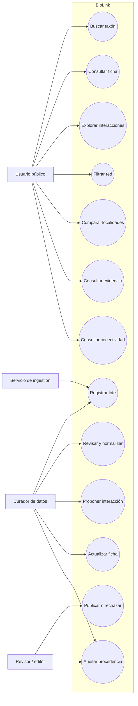
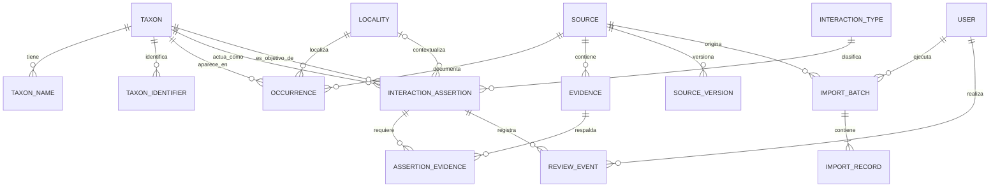
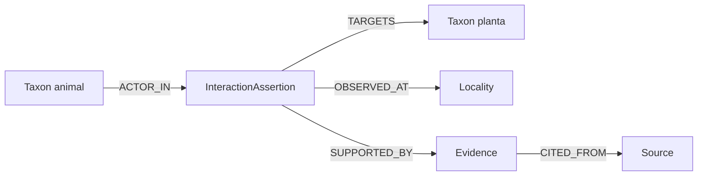

# BioLink — Etapa 2: Modelado del dominio y especificación de requisitos

**Versión:** 1.0  
**Fecha:** 20 de noviembre de 2026  
**Estado:** Propuesta de modelado lógico y requisitos; pendiente de validación antes del diseño físico.

> **Nota de alineación arquitectónica (20 de noviembre de 2026):** Los actores, requisitos funcionales/no funcionales, reglas del dominio (`RD-01`–`RD-16`), modelos lógicos y catálogo de operaciones de este documento permanecen vigentes y sin cambios. La organización de proyectos para su futura implementación sigue la arquitectura oficial SOA de **tres repositorios independientes** (`biolink-frontend`, `biolink-backend` con API REST integrada y `biolink-benchmarking`), documentada en [architecture.md](./architecture.md) y [repository_structure.md](./repository_structure.md).

---

## 1. Propósito de la etapa

Esta etapa transforma la propuesta de BioLink en una especificación que pueda implementarse y probarse sin ambigüedades. Se identifican los actores, casos de uso, requisitos funcionales y no funcionales, conceptos del dominio, reglas, cardinalidades y responsabilidades de los tres modelos de persistencia.

La guía del proyecto solicita que el modelo conceptual y los modelos lógicos de las tres bases representen un mismo dominio, sin contradicciones, y que cada modelo tenga una responsabilidad diferenciada. Por esa razón, este documento **no selecciona todavía motores de base de datos ni define esquemas físicos, índices, scripts o tecnologías**.

## 2. Dominio funcional de BioLink

### 2.1 Definición

BioLink es una plataforma académica para consultar y explorar interacciones ecológicas documentadas entre plantas y animales, comenzando por relaciones de frugivoría y consumo/remoción de frutos en la zona sur de la Reserva de la Biosfera Montes Azules (Chiapas). Playón de la Gloria se conserva como localidad comparativa externa a la reserva cuando una fuente la identifica expresamente.

BioLink no pretende representar toda la biodiversidad de Montes Azules ni reconstruir una red trófica completa. Su unidad principal de información no es simplemente la presencia de una especie, sino la **afirmación de una interacción respaldada por evidencia y contexto**.

### 2.2 Alcance funcional de V1

**Incluye:**
- Buscar taxones por nombre científico, sinónimo o identificador externo.
- Consultar fichas de taxones con información descriptiva y referencias.
- Explorar interacciones documentadas entre taxones animales y vegetales.
- Filtrar interacciones por localidad, periodo, tipo de interacción, método y fuente.
- Consultar la evidencia que respalda una interacción.
- Comparar la red documentada de dos localidades, sin interpretar el número de registros como abundancia real.
- Administrar fuentes, lotes de importación y revisión/publicación de afirmaciones.
- Consultar métricas sencillas de conectividad, como número de taxones asociados distintos.

**No incluye en V1:**
- Predecir interacciones no observadas.
- Estimar abundancia poblacional a partir del número de registros.
- Inferir dispersión efectiva, germinación o establecimiento de plántulas a partir de consumo o remoción de frutos.
- Modelar polinización, parasitismo, competencia, depredación general, enfermedades o todas las relaciones de la red trófica.
- Simular extinciones o escenarios ecológicos predictivos como funcionalidad principal.
- Aplicación móvil, sensores en tiempo real o captura de observaciones ciudadanas.
- Gestión de permisos de colecta o de investigación.

## 3. Fundamento de modelado derivado de la evidencia

Los estudios locales muestran por qué el modelo debe conservar el método, la localidad y la interpretación original:

1. Olea-Wagner et al. (2007) estudian tres murciélagos frugívoros y los frutos consumidos en dos contextos geográficos: la zona sur de Montes Azules y el Ejido Playón de la Gloria. La identificación de semillas en excretas es el método empleado para documentar la dieta. Por lo tanto, una afirmación derivada de este estudio debe conservar el método `FECAL_SEED_IDENTIFICATION` y la localidad indicada por la fuente. La presencia de semillas en excretas respalda consumo y paso de semillas por el tracto digestivo; por sí sola no demuestra germinación ni establecimiento de plántulas.
2. Camargo-Sanabria y Mendoza (2016) utilizaron cámaras trampa en árboles de *Licania platypus* y *Pouteria sapota*. Reportaron 13 especies de mamíferos y evidencia de consumo o remoción de frutos para ocho. La categoría combinada debe conservarse como `CONSUMES_OR_REMOVES_FRUIT_OF` cuando la publicación no distingue inequívocamente ambas conductas.
3. Un registro de presencia de una especie no constituye evidencia de interacción. Tampoco se debe crear una relación entre dos taxones solo porque ambos aparecen en la misma reserva.

**Consecuencia para el modelo:** la relación ecológica se representa como una afirmación con identificador propio, no como un enlace desnudo entre dos especies. Esa afirmación debe poder rastrearse a una o más piezas de evidencia, fuentes, métodos, periodos y localidades.

## 4. Actores

| ID | Actor | Descripción | Permisos principales |
|---|---|---|---|
| ACT-01 | Usuario público | Estudiante, docente, investigador o persona interesada que consulta BioLink. No requiere cuenta para las funciones de lectura de V1. | Buscar taxones, consultar fichas, explorar relaciones, filtrar redes y consultar fuentes/evidencias publicadas. |
| ACT-02 | Curador de datos | Persona autorizada que incorpora, revisa y corrige información científica. | Crear lotes de importación, revisar identificaciones, documentar evidencia, corregir fichas y proponer afirmaciones. |
| ACT-03 | Revisor/editor | Persona que valida y publica o rechaza afirmaciones propuestas. En un equipo pequeño puede coincidir con el curador, pero la acción debe quedar auditada. | Aprobar, rechazar, retirar o volver a abrir afirmaciones; consultar el historial de revisión. |
| ACT-04 | Servicio de ingestión | Componente interno que obtiene registros de fuentes externas o recibe archivos curados. | Registrar lotes, conservar referencias de origen y preparar datos para revisión. No publica afirmaciones por sí mismo. |

En V1 no se considera necesaria la creación de cuentas para los usuarios públicos. Sí se requieren identidades autenticadas para las operaciones administrativas, con permisos diferenciados o registro explícito de quién ejecutó cada cambio.

## 5. Casos de uso

| ID | Caso de uso | Actor principal | Prioridad | Resultado |
|---|---|---|---|---|
| CU-01 | Buscar taxón | Usuario público | Alta | Lista de taxones coincidentes, mostrando nombre aceptado y coincidencias por sinónimo. |
| CU-02 | Consultar ficha de taxón | Usuario público | Alta | Ficha descriptiva con atributos, fuentes y nivel de identificación. |
| CU-03 | Explorar interacciones de un taxón | Usuario público | Alta | Lista o subgrafo de las interacciones publicadas asociadas al taxón. |
| CU-04 | Filtrar red documentada | Usuario público | Alta | Red limitada por localidad, intervalo temporal, método, fuente o tipo de interacción. |
| CU-05 | Comparar localidades | Usuario público | Media | Comparación de taxones y afirmaciones documentadas entre dos localidades. |
| CU-06 | Consultar evidencia de una interacción | Usuario público | Alta | Detalle de fuente, localizador, método, periodo y límites de interpretación. |
| CU-07 | Consultar conectividad del taxón | Usuario público | Media | Número de taxones asociados distintos y detalle de las conexiones documentadas. |
| CU-08 | Registrar lote de importación | Curador | Alta | Lote identificable con fuente, fecha, consulta, filtros y estado. |
| CU-09 | Revisar y normalizar registros | Curador | Alta | Registros vinculados a identificadores canónicos o marcados como no resueltos. |
| CU-10 | Proponer afirmación de interacción | Curador | Alta | Afirmación en estado de borrador o revisión, con evidencia obligatoria. |
| CU-11 | Publicar o rechazar afirmación | Revisor/editor | Alta | Estado actualizado y registro de auditoría; publicación reflejada en la proyección del grafo. |
| CU-12 | Actualizar ficha flexible | Curador | Media | Nueva versión de la ficha con procedencia de cada afirmación descriptiva. |
| CU-13 | Auditar procedencia | Curador/revisor | Alta | Historial de importación, revisión, fuente y cambios de una afirmación. |

### 5.1 Diagrama de actores y casos de uso



## 6. Requisitos funcionales

| ID | Requisito | Prioridad | Criterio verificable |
|---|---|---|---|
| RF-01 | El sistema permitirá buscar taxones por nombre científico aceptado, nombre original, sinónimo o identificador externo. | Alta | Una búsqueda por sinónimo devuelve el taxón canónico relacionado y muestra el nombre usado en la fuente. |
| RF-02 | El sistema mostrará el nivel taxonómico real de cada registro y permitirá conservar identificaciones a nivel de género o morfoespecie. | Alta | `Piper sp.` u otra identificación incompleta no se convierte automáticamente en especie. |
| RF-03 | El sistema mostrará una ficha documental de taxón con atributos variables organizados por secciones y con referencias asociadas. | Alta | Los datos descriptivos muestran su fuente o se marcan como no documentados. |
| RF-04 | El sistema permitirá listar las interacciones publicadas de un taxón, distinguiendo su papel como organismo animal o vegetal. | Alta | Cada resultado identifica el taxón actor, el taxón objetivo y el tipo de interacción. |
| RF-05 | El sistema permitirá filtrar interacciones por localidad, estado geográfico respecto al ANP, periodo, temporada, método, tipo y fuente. | Alta | Los filtros se aplican a afirmaciones documentadas y no a simples ocurrencias. |
| RF-06 | El sistema mostrará el detalle de evidencia de cada afirmación publicada. | Alta | No se presenta una interacción pública sin al menos una referencia/localizador de evidencia. |
| RF-07 | El sistema permitirá comparar dos localidades mediante taxones y afirmaciones documentadas. | Media | La comparación distingue registros de Montes Azules, Playón de la Gloria y localidades indeterminadas. |
| RF-08 | El sistema calculará conectividad descriptiva sobre la red publicada, como número de taxones asociados distintos. | Media | El resultado se define como conectividad de la red documentada, no como abundancia ni fuerza ecológica. |
| RF-09 | El sistema registrará cada lote de importación con fuente, fecha, versión, endpoint/archivo, parámetros, filtros y estado. | Alta | Se puede reproducir o auditar de dónde provino el lote. |
| RF-10 | El sistema conservará el nombre y contenido original recibido antes de cualquier normalización. | Alta | La normalización no sobrescribe el registro original. |
| RF-11 | El sistema permitirá asociar un registro externo con un taxón canónico o marcarlo como pendiente/no resuelto. | Alta | No se fuerza una correspondencia cuando existen sinónimos o identificación insuficiente. |
| RF-12 | El sistema permitirá crear afirmaciones de interacción únicamente cuando exista evidencia asociada. | Alta | Una afirmación sin evidencia no puede pasar a revisión/publicación. |
| RF-13 | El sistema permitirá revisar, aprobar, rechazar, retirar o reabrir afirmaciones, dejando constancia de autor, fecha y motivo. | Alta | Toda transición de estado queda registrada. |
| RF-14 | El sistema publicará en el modelo de grafo únicamente afirmaciones aprobadas y vigentes. | Alta | Los borradores y rechazados no aparecen en consultas públicas del grafo. |
| RF-15 | El sistema permitirá actualizar fichas documentales con historial de versión y referencias por atributo/afirmación. | Media | Se conserva la versión anterior y se puede identificar la fuente de cada afirmación. |
| RF-16 | El sistema permitirá consultar las fuentes bibliográficas y los conjuntos de datos utilizados. | Alta | Se muestra cita, DOI/URL, licencia y fecha/versión cuando estén disponibles. |

## 7. Requisitos no funcionales

| ID | Requisito | Verificación propuesta |
|---|---|---|
| RNF-01 Trazabilidad | Toda interacción publicada debe ser rastreable a evidencia y fuente; toda ficha debe mostrar procedencia de sus afirmaciones relevantes. | Inspección de registros y pruebas de integridad. |
| RNF-02 Integridad | Los identificadores internos serán únicos; las referencias entre taxones, localidades, fuentes, evidencia y afirmaciones deberán ser válidas. | Pruebas de restricciones y referencias. |
| RNF-03 Reproducibilidad | Cada importación conservará proveedor, versión, consulta/filtros, fecha, cita, licencia y conteos reportados por el proceso. | Repetir una importación de prueba y comparar metadatos. |
| RNF-04 Inmutabilidad de origen | El registro original recibido se conservará separado de la versión normalizada. | Prueba de que una corrección no cambia el contenido original. |
| RNF-05 Consistencia entre modelos | La base relacional será fuente de verdad para identidades, afirmaciones y estados; los documentos y el grafo serán representaciones derivadas en sus dominios. | Pruebas de sincronización y reconciliación. |
| RNF-06 Auditabilidad | Las acciones administrativas y transiciones de estado tendrán autor, fecha, operación y motivo cuando corresponda. | Consulta del historial de auditoría. |
| RNF-07 Seguridad | Solo curadores y revisores autenticados podrán modificar datos; los usuarios públicos tendrán acceso de lectura a información publicada. | Pruebas de autorización. |
| RNF-08 Licenciamiento | Cada fuente, conjunto de datos y recurso multimedia conservará su licencia y atribución. | Revisión de metadatos de licencia antes de publicación/exportación. |
| RNF-09 Claridad científica | La interfaz diferenciará observación, evidencia indirecta, afirmación agregada e inferencia; no presentará inferencias como hechos observados. | Pruebas de contenido y revisión de fichas. |
| RNF-10 Portabilidad | Los datos de prueba y los procesos de carga deberán poder reconstruirse desde archivos/documentación de los repositorios correspondientes. | Instalación y carga desde cero en etapa posterior. |
| RNF-11 Rendimiento medible | Las operaciones prioritarias deberán medirse posteriormente bajo un entorno, dataset y carga definidos; los objetivos numéricos se fijarán en la etapa de benchmarks. | Benchmark reproducible posterior. |
| RNF-12 Accesibilidad | La consulta de información y resultados no dependerá exclusivamente del color; tablas y filtros tendrán etiquetas comprensibles. | Revisión de interfaz en etapa de implementación. |

## 8. Reglas del dominio

| ID | Regla |
|---|---|
| RD-01 | Una ocurrencia/presencia taxonómica no implica una interacción ecológica. |
| RD-02 | No se crea una afirmación de interacción sin una fuente y evidencia identificable. |
| RD-03 | Cada afirmación representa un vínculo taxón-actor → taxón-objetivo, con un tipo de interacción y un contexto definidos. En V1, el actor es un animal y el objetivo es una planta. |
| RD-04 | Cuando la fuente no distingue consumo de remoción, se conserva `CONSUMES_OR_REMOVES_FRUIT_OF`; no se divide artificialmente en dos relaciones. |
| RD-05 | Las semillas identificadas en excretas respaldan consumo y paso de semillas por el tracto digestivo; no prueban germinación, viabilidad ni establecimiento de plántulas. |
| RD-06 | Una especie registrada cerca de un árbol por cámara trampa no se incluye como interacción si la fuente no reporta evidencia de consumo/remoción. |
| RD-07 | Un dato geográfico puede tener estado `INSIDE_ANP`, `OUTSIDE_ANP`, `ADJACENT`, `UNDETERMINED` o `NOT_REPORTED`; no se asignará pertenencia al ANP por inferencia de nombre ambiguo. |
| RD-08 | Montes Azules y Playón de la Gloria se mantienen como contextos geográficos separados. La comparación no implica que PDLG forme parte del ANP. |
| RD-09 | La fecha se conserva con la precisión publicada: fecha exacta, intervalo, año, temporada, o desconocida. No se inventan fechas exactas. |
| RD-10 | Los taxones identificados a nivel de género, familia o morfoespecie permanecen en ese nivel hasta que una fuente permita resolverlos. |
| RD-11 | Se conserva el nombre original de la fuente junto con el nombre aceptado o concepto taxonómico interno. |
| RD-12 | El número de registros o afirmaciones no representa abundancia poblacional, preferencia ni intensidad ecológica sin un diseño de muestreo comparable y una medida explícita. |
| RD-13 | Una afirmación pública debe estar en estado `PUBLISHED` y tener al menos una evidencia revisada. |
| RD-14 | Una corrección taxonómica no altera la evidencia original ni elimina el nombre que utilizó la fuente. |
| RD-15 | Cada recurso con derechos/licencia propios conserva sus metadatos por separado; la licencia de un artículo no se transfiere automáticamente a sus imágenes o conjuntos de datos. |
| RD-16 | La red de grafo es una proyección de afirmaciones aprobadas; no es una segunda fuente independiente para editar la verdad científica. |

### 8.1 Vocabularios controlados iniciales

**Tipos de interacción V1:**

| Código | Etiqueta | Uso permitido |
|---|---|---|
| `CONSUMES_FRUIT_OF` | Consume fruto de | La fuente documenta consumo de fruto. |
| `REMOVES_FRUIT_OF` | Remueve fruto de | La fuente distingue la remoción del consumo. |
| `CONSUMES_OR_REMOVES_FRUIT_OF` | Consume o remueve fruto de | La fuente presenta ambas conductas combinadas o no permite separarlas. |

`DISPERSES_SEEDS_OF` no se habilita como relación afirmada por defecto en V1. Podría incorporarse cuando una fuente documente específicamente dispersión y el sistema modele qué significa esa evidencia. En el caso de semillas en excretas se guardará el método y la observación correspondiente sin afirmar establecimiento exitoso.

**Métodos de evidencia iniciales:** `FECAL_SEED_IDENTIFICATION`, `CAMERA_TRAP`, `FIELD_OBSERVATION`, `DATASET_RECORD`, `LITERATURE_REPORT`, `OTHER_REVIEWED`.

**Estados de afirmación:** `DRAFT`, `IN_REVIEW`, `PUBLISHED`, `REJECTED`, `WITHDRAWN`.

**Resolución taxonómica:** `SPECIES`, `GENUS`, `FAMILY`, `HIGHER_TAXON`, `MORPHOSPECIES`, `UNRESOLVED`.

## 9. Modelo conceptual del dominio

### 9.1 Entidades principales

| Entidad | Descripción | Identificador conceptual |
|---|---|---|
| Taxón | Organismo o grupo taxonómico identificado a un rango definido. | `taxon_id` |
| Nombre taxonómico | Nombre aceptado, sinónimo, combinación anterior o nombre literal de una fuente. | `taxon_name_id` |
| Identificador externo | Identificador que enlaza el taxón con un catálogo externo. | `taxon_identifier_id` |
| Localidad | Área natural protegida, localidad de estudio, ejido, sitio de muestreo u otro contexto geográfico. | `locality_id` |
| Fuente | Artículo, tesis, conjunto de datos o repositorio utilizado. | `source_id` |
| Versión de fuente/dataset | Versión concreta o descarga de un conjunto de datos externo. | `source_version_id` |
| Evidencia | Fragmento, tabla, figura, registro, observación o elemento que respalda una afirmación. | `evidence_id` |
| Ocurrencia | Registro de presencia de un taxón en un lugar y periodo, sin implicar interacción. | `occurrence_id` |
| Tipo de interacción | Concepto controlado que define la conducta o relación descrita por la fuente. | `interaction_type_id` |
| Afirmación de interacción | Relación documentada entre taxón actor y taxón objetivo, con contexto y estado de revisión. | `assertion_id` |
| Lote de importación | Ejecución de adquisición de información desde una fuente. | `import_batch_id` |
| Registro de importación | Registro recibido en un lote y su estado de validación. | `import_record_id` |
| Usuario interno | Curador o revisor que realiza una operación administrativa. | `user_id` |
| Rol | Conjunto de permisos de un usuario interno. | `role_id` |

### 9.2 Relaciones y cardinalidades

- Un taxón tiene uno o varios nombres taxonómicos; cada nombre registrado apunta a un taxón canónico cuando se ha podido resolver. Los nombres no resueltos pueden permanecer como registros pendientes.
- Un taxón puede tener cero o varios identificadores externos; un identificador externo de un mismo esquema debe ser único dentro del catálogo correspondiente.
- Un taxón puede aparecer en cero o varias ocurrencias.
- Una ocurrencia pertenece a un taxón y a una fuente; puede tener una localidad o coordenada desconocida.
- Una afirmación de interacción tiene exactamente un taxón actor, un taxón objetivo y un tipo de interacción. En V1, actor = animal y objetivo = planta.
- Una afirmación puede estar asociada con cero o una localidad conocida; si una publicación agrupa resultados de sitios diferentes, se separa la afirmación por localidad cuando la fuente lo permite.
- Una afirmación que llega a publicación tiene una o más evidencias revisadas.
- Una evidencia pertenece a una fuente y puede respaldar una afirmación. Una fuente puede generar muchas evidencias y respaldar muchas afirmaciones.
- Una fuente puede tener cero o varias versiones de dataset/descarga.
- Un lote de importación utiliza una fuente o versión de dataset y contiene uno o varios registros de importación.
- Un usuario interno puede ejecutar muchos lotes y revisiones. Un usuario puede tener uno o varios roles.
- Una localidad puede estar subordinada a otra localidad/área mediante una relación jerárquica; la pertenencia espacial al polígono oficial debe conservar su método y estado de validación.

### 9.3 Diagrama entidad-relación conceptual



La cardinalidad de evidencia es cero o muchas durante la captura; la regla de negocio exige al menos una evidencia revisada antes de pasar una afirmación al estado `PUBLISHED`.

## 10. Modelos lógicos por responsabilidad

Estos modelos son lógicos: describen entidades, documentos, nodos, relaciones y reglas, pero no fijan todavía sintaxis, motor, tipos físicos ni índices.

### 10.1 Modelo lógico relacional

**Responsabilidad:** mantener los registros estructurados que requieren integridad, identificadores estables, estados, auditoría y relaciones controladas. Será la fuente de verdad para la identidad canónica de taxones, localidades, fuentes, afirmaciones, evidencia estructurada, importaciones y revisiones.

| Tabla lógica | Atributos principales | Claves/relaciones y reglas |
|---|---|---|
| `taxon` | `taxon_id`, `accepted_name`, `scientific_authorship`, `taxonomic_rank`, `taxonomic_status`, `created_at`, `updated_at` | PK `taxon_id`; identidad interna estable. El rango puede ser especie, género, familia u otro. |
| `taxon_name` | `taxon_name_id`, `taxon_id`, `name`, `name_usage`, `language`, `source_id`, `is_preferred`, `verbatim_name` | FK a `taxon`; conserva sinónimos y grafías originales. No se elimina el nombre fuente. |
| `taxon_identifier` | `taxon_identifier_id`, `taxon_id`, `scheme`, `external_id`, `retrieved_at`, `source_id` | FK a `taxon`; unicidad por `scheme + external_id`. |
| `locality` | `locality_id`, `name`, `locality_type`, `parent_locality_id`, `protected_status`, `spatial_validation_status`, `geometry_reference`, `coordinate_precision`, `source_id` | FK jerárquica opcional; la coordenada/geometría puede estar ausente. Distingue dentro/fuera/adyacente/indeterminado/no reportado. |
| `source` | `source_id`, `source_type`, `title`, `authors`, `publication_year`, `doi`, `uri`, `publisher`, `citation_text`, `license_id` | Fuente bibliográfica o repositorio. El DOI/URI no sustituye el ID interno. |
| `source_version` | `source_version_id`, `source_id`, `provider_version`, `release_date`, `retrieved_at`, `endpoint_or_file`, `query_parameters`, `filters`, `license_id`, `checksum` | FK a `source`; permite identificar una versión concreta. |
| `evidence` | `evidence_id`, `source_id`, `source_version_id`, `source_locator`, `evidence_kind`, `method_code`, `reported_term`, `summary`, `period_start`, `period_end`, `license_id` | FK a fuente/versión; el localizador puede ser página, tabla, figura, sección o ID externo. |
| `occurrence` | `occurrence_id`, `taxon_id`, `source_id`, `source_record_id`, `locality_id`, `event_date`, `latitude`, `longitude`, `coordinate_uncertainty`, `basis_of_record`, `georeference_status` | FK a taxón/fuente/localidad; no crea interacción automáticamente. |
| `interaction_type` | `interaction_type_id`, `code`, `label`, `definition`, `actor_role`, `target_role`, `is_active` | Catálogo controlado. |
| `interaction_assertion` | `assertion_id`, `actor_taxon_id`, `target_taxon_id`, `interaction_type_id`, `locality_id`, `period_start`, `period_end`, `season_label`, `method_code`, `assertion_scope`, `status`, `created_by`, `created_at`, `reviewed_by`, `reviewed_at` | FK a taxones, tipo, localidad y usuarios. Actor y objetivo deben ser taxones válidos. En V1 actor animal y objetivo vegetal. |
| `assertion_evidence` | `assertion_id`, `evidence_id`, `evidence_role`, `review_note` | PK compuesta lógica; relaciona evidencia y afirmación. Una afirmación publicada requiere evidencia revisada. |
| `import_batch` | `import_batch_id`, `source_id`, `source_version_id`, `started_by`, `started_at`, `finished_at`, `query_parameters`, `filters`, `status`, `received_count`, `accepted_count`, `rejected_count` | FK a fuente/versión/usuario; los conteos son resultados de la ejecución, no valores estimados. |
| `import_record` | `import_record_id`, `import_batch_id`, `external_record_id`, `raw_document_id`, `validation_status`, `canonical_taxon_id`, `validation_notes` | FK a lote y taxón opcional; referencia el documento original sin reemplazarlo. |
| `user` | `user_id`, `display_name`, `email`, `password_hash`, `is_active`, `created_at` | Solo para usuarios internos. No se almacena contraseña en texto plano. |
| `role` | `role_id`, `code`, `name` | Catálogo de permisos. |
| `user_role` | `user_id`, `role_id` | Relación N:M de usuarios y roles. |
| `review_event` | `review_event_id`, `assertion_id`, `user_id`, `previous_status`, `new_status`, `reason`, `created_at` | Historial inmutable de las transiciones relevantes. |

**Nota de modelado:** `source_type` puede incluir `PUBLICATION`, `THESIS`, `DATASET`, `REPOSITORY` u `OTHER`. No se debe confundir una publicación científica con la versión de un dataset descargado desde un repositorio.

### 10.2 Modelo lógico documental

**Responsabilidad:** conservar información narrativa o heterogénea cuya estructura varía por taxón, grupo biológico, fuente o tipo de evidencia. Los documentos amplían los identificadores relacionales; no se convierten en una segunda fuente de verdad para taxones o estados de publicación.

#### Documento `taxon_dossier`

Un documento por taxón, identificado con el mismo `taxon_id` interno.

```json
{
  "_id": "<taxon_id>",
  "document_type": "taxon_dossier",
  "schema_version": 1,
  "summary": {
    "description": {
      "value": "Descripción respaldada por fuente",
      "source_refs": ["<source_id>"],
      "locators": ["p. X"]
    }
  },
  "sections": {
    "morphology": [],
    "ecology": {
      "habitats": [],
      "diet": [],
      "activity_patterns": [],
      "notes": []
    },
    "conservation": [],
    "distribution": []
  },
  "media": [
    {
      "media_id": "...",
      "media_type": "image",
      "uri": "...",
      "license": "...",
      "attribution": "...",
      "source_ref": "..."
    }
  ],
  "claims": [
    {
      "claim_id": "...",
      "field": "ecology.diet",
      "value": "...",
      "source_id": "...",
      "source_locator": "..."
    }
  ],
  "updated_at": "...",
  "document_version": 1
}
```

Los arreglos `morphology`, `ecology`, `conservation` y `distribution` no son obligatorios en todos los taxones. Cada afirmación descriptiva debe incluir procedencia. La taxonomía canónica y sus identificadores continúan siendo administrados por el modelo relacional.

#### Documento `study_dossier`

Un documento por fuente de investigación cuando convenga almacenar un expediente metodológico amplio y heterogéneo:

- `source_id` como identificador externo al documento.
- Resumen, pregunta de investigación y diseño de muestreo.
- Métodos, instrumentos, esfuerzo y unidades de muestreo.
- Localidades y periodos descritos por el estudio.
- Taxones focales y grupos estudiados.
- Limitaciones e interpretación permitida.
- Referencias a páginas, tablas, figuras y fuentes complementarias.

#### Documento `raw_source_record`

Un documento por registro original importado o referencia inmutable a ese registro:

- proveedor, identificador externo, versión/descarga, fecha de obtención;
- payload original o ubicación del archivo de origen, sujeto a licencia y términos de uso;
- checksum cuando sea posible;
- estado de validación y referencia al `import_record_id` relacional;
- metadatos de transformación separados del contenido original.

**Reglas documentales:** los documentos llevan `schema_version`; se validan en la entrada; los campos opcionales pueden variar, pero no se omiten procedencias ni licencias; la normalización nunca sobrescribe el payload original.

### 10.3 Modelo lógico de grafo

**Responsabilidad:** consultar conectividad, patrones, vecinos y subredes de las interacciones publicadas. El grafo será una proyección de las afirmaciones aprobadas en el modelo relacional.

**Nodos:**

| Etiqueta | Propiedades principales |
|---|---|
| `Taxon` | `taxon_id`, `accepted_name`, `taxonomic_rank`, `organism_group`, `taxonomic_status` |
| `InteractionAssertion` | `assertion_id`, `interaction_type_code`, `period_start`, `period_end`, `season_label`, `method_code`, `status`, `assertion_scope` |
| `Locality` | `locality_id`, `name`, `locality_type`, `protected_status`, `spatial_validation_status` |
| `Evidence` | `evidence_id`, `evidence_kind`, `method_code`, `source_locator`, `review_status` |
| `Source` | `source_id`, `source_type`, `title`, `publication_year`, `doi_or_uri` |

**Relaciones dirigidas:**

| Relación | Desde → hacia | Significado |
|---|---|---|
| `ACTOR_IN` | `Taxon` → `InteractionAssertion` | El taxón animal ocupa el papel de actor. |
| `TARGETS` | `InteractionAssertion` → `Taxon` | El taxón vegetal es el objetivo de la interacción. |
| `OBSERVED_AT` | `InteractionAssertion` → `Locality` | Contexto espacial reportado para la afirmación. |
| `SUPPORTED_BY` | `InteractionAssertion` → `Evidence` | Evidencia que respalda la afirmación. |
| `CITED_FROM` | `Evidence` → `Source` | Fuente de la evidencia. |
| `WITHIN_OR_PART_OF` | `Locality` → `Locality` | Jerarquía o inclusión territorial solo cuando esté respaldada. |

El nodo intermedio `InteractionAssertion` es intencional: evita colapsar varias afirmaciones entre los mismos taxones cuando difieren en fuente, localidad, temporada, método o estado de revisión. También permite que una interacción tenga varias evidencias.

**Ejemplo conceptual:**



**Reglas del grafo:**
- Solo se proyectan afirmaciones `PUBLISHED` y vigentes.
- Cada `InteractionAssertion.assertion_id` corresponde a una afirmación relacional única.
- Cada `Taxon.taxon_id` corresponde al identificador canónico relacional.
- El grafo no inventa relaciones a partir de coincidencias de ocurrencias.
- Las métricas se calculan sobre la red documentada y deben mostrar filtros y alcance.

## 11. Matriz de responsabilidad y fuente de verdad

| Dato | Fuente de verdad | Representaciones secundarias | Motivo |
|---|---|---|---|
| Identidad interna del taxón y rango | Relacional (`taxon`) | Nodo `Taxon` en grafo; referencia desde documento | Mantener identidad, unicidad y relaciones controladas. |
| Nombres aceptados, sinónimos e identificadores externos | Relacional (`taxon_name`, `taxon_identifier`) | Vista resumida en documento cuando se requiera | Reconciliación taxonómica y búsquedas consistentes. |
| Descripción ecológica y morfológica flexible | Documental (`taxon_dossier`) | No se replica completa en grafo | Los atributos varían entre grupos y fuentes. |
| Fuentes, citas y versiones de dataset | Relacional (`source`, `source_version`) | Documento metodológico y nodo `Source` | Integridad bibliográfica y versionado. |
| Payloads originales de fuentes externas | Documental (`raw_source_record`) o archivo de origen inmutable | Referencia relacional desde lote/registro | Conservar estructuras nativas heterogéneas. |
| Ocurrencias | Relacional (`occurrence`) con payload original referido desde documental | No se convierten automáticamente en aristas | Integridad y separación entre presencia e interacción. |
| Afirmaciones de interacción y estado de revisión | Relacional (`interaction_assertion`) | Nodo `InteractionAssertion` en grafo | El registro aprobado es autoritativo y auditable. |
| Conectividad y recorridos | Grafo | Resultados calculados, no fuente de verdad | Consultar patrones de relación. |
| Lotes e historial de revisión | Relacional | Referencias a documentos originales | Auditoría y control transaccional. |

### 11.1 Política de sincronización entre modelos

1. Una afirmación se crea y revisa en el modelo relacional.
2. Al aprobarse, el servicio de aplicación registra el cambio de estado y una tarea pendiente de proyección.
3. Se crea o actualiza la representación documental que corresponda, si la operación afecta un expediente flexible.
4. Se proyecta la afirmación aprobada al grafo utilizando `assertion_id` como clave de correspondencia.
5. Si la proyección falla, la operación queda marcada como pendiente/error; no se informa al usuario que la publicación está completamente sincronizada.
6. Un proceso de reconciliación compara las afirmaciones publicadas en el modelo relacional con los nodos/relaciones de grafo y repara diferencias.
7. Retirar una afirmación cambia su estado en la fuente de verdad y debe retirarla de la vista pública del grafo.

No se presupone una transacción distribuida entre los tres motores. El detalle técnico de reintentos, patrón outbox y compensación se decidirá en la etapa de arquitectura.

## 12. Catálogo de operaciones V1

El catálogo completo está en `02_catalogo_operaciones_biolink.csv`. Esta sección define las operaciones principales y los modelos involucrados.

| ID | Operación | Modelos | Prioridad | Resultado esencial |
|---|---|---|---|---|
| OP-01 | Buscar taxones | Relacional | Alta | Coincidencias por nombre, sinónimo o identificador. |
| OP-02 | Consultar ficha de taxón | Relacional + Documental | Alta | Datos de identidad más ficha flexible y procedencia. |
| OP-03 | Listar interacciones de un taxón | Grafo + Relacional | Alta | Afirmaciones publicadas y taxones asociados. |
| OP-04 | Consultar detalle/evidencia de interacción | Relacional + Documental | Fuente, localizador, método, periodo y límites. |
| OP-05 | Filtrar subred | Grafo + Relacional | Subgrafo según filtros y solo afirmaciones publicadas. |
| OP-06 | Comparar localidades | Grafo + Relacional | Diferencias y coincidencias entre redes documentadas. |
| OP-07 | Calcular conectividad descriptiva | Grafo | Número de taxones asociados distintos. |
| OP-08 | Consultar fuente/estudio | Relacional + Documental | Cita, versión, diseño, muestreo y limitaciones. |
| OP-09 | Registrar importación | Relacional + Documental | Lote y registros originales rastreables. |
| OP-10 | Validar y normalizar registro | Relacional + Documental | Relación con taxón canónico o estado no resuelto. |
| OP-11 | Crear afirmación de interacción | Relacional + Documental | Afirmación en borrador con evidencia asociada. |
| OP-12 | Revisar/publicar afirmación | Relacional + Grafo | Estado auditado y proyección actualizada. |
| OP-13 | Actualizar ficha de taxón | Documental + Relacional | Nueva versión documental asociada al taxón. |
| OP-14 | Consultar historial de procedencia | Relacional + Documental | Lotes, fuentes, normalizaciones y revisiones. |
| OP-15 | Consultar ocurrencias | Relacional + Documental | Registros de presencia sin inferir interacciones. |

### 12.1 Requisitos mínimos de entrada y salida por operación

- Toda consulta de red recibe identificadores canónicos o filtros validados; no debe resolver nombres ambiguos de forma silenciosa.
- OP-03 a OP-07 deben excluir borradores, rechazados y retirados.
- OP-04 debe devolver un localizador concreto de evidencia cuando exista (página, tabla, figura, sección o ID de registro). Si la fuente solo aporta una afirmación general, la interfaz lo indicará.
- OP-06 debe reportar localidad indeterminada por separado y no incluirla automáticamente en Montes Azules ni en Playón de la Gloria.
- OP-07 debe contar taxones asociados distintos; opcionalmente puede reportar número de afirmaciones, pero ambos indicadores deben mostrarse separados.
- OP-09 debe poder terminar con registros aceptados, rechazados o pendientes; un lote no es “exitoso” solo porque se descargó.
- OP-10 debe conservar el nombre original, el resultado de reconciliación, la regla utilizada y, cuando aplique, la decisión del revisor.
- OP-11 no podrá generar una interacción si faltan taxones, tipo de interacción, localidad/periodo cuando estén disponibles, fuente o evidencia.
- OP-12 debe registrar quién revisó, decisión, fecha y motivo. La publicación en grafo se considera completa solo cuando la proyección fue confirmada.
- OP-13 debe conservar el historial de versiones y las referencias que respaldan los campos modificados.
- OP-15 no podrá crear aristas de interacción como efecto secundario.

## 13. Diccionario de conceptos y atributos

| Concepto | Atributo | Definición | Regla/calidad |
|---|---|---|---|
| Taxón | `taxon_id` | Identificador interno estable del concepto taxonómico | No depende de la grafía del nombre. |
| Taxón | `accepted_name` | Nombre científico o etiqueta aceptada en BioLink | Se acompaña del rango taxonómico. |
| Taxón | `taxonomic_rank` | Nivel de identificación | No se infiere un rango más específico que la fuente. |
| Taxón | `taxonomic_status` | Estado de reconciliación | Aceptado, no resuelto o pendiente según catálogo definido. |
| Nombre taxonómico | `name` | Nombre literal utilizado por una fuente o catálogo | Se conserva la grafía original. |
| Nombre taxonómico | `name_usage` | Tipo de uso del nombre | Aceptado, sinónimo, original, nombre común u otro. |
| Localidad | `locality_type` | Tipo de unidad geográfica | ANP, sitio de estudio, ejido, municipio u otro. |
| Localidad | `spatial_validation_status` | Estado de verificación geográfica respecto al área de interés | No se asigna dentro/fuera sin evidencia espacial o fuente clara. |
| Fuente | `source_type` | Naturaleza de la fuente | Artículo, tesis, dataset, repositorio u otra. |
| Fuente | `license_id` | Identificador/referencia de licencia aplicable | Se conserva por cada recurso o dataset cuando difiera. |
| Evidencia | `source_locator` | Localización dentro de la fuente | Página, tabla, figura, sección o identificador externo. |
| Evidencia | `method_code` | Método que produce la evidencia | Vocabulario controlado, conserva el método original. |
| Ocurrencia | `event_date` | Fecha o intervalo de presencia | Puede ser parcial o desconocido. |
| Ocurrencia | `coordinate_uncertainty` | Incertidumbre espacial reportada | No se inventa precisión. |
| Afirmación | `actor_taxon_id` | Taxón que realiza la conducta | En V1 es animal. |
| Afirmación | `target_taxon_id` | Taxón que recibe la interacción | En V1 es planta. |
| Afirmación | `interaction_type_id` | Tipo de relación según evidencia | No se divide una categoría combinada de la fuente. |
| Afirmación | `assertion_scope` | Nivel al que se reporta la afirmación | Evento, agregado por estudio/temporada, u otro claramente declarado. |
| Afirmación | `status` | Estado de revisión/publicación | Solo publicado es consultable en la red pública. |
| Importación | `query_parameters` | Parámetros utilizados en adquisición | Se conservan para reproducibilidad. |
| Importación | `validation_status` | Resultado de revisión de cada registro | Aceptado, pendiente, rechazado o no resuelto. |

## 14. Escenarios de aceptación

| ID | Escenario | Resultado esperado |
|---|---|---|
| AC-01 | Buscar `Artibeus lituratus` por nombre aceptado. | Se encuentra el taxón y se muestra su rango. |
| AC-02 | Buscar un taxón por un sinónimo vinculado. | Se devuelve el taxón canónico junto al sinónimo consultado. |
| AC-03 | Consultar una identificación `Piper sp.`. | Se mantiene a nivel de género; el sistema no inventa especie. |
| AC-04 | Consultar interacciones de *Carollia perspicillata*. | Se muestran solo afirmaciones publicadas y se indica que la evidencia del estudio se basa en semillas identificadas en excretas. |
| AC-05 | Consultar mamíferos asociados a *Licania platypus*. | Se conserva la categoría reportada por el estudio y el método de cámaras trampa; no se transforma automáticamente en dispersión de semillas. |
| AC-06 | Filtrar por Montes Azules. | Se excluyen registros marcados como Playón de la Gloria u otras localidades externas; los indeterminados se presentan aparte. |
| AC-07 | Intentar publicar afirmación sin fuente/evidencia. | La operación es rechazada con validación explícita. |
| AC-08 | Importar un registro con nombre taxonómico no resuelto. | Se conserva payload/nombre original y se marca como pendiente, sin crear relación incorrecta. |
| AC-09 | Publicar una afirmación aprobada cuando el grafo está disponible. | La representación del grafo contiene el `assertion_id` y los contextos referidos. |
| AC-10 | Fallar la actualización del grafo después de aprobar la afirmación. | La operación queda con sincronización pendiente/error; no se declara integración completa y puede reconciliarse. |
| AC-11 | Retirar una afirmación publicada. | Deja de aparecer en la red pública y conserva su historial. |
| AC-12 | Comparar Montes Azules con Playón de la Gloria. | Se muestran por separado las dos localidades y sus fuentes; no se afirma que ambas pertenezcan al ANP. |
| AC-13 | Consultar el grado/conectividad de un taxón. | Se cuentan socios taxonómicos distintos y se aclara que no representa abundancia o intensidad de interacción. |
| AC-14 | Consultar una ocurrencia de GBIF/otro proveedor. | Se muestra como presencia; no se crea arista ecológica por este solo hecho. |

## 15. Decisiones que quedan abiertas para las siguientes etapas

1. Motor concreto de cada modelo y versiones: se decidirá en arquitectura/selección tecnológica, después de revisar operaciones y restricciones del entorno.
2. Tecnología de `biolink-backend` (API REST y servicios integrados) y estrategia de sincronización: etapa 3 y [architecture.md](./architecture.md).
3. Tipos físicos, índices, restricciones físicas, colecciones y scripts: etapa 4.
4. Alcance de descargas masivas y fuentes de datos por licencia: análisis de adquisición previo a poblar las bases.
5. Criterios numéricos de rendimiento y tamaño de datos para benchmarks: después de cerrar las operaciones medibles y el conjunto de datos de prueba.
6. Nivel geográfico mínimo para publicar una afirmación: se validará con los metadatos disponibles y la política de privacidad/sensibilidad de coordenadas.

## 16. Criterios de cierre de la etapa 2

| Criterio | Estado |
|---|---|
| Actores identificados | Definido |
| Casos de uso principales | Definido |
| Requisitos funcionales | Definido |
| Requisitos no funcionales | Definido |
| Reglas del dominio y vocabularios iniciales | Definido |
| Entidades y cardinalidades conceptuales | Definido |
| Modelo lógico relacional | Propuesto |
| Modelo lógico documental | Propuesto |
| Modelo lógico de grafo | Propuesto |
| Fuente de verdad y política de sincronización | Propuesta definida a nivel lógico |
| Catálogo de operaciones con entradas, validaciones, salidas y errores | Anexo CSV |
| Criterios de aceptación | Definido |

**Dictamen:** la Etapa 2 queda documentada como especificación funcional y modelado lógico inicial. Antes de pasar al diseño físico debe revisarse que el alcance, los casos de uso y las operaciones sean coherentes y suficientes para justificar las tres bases. No se considera implementado ni probado ningún modelo de persistencia.

## 17. Referencias

1. Universidad Politécnica de Chiapas. (2026). *Guía de trabajo para estudiantes: Proyecto final — Diseño, desarrollo e integración de tres modelos de bases de datos*. Material de orientación del proyecto.
2. Olea-Wagner, A., Lorenzo, C., Naranjo, E., Ortiz, D. y León-Paniagua, L. (2007). *Diversidad de frutos que consumen tres especies de murciélagos (Chiroptera: Phyllostomidae) en la selva lacandona, Chiapas, México*. Revista Mexicana de Biodiversidad, 78, 191–200. https://doi.org/10.22201/ib.20078706e.2007.001.393
3. Camargo-Sanabria, A. A. y Mendoza, E. (2016). *Interactions between terrestrial mammals and the fruits of two neotropical rainforest tree species*. Acta Oecologica, 73, 45–52. https://doi.org/10.1016/j.actao.2016.02.005
4. Comisión Nacional de Áreas Naturales Protegidas (CONANP). (s. f.). *Ficha SIMEC: Montes Azules*. https://simec.conanp.gob.mx/informacion/ficha/172?reg=11

---

**Fin de la Etapa 2 — BioLink**
