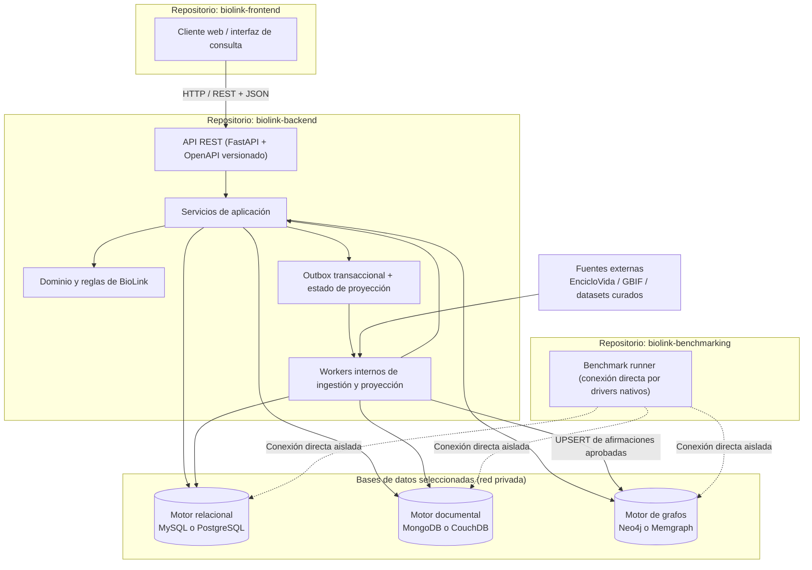

# BioLink — Etapa 3: Arquitectura y selección tecnológica

**Versión:** 1.1  
**Fecha de investigación inicial:** 20 de noviembre de 2026  
**Última actualización arquitectónica:** 20 de noviembre de 2026  
**Estado:** Arquitectura oficial en tres repositorios independientes (`biolink-frontend`, `biolink-backend`, `biolink-benchmarking`); motores preseleccionados y pendientes de validación empírica mediante benchmarks.

> **Documentos arquitectónicos complementarios:** Véase [README.md](./README.md), [architecture.md](./architecture.md), [repository_structure.md](./repository_structure.md), [deployment.md](./deployment.md) y [benchmarking.md](./benchmarking.md) para el detalle operativo vigente de los tres repositorios.

---

## 1. Propósito de la etapa

Esta etapa convierte los requisitos y modelos lógicos de la etapa 2 en una arquitectura de aplicación integrada y en una decisión tecnológica argumentada. La guía del proyecto exige describir los componentes, los flujos de información, la API, las responsabilidades de persistencia, la selección del stack y la fuente de verdad y sincronización.

La elección de motores debe estar motivada por las operaciones de BioLink. No se escogerán tres productos por popularidad ni se dividirán artificialmente los mismos datos. Cada motor tendrá una función específica:

- Relacional: integridad de identidades, fuentes, evidencia estructurada, afirmaciones, importaciones, revisión y auditoría.
- Documental: expedientes flexibles, metodologías y payloads originales de fuentes.
- Grafo: consultas de conectividad, recorridos y subredes de afirmaciones aprobadas.

**Alcance de esta etapa:** arquitectura lógica, responsabilidades, flujos de integración, comparación documental de motores, preselección tecnológica y protocolo de benchmark. No incluye DDL, colecciones físicas definitivas, índices, scripts de carga ni código.

## 2. Insumos de diseño

La arquitectura se deriva de los quince identificadores de operación del catálogo de la etapa 2 (`OP-01` a `OP-15`) y de los requisitos funcionales y reglas del dominio. En particular:

- `OP-01`, `OP-08`, `OP-09`, `OP-10`, `OP-11`, `OP-12`, `OP-14` y `OP-15` necesitan registros estructurados, estados y trazabilidad.
- `OP-02`, `OP-04`, `OP-08`, `OP-09`, `OP-10` y `OP-13` aprovechan documentos anidados o payloads originales.
- `OP-03`, `OP-04`, `OP-05`, `OP-06`, `OP-07` y la proyección de `OP-12` justifican consultas de grafo.

La regla principal se conserva: una ocurrencia no es una interacción. El grafo solo contendrá afirmaciones publicadas respaldadas por evidencia; no se crearán relaciones a partir de la mera coexistencia de especies.

## 3. Decisión arquitectónica general

BioLink adopta una **arquitectura orientada a servicios (SOA) en tres repositorios independientes**:

1. **`biolink-frontend`**: interfaz de usuario desacoplada que consume exclusivamente los contratos HTTP/REST del backend y nunca accede directamente a las bases de datos.
2. **`biolink-backend`**: repositorio único de aplicación de servidor que integra **API REST (FastAPI)**, lógica de negocio, servicios, repositorios separados por modelo de persistencia, auditoría y procesos internos de ingestión/proyección. **La API no es un repositorio separado.**
3. **`biolink-benchmarking`**: entorno independiente conectado directamente a los seis motores candidatos mediante drivers o protocolos nativos, sin depender de `biolink-backend` ni de su API REST.

Dentro de `biolink-backend`, se mantiene un diseño de **monolito modular**: no se recomienda iniciar con microservicios internos, Kafka, Kubernetes ni transacciones distribuidas, pues el dominio de V1 y el entorno de recursos limitados no justifican esa complejidad. El servidor de API REST y el worker de sincronización pueden ejecutarse como procesos separados del mismo código de `biolink-backend`, compartiendo los módulos de dominio y aplicación.

*(Nota de actualización v1.1: queda obsoleta la propuesta preliminar de mantener `backend/`, `api/` y `frontend/` como carpetas separadas dentro de un mismo repositorio.)*

### 3.1 Diagrama lógico



El diagrama representa la arquitectura de tres repositorios. Los motores definitivos se seleccionarán después del benchmark; no significa que los seis candidatos se ejecuten simultáneamente. Asimismo, `biolink-benchmarking` accede directamente a cada motor por separado y nunca atraviesa `biolink-backend`.

### 3.2 Componentes y responsabilidades

| Repositorio | Componente | Responsabilidad | No debe hacer |
|---|---|---|---|
| `biolink-frontend` | Interfaz de usuario | Capturar filtros, presentar fichas, tablas, fuentes y visualizaciones de redes; consumir contratos HTTP/REST. | Conectarse directamente a las bases, depender de drivers de BD o guardar credenciales de motores. |
| `biolink-backend` | API REST (integrada) | Exponer endpoints versionados (`/api/v1`), publicar especificación OpenAPI, validar sintaxis JSON, autenticar usuarios internos y paginar respuestas. | Operar como repositorio separado ni contener reglas ecológicas complejas o consultas embebidas. |
| `biolink-backend` | Dominio | Definir taxones, afirmaciones, evidencias, reglas de localidad, vocabularios y transiciones de estado (`RD-01`–`RD-16`). | Depender de clases específicas de MySQL, MongoDB o Neo4j. |
| `biolink-backend` | Servicios de aplicación | Coordinar casos de uso (`OP-01`–`OP-15`), validar reglas, combinar resultados y decidir qué repositorios invocar. | Exponer detalles internos de cada base a la interfaz. |
| `biolink-backend` | Repositorio relacional | Ejecutar operaciones estructuradas y transaccionales. | Escribir documentos o modificar la proyección del grafo directamente. |
| `biolink-backend` | Repositorio documental | Leer/crear versiones de expedientes y conservar registros originales. | Cambiar el estado oficial de una afirmación. |
| `biolink-backend` | Repositorio de grafo | Consultar subredes, vecindarios y conectividad; ejecutar upserts de proyección. | Crear o aprobar afirmaciones científicas. |
| `biolink-backend` | Worker de ingestión | Descargar/recibir registros, guardar origen, normalizar y preparar revisión. | Publicar automáticamente relaciones ecológicas. |
| `biolink-backend` | Worker de proyección | Aplicar eventos del outbox y mantener el grafo derivado. | Convertir una falla de sincronización en un éxito aparente. |
| `biolink-benchmarking` | Benchmark runner y adaptadores | Conectar directamente con drivers/protocolos nativos, cargar datasets, ejecutar workloads equivalentes y exportar métricas. | Usar `biolink-backend`, FastAPI, servicios/ORM de la aplicación, alterar datos reales o mezclar datos sintéticos con evidencia científica. |

### 3.3 Organización en tres repositorios independientes

Se reemplaza la estructura anterior de un único repositorio con carpetas `backend/`, `api/`, `frontend/` y `benchmarking/` por **tres repositorios independientes**. Véase el detalle completo de carpetas en [repository_structure.md](./repository_structure.md).

```text
biolink-frontend/            # Repositorio 1: interfaz cliente HTTP/REST
├── src/
│   ├── api-client/
│   ├── features/
│   └── components/
├── tests/
├── .env.example
└── README.md

biolink-backend/             # Repositorio 2: API REST + backend modular + persistencia
├── src/
│   ├── api/                 # Controladores, schemas, OpenAPI y seguridad (integrada en backend)
│   ├── domain/
│   ├── application/
│   ├── ports/
│   ├── repositories/
│   │   ├── relational/
│   │   ├── document/
│   │   └── graph/
│   └── workers/
├── database/
│   ├── relational/
│   ├── document/
│   └── graph/
├── contracts/               # Contratos OpenAPI versionados
├── infra/
├── tests/
├── .env.example
├── pyproject.toml
└── README.md

biolink-benchmarking/        # Repositorio 3: entorno aislado de benchmark directo
├── docker/
├── datasets/
├── drivers/
├── workloads/
├── runners/
├── scripts/
├── tests/
├── results/
├── reports/
├── .env.example
├── pyproject.toml
└── README.md
```

Los documentos de diseño y arquitectura transversales se mantienen en `docs/` (incluyendo `architecture.md`, `repository_structure.md`, `deployment.md`, `benchmarking.md` y las etapas 1 a 3). No se debe iniciar el desarrollo de `biolink-backend` ni `biolink-frontend` ni crear sus archivos ejecutables hasta cerrar la fase de benchmarks y el diseño físico de Etapa 4. Dentro de `biolink-backend`, la capa `api/` puede interactuar con `application/` y `domain/` manteniendo siempre las dependencias apuntando desde el exterior hacia el dominio.

## 4. Responsabilidad y fuente de verdad de cada motor

La distribución evita duplicar sin control los mismos datos. Cada dato tiene una autoridad definida.

| Dato / entidad | Fuente de verdad | Representación secundaria | Razón |
|---|---|---|---|
| Identidad canónica de taxón, rango y nombres | Relacional | Campos de búsqueda/proyección en documento y grafo | Requiere identificadores estables, unicidad y referencias controladas. |
| Localidades, jerarquía y estado dentro/fuera/adyacente/indeterminado | Relacional | Nodos `Locality` en grafo; referencias en documentos | Las decisiones geográficas deben ser auditables y no inferidas por proximidad textual. |
| Fuentes, versiones, licencias y metadatos bibliográficos estructurados | Relacional | Resumen metodológico en documento; nodo `Source` en grafo | Necesitan claves, referencias y trazabilidad. |
| Evidencia estructurada y localizadores | Relacional | Expediente/fragmentos auxiliares en documento; nodo `Evidence` en grafo | Debe comprobarse la evidencia asociada a cada afirmación. |
| Afirmaciones, tipo, contexto, autor y estado de revisión | Relacional | Proyección en grafo cuando está publicada | Es el registro oficial que decide qué relación puede consultar el público. |
| Ficha descriptiva variable del taxón (`taxon_dossier`) | Documental | Identificador y versión vigente referenciados desde el relacional | La estructura puede cambiar entre grupos taxonómicos y fuentes. |
| Expediente metodológico (`study_dossier`) | Documental | Metadatos de fuente en el relacional y nodo `Source` en grafo | Contiene contenido anidado/narrativo variable. |
| Registro original de proveedor (`raw_source_record`) | Documental o archivo inmutable versionado, según licencia | ID, checksum y estado de procesamiento en relacional | Preserva el payload sin sobrescribirlo durante normalización. |
| Red de taxones, afirmaciones, evidencias, fuentes y localidades | Grafo como proyección derivada | IDs canónicos que provienen del relacional | Está optimizada para recorridos; no sustituye el registro oficial. |
| Auditoría, importaciones, revisión y tareas de sincronización | Relacional | Referencias a documentos o nodos asociados | Requiere historial estructurado y transaccional. |

**Regla:** el grafo nunca es una fuente independiente para editar las afirmaciones. Si una relación cambia, se corrige primero en el sistema de registro relacional y luego se reconstruye su proyección.

## 5. Flujos integrados principales

> **Alcance de los flujos:** Los escenarios `5.1` a `5.5` describen la interacción en tiempo de ejecución entre `biolink-frontend` (vía HTTP/REST) y `biolink-backend` (API REST integrada + servicios + repositorios). El repositorio `biolink-benchmarking` nunca ejecuta estos flujos a través de la API; mide operaciones equivalentes conectándose directamente a los motores.

### 5.1 Consulta de ficha (`OP-02`)

1. La API recibe `taxon_id`.
2. El servicio verifica la identidad canónica y los nombres en el repositorio relacional.
3. Recupera `taxon_dossier` del repositorio documental usando el mismo `taxon_id`.
4. Integra ambas respuestas y expone procedencia y versión.
5. Si el expediente no existe, devuelve la identidad y comunica que no hay ficha documental, sin fabricar campos.

### 5.2 Exploración de interacciones (`OP-03`, `OP-05`, `OP-07`)

1. El servicio valida `taxon_id`, localidad y filtros contra el relacional.
2. El repositorio de grafo consulta solo nodos y afirmaciones proyectadas como publicadas.
3. El servicio integra nombres canónicos y, cuando se solicita detalle, recupera la evidencia estructurada.
4. La respuesta incluye filtros aplicados, contexto, fuentes, método y advertencias interpretativas.
5. La conectividad se expresa como número de taxones asociados distintos en la red documentada; no como abundancia o fuerza de interacción.

### 5.3 Ingestión y revisión (`OP-09`, `OP-10`, `OP-11`)

1. Se registra un lote de importación en el relacional con fuente, versión, endpoint/archivo, fecha, consulta y filtros.
2. Cada payload original se conserva en el repositorio documental cuando las condiciones de licencia lo permiten; si no, se guarda una referencia verificable al archivo de origen y su checksum.
3. Se crea el vínculo entre registro recibido y taxón canónico o se marca como no resuelto.
4. El curador crea una afirmación en estado `DRAFT` o `IN_REVIEW`, vinculando evidencia, método, periodo y localidad.
5. La afirmación no es pública hasta la aprobación del revisor.

### 5.4 Publicación y proyección (`OP-12`)

1. Una transacción relacional valida la transición de estado, actualiza la afirmación, inserta el evento de auditoría y agrega un evento al outbox.
2. El worker lee el outbox y hace un upsert idempotente de nodos/relaciones en el grafo.
3. El worker marca el evento como procesado y la proyección como `SYNCED`; en error, conserva `PENDING`/`ERROR` con detalle y reintento.
4. El servicio no informa sincronización completa hasta confirmar el resultado del worker.
5. Las consultas públicas de red solo muestran la proyección disponible y sincronizada; durante una demora, la API informa el estado en vez de afirmar que la red ya se actualizó.

### 5.5 Actualización de ficha (`OP-13`)

1. El curador prepara una nueva versión de `taxon_dossier`.
2. El repositorio documental valida la versión del documento y conserva la anterior.
3. El relacional registra actor, fuente, versión documental vigente y evento de auditoría.
4. Si una de las operaciones falla, la actualización queda pendiente de reconciliación; no se debe ocultar la discrepancia.

## 6. Consistencia e integración entre motores

### 6.1 Patrón recomendado

Se recomienda una **tabla outbox transaccional en el motor relacional** para sincronizar cambios publicados hacia el grafo. No se requiere un broker externo en V1: un worker puede consultar el outbox en intervalos cortos o ejecutarse bajo demanda en desarrollo.

El outbox se escribe en la misma transacción que cambia la afirmación y su historial. El evento debe contener un identificador único, tipo de evento, ID de afirmación, versión, fecha, estado de procesamiento, número de intentos y último error.

### 6.2 Idempotencia

La proyección debe usar `assertion_id` como identidad estable. Reprocesar el mismo evento no debe duplicar una afirmación ni sus conexiones. La operación de retiro debe eliminar o marcar inactiva su representación pública en el grafo.

### 6.3 Fallos parciales

| Escenario | Respuesta esperada |
|---|---|
| No se puede guardar el lote relacional | No inicia la importación; error visible. |
| Se registra el lote pero falla el almacenamiento documental del payload | Lote permanece incompleto; se reintenta o se conserva referencia al origen; no se declara ingestión completa. |
| Una afirmación no tiene evidencia revisada | No puede pasar a `PUBLISHED`. |
| La afirmación se aprueba pero el grafo está fuera de servicio | La aprobación relacional permanece; el outbox queda pendiente; la API informa sincronización pendiente y reintenta. |
| El worker reejecuta un evento | Upsert idempotente; no se duplican nodos o relaciones. |
| La versión documental se actualiza pero falla la anotación de auditoría relacional | Estado de cambio pendiente/reconciliación; no se reporta actualización totalmente terminada. |

No se implementarán transacciones distribuidas entre los tres motores en V1. La consistencia se gestionará por la autoridad de cada dato, eventos idempotentes y reconciliación explícita.

## 7. Comparación y selección tecnológica

La siguiente comparación es una **evaluación documental previa**, no un resultado de rendimiento. Las características se verificaron en documentación oficial consultada el 20 de noviembre de 2026. Los motores se comparan dentro de su propio paradigma; no tiene sentido comparar directamente la latencia de una búsqueda documental contra un recorrido de grafo.

### 7.1 Modelo relacional: MySQL 8.4 LTS vs PostgreSQL 18.7

| Criterio | MySQL 8.4 LTS (InnoDB) | PostgreSQL 18.7 |
|---|---|---|
| Transacciones e integridad | InnoDB ofrece ACID, commit/rollback, recuperación y claves foráneas. | Transacciones ACID, claves foráneas y restricciones relacionales. |
| Consultas del modelo BioLink | Suficiente para joins de taxones, nombres, fuentes, afirmaciones, estados, auditoría y lotes. | Suficiente para las mismas operaciones; consultas SQL y funciones avanzadas. |
| JSON | Tipo nativo JSON, validación sintáctica y funciones de lectura/modificación; índices indirectos mediante columnas generadas. | `jsonb` y operadores de consulta; índices GIN para búsquedas de claves/valores y contención. |
| Ventaja específica | Rama LTS orientada a estabilidad; ampliamente utilizado y con conectores maduros. | Mayor flexibilidad si el modelo relacional necesitara consultas e indexación intensiva sobre JSON. |
| Límite relevante para BioLink | No indexa directamente una columna JSON; requiere columnas generadas para indexar valores escalares. No afecta a las tablas normalizadas propuestas. | Puede solaparse con la responsabilidad documental si se utiliza `jsonb` como expediente principal; eso no es necesario en esta arquitectura. |
| Ajuste preliminar | **Muy alto.** El dominio usa principalmente tablas normalizadas y transacciones. | **Muy alto.** Alternativa técnica plenamente válida. |

**Conclusión:** MySQL sí puede implementar el modelo relacional de BioLink. No existe una regla del dominio, relación, cardinalidad ni operación definida en la etapa 2 que lo excluya. Su soporte InnoDB para transacciones y claves foráneas es suficiente para la fuente de verdad relacional.

**Preselección:** MySQL 8.4 LTS como primera opción, PostgreSQL 18.7 como alternativa de comparación. Esta preferencia es provisional: el benchmark debe medir las consultas y transacciones reales definidas para BioLink. PostgreSQL 19.0 fue anunciado como versión disponible el 19 de noviembre de 2026; se utiliza 18.7 como candidato de comparación para no basar la decisión en una versión mayor publicada apenas un día antes del corte documental.

### 7.2 Modelo documental: MongoDB Community Server 8.0 vs Apache CouchDB 3.5.3

| Criterio | MongoDB Community Server 8.0 | Apache CouchDB 3.5.3 |
|---|---|---|
| Modelo | Documentos BSON con campos anidados y arreglos. | Documentos JSON con API HTTP. |
| Consultas | Consultas ad hoc, índices secundarios, índices compuestos y agregaciones. | Mango Query, vistas MapReduce y API HTTP de documentos. |
| Validación | Validación de documentos con reglas JSON Schema compatibles con la implementación de MongoDB. | Validación de documentos mediante funciones de diseño; consultas y validación orientadas a su arquitectura. |
| Ventaja específica | Se ajusta a fichas de taxón con secciones variables, expedientes de estudio y búsqueda de atributos anidados. | Licencia Apache 2.0, API HTTP y replicación integrada; útil si la sincronización entre nodos fuera un requisito central. |
| Límite relevante | Community Server se distribuye bajo SSPL, que no está aprobada por OSI; debe documentarse si se redistribuye el servidor o se ofrece como servicio. | La replicación distribuida no es un requisito prioritario de V1; consultas analíticas complejas requieren diseñar vistas/índices adecuados. |
| Ajuste preliminar | **Muy alto.** Buena correspondencia con expedientes heterogéneos y carga de registros originales. | **Alto.** Viable, con ventaja de licencia y replicación pero menos alineado con las consultas documentales previstas. |

**Preselección:** MongoDB Community Server 8.0 para los documentos. Se prefiere por su combinación de consultas ad hoc, índices secundarios, agregaciones y validación de documentos, capacidades adecuadas a las operaciones `OP-02`, `OP-08`, `OP-09`, `OP-10` y `OP-13`.

**Condición de licencia:** MongoDB Community es gratuito para descarga y uso self-managed, pero el servidor se publica bajo SSPL y no bajo una licencia aprobada por OSI. Para un prototipo académico local no supone un costo de licencia según la oferta Community; aun así, la licencia debe registrarse y revisarse antes de redistribuir el servidor o transformar el proyecto en un servicio público. Si se requiere una licencia permisiva, CouchDB 3.5.3 (Apache 2.0) es alternativa viable.

### 7.3 Modelo de grafo: Neo4j Community vs Memgraph Community

| Criterio | Neo4j Community | Memgraph Community |
|---|---|---|
| Modelo | Grafo de propiedades con nodos, relaciones y propiedades. | Grafo de propiedades. |
| Lenguaje | Cypher; patrones y caminos variables. | Cypher compatible y funciones de análisis mediante MAGE. |
| Recorridos | El lenguaje permite describir patrones, recorridos y caminos variables de forma declarativa. | Orientado a consultas de grafo y analítica; incluye librería de algoritmos MAGE en la imagen correspondiente. |
| Memoria | La imagen Docker de Neo4j utiliza por defecto 512 MB de heap y 512 MB de page cache; ambos pueden configurarse. | Documentación indica 1 GB de RAM mínimo y recomienda 16 GB para su configuración de referencia. |
| Límite Community relevante | Una sola base de usuario y diferencias de seguridad/constraints frente a Enterprise; la aplicación solo necesita una base de grafo y la API controlará los permisos. | Arquitectura in-memory puede ejercer más presión sobre un presupuesto de 4 GB para todo el entorno. |
| Ajuste preliminar | **Muy alto.** Es apropiado para la proyección `Taxon–InteractionAssertion–Evidence–Source–Locality` y el aprendizaje Cypher. | **Alto.** Alternativa válida; debe comprobarse su consumo real bajo el límite de memoria. |

**Preselección:** Neo4j Community para la proyección del grafo. Su modelo de propiedades y Cypher expresan directamente los recorridos de BioLink. La limitación de una sola base de usuario no bloquea V1, pues BioLink necesita un único grafo lógico. En operación de la aplicación, `biolink-backend` debe ser la única vía de acceso hacia los motores y no se expondrá el puerto de Neo4j a `biolink-frontend` ni al público (durante pruebas aisladas en `biolink-benchmarking`, el puerto de prueba se restringe a `127.0.0.1`).

Memgraph se conserva como alternativa de benchmark, especialmente para medir consumo de memoria y tiempos de recorridos bajo el presupuesto de 4 GB. Su requisito mínimo documentado es 1 GB, mientras que la configuración recomendada por el proveedor es considerablemente mayor; esto no lo vuelve imposible, pero sí lo hace menos atractivo como primera opción en el entorno restringido.

### 7.4 Backend unificado (`biolink-backend`), frontend y despliegue independiente

| Tecnología | Repositorio / papel | Decisión |
|---|---|---|
| Python | `biolink-backend` y `biolink-benchmarking` | Propuesto por su ecosistema de datos y conectores para los tres modelos (proyectos y dependencias separados por repositorio). |
| FastAPI | `biolink-backend` (API REST integrada) | Preseleccionado; publica contratos HTTP/REST + OpenAPI versionados hacia `biolink-frontend`. |
| Pydantic | `biolink-backend` (frontera de entrada/salida) | Esquemas de solicitudes/respuestas HTTP sin sustituir las reglas del dominio. |
| SQLAlchemy + driver del motor | `biolink-backend` (repositorio relacional) | Abstracción candidata **solo para la aplicación**; estrictamente **prohibido** como intermediario en `biolink-benchmarking`, donde se usan conectores nativos directos. |
| Driver oficial de MongoDB / cliente HTTP CouchDB | `biolink-backend` y `biolink-benchmarking` | En `biolink-backend`, encapsulado en repositorio documental; en `biolink-benchmarking`, acceso directo sin capa de aplicación. |
| Driver oficial de Neo4j / cliente Bolt Memgraph | `biolink-backend` y `biolink-benchmarking` | En `biolink-backend`, encapsulado en repositorio de grafo; en `biolink-benchmarking`, acceso directo por Bolt. |
| Docker Compose independiente | Uno por repositorio | Preseleccionado para ejecutar los contenedores de `biolink-benchmarking` (secuencial y aislado) separados del stack operativo de `biolink-backend` y del despliegue de `biolink-frontend`. |

FastAPI se selecciona dentro de `biolink-backend` porque el servicio expone una API REST de operaciones claramente definidas, con entrada/salida JSON, versionado de rutas y documentación de contrato OpenAPI para `biolink-frontend`. No se justifica adoptar GraphQL en V1: la mayoría de los casos de uso corresponden a operaciones identificadas con parámetros y respuestas bien delimitadas.

### 7.5 Stack preseleccionado

| Capa / repositorio | Tecnología preseleccionada | Estado |
|---|---|---|
| Frontend (`biolink-frontend`) | Cliente web HTTP/REST (stack UI por definir antes de Etapa 8) | Pendiente de selección e implementación; comunicación exclusiva vía OpenAPI/REST |
| Backend y API (`biolink-backend`) | Python + FastAPI (REST/JSON + OpenAPI versionado) | Preseleccionado como repositorio único de backend y API |
| Sincronización interna (`biolink-backend`) | Outbox relacional + worker idempotente | Preseleccionado |
| Relacional | MySQL 8.4 LTS | Primera opción, pendiente benchmark frente a PostgreSQL 18.7 |
| Documental | MongoDB Community Server 8.0 | Preseleccionado con observación de licencia SSPL frente a CouchDB 3.5.3 |
| Grafo | Neo4j Community | Preseleccionado, pendiente benchmark operativo y ajuste de memoria frente a Memgraph |
| Benchmarking (`biolink-benchmarking`) | Entorno Python independiente con drivers nativos y Docker Compose aislado | En preparación independiente; sin dependencia de `biolink-backend` |

**La preselección no equivale a mediciones de rendimiento.** Los resultados del benchmark podrán confirmar o cambiar la elección relacional, documental o de grafo si aparece una diferencia material bajo las operaciones de BioLink.

## 8. Presupuesto de recursos y despliegue

El límite acordado para las pruebas iniciales es **máximo 4 GB de memoria para el entorno de contenedores**, con una duración de ejecución del benchmark de **hasta 2 horas**. Los motores candidatos se probarán de manera secuencial en `biolink-benchmarking` para evitar que compitan por memoria y distorsionen la comparación; durante estas corridas, `biolink-backend` y `biolink-frontend` permanecerán apagados.

Para el entorno integrado de la primera versión (`biolink-backend` + sus tres bases seleccionadas, véase [deployment.md](./deployment.md)) se propone comenzar con límites conservadores y ajustarlos con mediciones reales. Como presupuesto inicial orientativo:

| Servicio | Límite inicial propuesto |
|---|---:|
| MySQL / PostgreSQL (solo uno activo) | 768 MB |
| MongoDB / CouchDB (solo uno activo) | 768 MB |
| Neo4j / Memgraph (solo uno activo) | 1,024 MB |
| `biolink-backend` (API REST + worker) | 512 MB |
| Margen para sistema, cliente (`biolink-frontend` / runner) y medición | 1,024 MB |
| **Total máximo objetivo** | **4,096 MB** |

Estos límites son valores iniciales de configuración, no mediciones ni requerimientos oficiales de los productos. Si un motor no puede completar la carga o las consultas dentro de su límite, se registra como resultado; no se le permite exceder el presupuesto silenciosamente.

### 8.1 Reglas de Docker Compose (por repositorio)

- Mantener archivos Compose separados: `biolink-benchmarking` utiliza su propio `docker/compose.yaml` y **nunca** comparte Compose, redes ni volúmenes con `biolink-backend`.
- En `biolink-benchmarking`, ejecutar un candidato de cada modelo a la vez mediante perfiles o archivos separados; no levantar los seis simultáneamente ni depender de la API/backend.
- Fijar versiones/tag de imagen y registrar digest cuando sea posible. Evitar `latest` en los experimentos.
- Definir `mem_limit` y, si es necesario, `cpus` en el servicio de la base para mantener condiciones controladas.
- Usar volúmenes nombrados separados para persistencia, y limpiar los volúmenes entre candidatos para evitar contaminación de datos.
- En operación de `biolink-backend`, las bases se conectan a una red privada de Compose; solo la API REST del backend y las herramientas estrictamente necesarias reciben puertos del host (ligados a `127.0.0.1` en desarrollo). En `biolink-benchmarking`, los puertos de prueba se exponen únicamente en `127.0.0.1`.
- Guardar contraseñas en variables de entorno o secretos locales (`.env` fuera de Git, documentado en `.env.example`); nunca en el repositorio.
- Registrar versión, memoria efectiva, CPU, sistema operativo, Docker, parámetros del motor y configuración de almacenamiento en cada resultado.

## 9. Protocolo de benchmark para validar la selección

> **Ejecución independiente (`biolink-benchmarking`):** Todo el protocolo descrito en las subsecciones `9.1` a `9.7` se ejecuta exclusivamente desde el repositorio `biolink-benchmarking` mediante conexiones directas a los motores. Véase la especificación ampliada en [benchmarking.md](./benchmarking.md).

El benchmark se ejecutará después de la definición de operaciones de la etapa 2 y antes de cerrar definitivamente el stack. La investigación documental permite preseleccionar, pero no permite afirmar qué motor será más rápido en el equipo local.

### 9.1 Candidatos a comparar

| Modelo | Candidato A | Candidato B |
|---|---|---|
| Relacional | MySQL 8.4 LTS (8.4.12 al corte documental) | PostgreSQL 18.7 |
| Documental | MongoDB Community 8.0 (8.0.38 al corte documental) | CouchDB 3.5.3 |
| Grafo | Neo4j Community (versión estable fijada al ejecutar) | Memgraph Community (versión estable fijada al ejecutar) |

La comparación entre motores se hace dentro del mismo modelo, con el mismo volumen y la misma carga lógica. No se comparan tiempos absolutos de SQL con tiempos de un recorrido de grafo.

### 9.2 Dataset

Se utilizarán dos grupos separados:

1. **Fixture científico de referencia:** solo registros y afirmaciones con fuente y localizador verificables; volumen pequeño, sin fabricar hechos.
2. **Dataset sintético de rendimiento:** taxones e identificadores ficticios marcados como `SYNTHETIC_BENCHMARK`, generado con semilla fija. Se utiliza para aumentar el volumen sin afirmar que esos organismos o interacciones existen.

Tamaños iniciales propuestos para pruebas: 1,000; 10,000; y 50,000 afirmaciones sintéticas. Las mismas entidades, claves y relaciones lógicas se reutilizan dentro de cada comparación de modelo.

### 9.3 Operaciones representativas

| Modelo | Operaciones de benchmark | Relación con catálogo |
|---|---|---|
| Relacional | Búsqueda taxonómica por nombre/sinónimo; consulta filtrada de afirmaciones; inserción transaccional de afirmación + evidencia + auditoría + outbox; lote de importación. | OP-01, OP-09, OP-11, OP-12, OP-14, OP-15 |
| Documental | Lectura de dossier por `taxon_id`; consulta de atributos anidados; escritura de una nueva versión; inserción por lote de registros originales. | OP-02, OP-08, OP-09, OP-10, OP-13 |
| Grafo | Consulta de vecinos de un taxón; subgrafo filtrado por localidad/tipo/periodo; conteo de taxones contraparte; upsert idempotente de una afirmación publicada. | OP-03, OP-05, OP-07, OP-12 |

### 9.4 Métricas

- Latencia por operación: mediana (p50), p95 y máximo.
- Rendimiento: operaciones por segundo cuando corresponda.
- Tiempo de carga inicial e inserción por lote.
- Tiempo de creación de índices y almacenamiento ocupado.
- Pico de memoria del contenedor y CPU durante carga/consulta.
- Errores, timeouts y porcentaje de operaciones correctas.
- Validación de resultados: mismos IDs, relaciones, filtros y conteos esperados.

No se establecerá una mezcla hipotética de 80% lecturas y 20% escrituras: cada operación se medirá por separado hasta contar con una distribución de uso justificada.

### 9.5 Diseño de ejecución (máximo 120 minutos)

| Bloque | Tiempo límite | Actividad |
|---|---:|---|
| Preparación | 10 min | Verificar versiones, salud, límites de memoria y dataset. Las imágenes se descargarán previamente; el tiempo de descarga se reportará por separado. |
| Relacional | 30 min | Ejecutar MySQL y PostgreSQL secuencialmente, 15 min por candidato. |
| Documental | 25 min | Ejecutar MongoDB y CouchDB secuencialmente, 12 min por candidato más margen. |
| Grafo | 35 min | Ejecutar Neo4j y Memgraph secuencialmente, 17 min por candidato más margen. |
| Validación y cierre | 20 min | Comprobar resultados, consolidar métricas y exportar reportes. |
| **Total** | **120 min** | Límite total de ejecución. |

El límite temporal es un techo, no una obligación de terminar una operación incompleta. Si un candidato no termina dentro de su ventana, se registra como timeout y se explica. Los tiempos de descarga de imágenes, configuración inicial y solución de problemas se reportan por separado para no confundir preparación con medición.

### 9.6 Condiciones de equidad y reproducibilidad

- Misma máquina, sistema operativo, configuración de Docker y límites para todos los candidatos.
- Ejecutar un solo motor a la vez y detener el contenedor antes de iniciar el siguiente.
- Usar el mismo dataset lógico, semilla y número de operaciones por candidato.
- Realizar una fase de calentamiento antes de guardar mediciones; repetir cada operación varias veces y calcular p50/p95.
- Guardar scripts, parámetros, logs, versiones, memoria/CPU y resultados CSV.
- Restablecer volúmenes y datos entre motores; no reutilizar cachés de otro candidato.
- Reportar rendimiento y corrección por separado. Un resultado más rápido que viola integridad o produce un conjunto incorrecto no es aceptable.
- No modificar el modelo lógico para favorecer a un candidato; documentar cualquier adaptación necesaria para la sintaxis de cada motor.

### 9.7 Regla de decisión

La elección final no se hará por una única consulta rápida. Se valorará en este orden:

1. Cumplimiento funcional y corrección de resultados.
2. Integridad, trazabilidad y capacidad de reconstrucción.
3. Capacidad para ejecutar las operaciones de BioLink con el conjunto de datos objetivo.
4. Consumo máximo de memoria y estabilidad bajo 4 GB.
5. Latencia p50/p95 y tiempo de carga.
6. Facilidad de operación, documentación, drivers y licencia.

Si dos candidatos son funcionalmente equivalentes y sus resultados no muestran una diferencia material, se preferirá el que reduzca complejidad operativa y facilite la continuidad académica.

## 10. Decisiones arquitectónicas registradas

| ID | Decisión | Justificación | Estado |
|---|---|---|---|
| ADR-01 | `biolink-backend` como monolito modular dentro de una SOA de 3 repositorios (sin microservicios internos) | V1 tiene un dominio acotado, un equipo pequeño y un presupuesto reducido; los 3 repositorios aíslan frontend, backend y benchmarking sin fragmentar la lógica de dominio. | Aceptada (actualizada v1.1) |
| ADR-02 | API REST integrada en `biolink-backend` como frontera única con contratos OpenAPI versionados | Los casos de uso están definidos como operaciones con entradas y salidas claras; `biolink-frontend` accede solo por HTTP/REST y la API no forma un repositorio separado. | Aceptada (actualizada v1.1) |
| ADR-03 | Relacional como fuente de verdad de identidades, afirmaciones y estados | Garantiza integridad y auditoría de datos científicos estructurados. | Aceptada |
| ADR-04 | Documental como fuente de verdad de expedientes flexibles y payloads originales | Evita forzar campos variables a un esquema tabular rígido y conserva la forma original recibida. | Aceptada |
| ADR-05 | Grafo como proyección de afirmaciones publicadas | Evita edición duplicada y facilita reconstrucción/idempotencia. | Aceptada |
| ADR-06 | Outbox + worker para proyección de grafo | Maneja fallos parciales sin implementar transacciones distribuidas. | Aceptada |
| ADR-07 | MySQL 8.4 LTS como primera opción relacional; PostgreSQL 18.7 como alternativa | Ambos satisfacen el modelo; MySQL no tiene incompatibilidad de diseño. | Provisional, benchmark pendiente |
| ADR-08 | MongoDB Community 8.0 para documentos; CouchDB como alternativa | Consultas ad hoc, índices secundarios, agregaciones y esquema flexible; registrar SSPL. | Provisional |
| ADR-09 | Neo4j Community para grafo; Memgraph como alternativa de prueba | Cypher y ajuste de memoria Docker adecuados; limitaciones Community se compensan con una sola DB y control en `biolink-backend`. | Provisional |
| ADR-10 | Python + FastAPI dentro de `biolink-backend` | Encaja con API REST integrada, validación, workers y tareas de ingestión de datos. | Preseleccionada |
| ADR-11 | Separación oficial en tres repositorios independientes (`biolink-frontend`, `biolink-backend`, `biolink-benchmarking`) | Reemplaza la estructura previa en carpetas locales y evita acoplar UI, backend y benchmark. | Aceptada (nueva v1.1) |
| ADR-12 | Comunicación frontend-backend mediante HTTP/REST con especificación OpenAPI y versionado (`/api/v1`) | Desacopla la evolución del cliente de la implementación interna del backend. | Aceptada (nueva v1.1) |
| ADR-13 | Independencia de `biolink-benchmarking` con conexiones directas a motores mediante drivers nativos | Mide el rendimiento real de cada motor sin intermediación de FastAPI, servicios u ORM de aplicación. | Aceptada (nueva v1.1) |

## 11. Riesgos y mitigaciones

| Riesgo | Mitigación |
|---|---|
| Desincronización relacional-grafo | Outbox transaccional, eventos idempotentes, reintentos y reconciliación. |
| Duplicación de taxones o afirmaciones | IDs internos estables, restricciones relacionales y upsert basado en IDs. |
| MongoDB SSPL no compatible con un futuro requisito de distribución | Documentar licencia desde el inicio y conservar CouchDB como alternativa Apache 2.0. |
| Neo4j Community con seguridad/constraints limitadas | No exponer puertos públicamente; controlar acceso en API; validar datos antes de proyectarlos. |
| Memoria insuficiente en Docker | Motores secuenciales para benchmark, límites explícitos y medición de pico de memoria. |
| Benchmark sesgado por caché o dataset diferente | Semilla fija, reinicio controlado, calentamiento y mismas operaciones dentro de cada paradigma. |
| Datos sintéticos confundidos con evidencia científica | Marcar todos los registros sintéticos; separar físicamente fixtures científicos y datasets de rendimiento. |
| Cambios de versiones entre ejecución y reporte | Fijar tag/digest, registrar fecha, versión y configuración en cada resultado. |

## 12. Criterios de aceptación de la etapa 3

| Criterio | Resultado |
|---|---|
| Diagrama de arquitectura (3 repositorios SOA) | Elaborado |
| Responsabilidades de `biolink-frontend`, `biolink-backend` (API + servicios + repositorios) y `biolink-benchmarking` | Definidas |
| Separación de los tres modelos de persistencia | Definida |
| Fuente de verdad por tipo de dato | Definida |
| Política de sincronización y fallos parciales | Definida |
| Comparativa de tecnologías por modelo | Elaborada |
| MySQL incluido y evaluado para modelo relacional | Sí; no existe impedimento de diseño |
| Selección preliminar del stack | Elaborada con decisiones pendientes de benchmark identificadas |
| Protocolo de benchmark independiente dentro de 4 GB y 2 horas | Elaborado |
| Evidencia empírica de rendimiento | Pendiente de ejecución local en `biolink-benchmarking`; no se inventan resultados |

**Dictamen:** la Etapa 3 está completada como diseño arquitectónico y selección tecnológica preliminar bajo una arquitectura SOA de **tres repositorios independientes** (`biolink-frontend`, `biolink-backend` y `biolink-benchmarking`). El stack propuesto para `biolink-backend` es Python/FastAPI (API REST y backend unificados), MySQL 8.4 LTS, MongoDB Community 8.0 y Neo4j Community. La selección definitiva de los tres motores queda pendiente de las comparaciones empíricas ejecutadas en `biolink-benchmarking`. No se afirma que se haya ejecutado la campaña completa de pruebas ni iniciado el desarrollo de backend o frontend.

## 13. Entrada a la etapa 4

La siguiente etapa será el diseño físico dentro de `biolink-backend`. Se podrán definir los esquemas, tipos, claves, restricciones, índices, validadores, propiedades concretas y el contrato OpenAPI v1 a partir de los motores finalmente elegidos. Para evitar rehacer trabajo, se recomienda cerrar antes el benchmark de selección de motores en `biolink-benchmarking`.

No se debe iniciar aún la implementación de persistencia en `biolink-backend` ni el desarrollo de `biolink-frontend`. Primero se ejecutarán los benchmarks controlados en `biolink-benchmarking` con los límites establecidos.

## 14. Historial de cambios

| Versión | Fecha | Descripción |
|---|---|---|
| 1.0 | 20 de noviembre de 2026 | Versión inicial de arquitectura lógica, comparativa documental de motores y protocolo de benchmark. |
| 1.1 | 20 de noviembre de 2026 | Actualización a arquitectura oficial SOA en tres repositorios independientes (`biolink-frontend`, `biolink-backend` con API REST integrada y `biolink-benchmarking`); retiro de la estructura obsoleta en carpetas `backend/`, `api/` y `frontend/` y enlace a [architecture.md](./architecture.md), [repository_structure.md](./repository_structure.md), [deployment.md](./deployment.md) y [benchmarking.md](./benchmarking.md). |

---

## Referencias técnicas consultadas

1. MySQL. *MySQL 8.4 Reference Manual — Introduction to InnoDB*. https://dev.mysql.com/doc/refman/8.4/en/innodb-introduction.html
2. MySQL. *MySQL 8.4 Reference Manual — The JSON Data Type*. https://dev.mysql.com/doc/refman/8.4/en/json.html
3. MySQL. *MySQL 8.4 Reference Manual — Releases: Innovation and LTS*. https://dev.mysql.com/doc/refman/8.4/en/mysql-releases.html
4. MySQL. *MySQL 8.4 Release Notes*. https://dev.mysql.com/doc/relnotes/mysql/8.4/en/
5. PostgreSQL Global Development Group. *PostgreSQL 18 — JSON Types*. https://www.postgresql.org/docs/18/datatype-json.html
6. PostgreSQL Global Development Group. *PostgreSQL 18.7 Release Notes*. https://www.postgresql.org/docs/18/release-18-7.html
7. PostgreSQL Global Development Group. *Versioning Policy*. https://www.postgresql.org/support/versioning/
8. MongoDB. *MongoDB 8.0 Release Notes*. https://www.mongodb.com/docs/v8.0/release-notes/
9. MongoDB. *Specify JSON Schema Validation*. https://www.mongodb.com/docs/manual/core/schema-validation/specify-json-schema/
10. MongoDB. *Compound Indexes*. https://www.mongodb.com/docs/manual/core/indexes/index-types/index-compound/
11. MongoDB. *MongoDB Licensing — Community Edition*. https://www.mongodb.com/legal/licensing/community-edition
12. MongoDB. *Server Side Public License FAQ*. https://www.mongodb.com/legal/licensing/server-side-public-license/faq
13. Apache Software Foundation. *Apache CouchDB 3.5.3 Documentation*. https://docs.couchdb.org/en/stable/
14. Apache Software Foundation. *Apache CouchDB release catalog*. https://release-catalog.apache.org/couchdb/index.html
15. Neo4j. *Cypher Manual — Patterns*. https://neo4j.com/docs/cypher-manual/current/patterns/
16. Neo4j. *Getting started with Neo4j in Docker*. https://neo4j.com/docs/operations-manual/current/docker/introduction/
17. Neo4j. *Modify the default configuration*. https://neo4j.com/docs/operations-manual/current/docker/configuration/
18. Neo4j. *Cypher and Neo4j editions*. https://neo4j.com/docs/cypher-manual/current/introduction/cypher-neo4j/
19. Neo4j. *Neo4j Community Edition licensing*. https://neo4j.com/open-source-project/
20. Memgraph. *Install Memgraph*. https://memgraph.com/docs/getting-started/install-memgraph
21. Memgraph. *Install Memgraph with Docker*. https://memgraph.com/docs/getting-started/install-memgraph/docker
22. Memgraph. *Community Edition pricing and features*. https://memgraph.com/pricing
23. Docker. *Compose services reference*. https://docs.docker.com/reference/compose-file/services/
24. FastAPI. *Features and automatic API documentation*. https://fastapi.tiangolo.com/

**Fecha de consulta de fuentes web:** 20 de noviembre de 2026.
