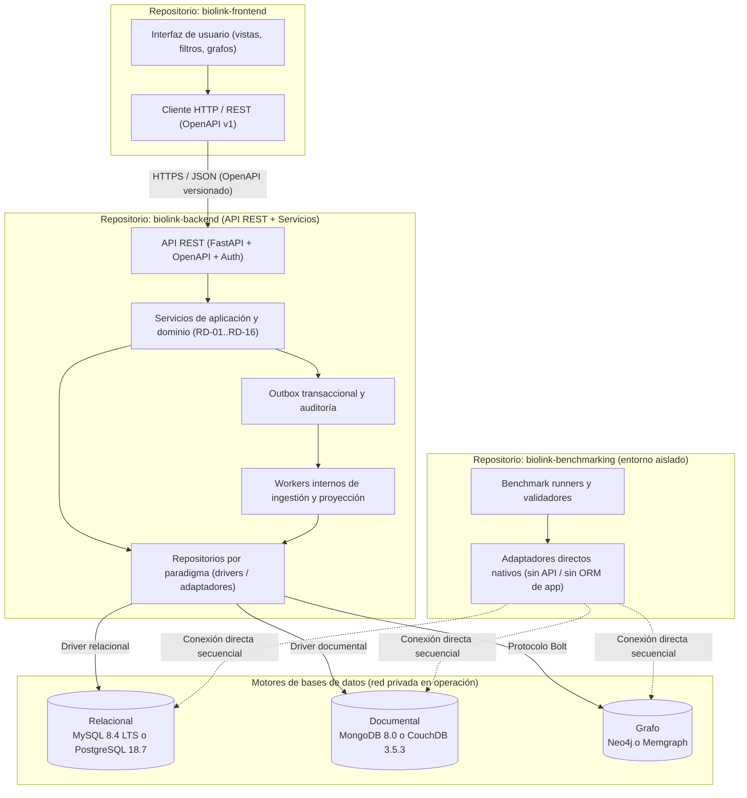

# BioLink — Arquitectura Global (Tres Repositorios Independientes)

**Versión:** 1.0  
**Fecha:** 20 de noviembre de 2026  
**Estado:** Decisión arquitectónica oficial; motores preseleccionados y pendientes de validación empírica en `biolink-benchmarking`.

---

## 1. Decisión arquitectónica oficial

BioLink se organiza como una **arquitectura orientada a servicios (SOA) dividida en tres repositorios independientes**:

1. `biolink-frontend`
2. `biolink-backend`
3. `biolink-benchmarking`

**Sustitución de la propuesta anterior:** la estructura preliminar descrita en versiones iniciales del proyecto —que contemplaba `backend/`, `api/`, `frontend/` y `benchmarking/` como directorios dentro de un mismo repositorio, o la API como componente separado— queda **oficialmente obsoleta**. En la arquitectura vigente:

- **Backend y API REST conforman un único repositorio** (`biolink-backend`), manteniendo separación modular interna por capas.
- **El frontend es un repositorio cliente desacoplado** (`biolink-frontend`) que consume exclusivamente los contratos HTTP/REST del backend.
- **El entorno de benchmarking es un repositorio completamente independiente** (`biolink-benchmarking`) que se comunica directamente con los motores de bases de datos mediante drivers o protocolos nativos.

Esta decisión no modifica las reglas ecológicas del dominio (`RD-01`–`RD-16`), los requisitos funcionales y no funcionales (`RF-01`–`RF-16`, `RNF-01`–`RNF-12`), el catálogo de operaciones (`OP-01`–`OP-15`) ni los tres modelos lógicos definidos en [02_etapa_2_modelado_y_requisitos_biolink.md](./02_etapa_2_modelado_y_requisitos_biolink.md).

---

## 2. Responsabilidades y límites de cada repositorio

### 2.1 `biolink-frontend`

**Propósito:** proveer la interfaz de usuario académica para consultar taxones, fichas descriptivas, evidencias, redes de interacción y comparaciones entre localidades (Montes Azules y Playón de la Gloria).

**Responsabilidades:**
- Interfaz de usuario (web u otra interfaz cliente por definir en su etapa).
- Visualización de especies, clasificaciones, nombres originales/reconciliados y expedientes documentales.
- Formularios y filtros por localidad, estado respecto al ANP, periodo, temporada, método, tipo de interacción y fuente.
- Visualizaciones interactivas de redes/grafos ecológicos y métricas descriptivas con advertencias metodológicas.
- Flujos administrativos para curadores y revisores autenticados (importación, normalización, propuestas y revisión de afirmaciones).
- Consumo exclusivo de los contratos HTTP/REST publicados por `biolink-backend`.

**Límites y prohibiciones:**
- **Prohibido** conectarse directamente a las bases de datos relacional, documental o de grafos.
- **Prohibido** almacenar credenciales, cadenas de conexión o drivers de motores de bases de datos.
- **Prohibido** replicar lógica de validación crítica del dominio o modificar el estado de publicación fuera de la API.

### 2.2 `biolink-backend`

**Propósito:** actuar como núcleo único de servicios, lógica de negocio, API REST y coordinación de persistencia poliglota de la aplicación BioLink.

**Responsabilidades:**
- **API REST integrada (FastAPI):** controladores/routers HTTP, esquemas de entrada/salida (Pydantic), especificación OpenAPI y versionado de endpoints. **La API no es un repositorio separado.**
- **Servicios de aplicación y dominio:** implementación de reglas `RD-01`–`RD-16`, flujos `OP-01`–`OP-15`, validaciones científicas y control de transiciones de estado (`DRAFT`, `IN_REVIEW`, `PUBLISHED`, `REJECTED`, `WITHDRAWN`).
- **Repositorios y adaptadores de persistencia:** integración coordinada mediante drivers/clientes propios hacia los tres motores seleccionados:
  - Relacional: MySQL 8.4 LTS o PostgreSQL 18.7.
  - Documental: MongoDB Community Server 8.0 o Apache CouchDB 3.5.3.
  - Grafo: Neo4j Community o Memgraph Community.
- **Validación y auditoría:** trazabilidad de lotes de importación, preservación inmutable de nombres/payloads originales, registro de `review_event` y metadatos de licencia.
- **Sincronización del grafo y procesos internos:** tabla outbox transaccional en el motor relacional y workers internos de ingestión y proyección idempotente hacia el grafo (ejecutables como procesos separados del mismo código de `biolink-backend`, sin microservicios ni broker externo en V1).
- **Autenticación y autorización:** control de acceso para operaciones administrativas de curadores, revisores y servicio de ingestión.

**Límites y prohibiciones:**
- No debe contener lógica de presentación ni código de interfaz de usuario.
- No debe incorporar scripts de benchmark comparativo ni datasets sintéticos de rendimiento dentro del flujo productivo de la aplicación.

### 2.3 `biolink-benchmarking`

**Propósito:** proveer un entorno aislado, controlado y reproducible para comparar empíricamente los seis motores candidatos dentro de su respectivo paradigma de datos antes de cerrar la selección definitiva del stack de BioLink.

**Responsabilidades:**
- Conexión directa a cada motor candidato mediante sus drivers, conectores o interfaces nativas (sin capa intermedia).
- Preparación y carga de dos conjuntos separados: fixture científico de referencia (basado en la Etapa 1) y dataset sintético determinista (`SYNTHETIC_BENCHMARK`).
- Ejecución de workloads equivalentes por categoría derivados de `OP-01` a `OP-15`.
- Medición separada de conexión, carga inicial, creación de índices, latencia por operación (`p50`, `p95`, máximo), throughput, almacenamiento, memoria máxima y CPU.
- Validación estricta de corrección de resultados (integridad, filtros, cardinalidades e IDs esperados).
- Exportación reproducible de metadatos (JSON), métricas individuales (CSV) y reportes comparativos.

**Límites y prohibiciones:**
- **Prohibido** depender de `biolink-backend`, FastAPI, endpoints HTTP de la aplicación, servicios de aplicación u ORM compartido de BioLink.
- **Prohibido** compartir archivos Docker Compose o volúmenes con la futura aplicación.
- **Prohibido** mezclar registros sintéticos con el fixture científico o comparar tiempos absolutos entre paradigmas distintos (por ejemplo, SQL vs. grafo).

---

## 3. Esquema oficial de comunicación entre proyectos

### 3.1 Esquema normativo de conectividad

```text
biolink-frontend
       |
       | HTTP / REST
       v
biolink-backend
       |
       | Drivers nativos
       v
Bases de datos:
- Relacional
- Documental
- Grafo

biolink-benchmarking
       |
       | Conexiones directas
       v
Bases de datos
```

### 3.2 Diagrama arquitectónico integrado



---

## 4. Contratos entre `biolink-frontend` y `biolink-backend`

La comunicación entre `biolink-frontend` y `biolink-backend` se rige por contratos explícitos publicados y mantenidos por el backend:

1. **Especificación OpenAPI:** `biolink-backend` genera y versiona la especificación OpenAPI 3.x (esquemas de solicitud, respuesta y errores). `biolink-frontend` consume esta especificación como contrato oficial para tipado, clientes HTTP y pruebas de integración.
2. **Versionado de endpoints:** todas las rutas públicas y administrativas utilizarán prefijo de versión explícito en la URL (por ejemplo, `/api/v1/taxa`, `/api/v1/interactions`, `/api/v1/sources`, `/api/v1/assertions`).
3. **Política de evolución de contratos:**
   - Cambios aditivos retrocompatibles (nuevos campos opcionales o nuevos endpoints) permanecen dentro de `/api/v1`.
   - Cambios que rompan compatibilidad (renombrado o eliminación de campos obligatorios, cambio de semántica de respuesta o errores) exigen incrementar la versión mayor del contrato (`/api/v2`) manteniendo transición documentada.
4. **Reglas de contenido de respuesta:**
   - Todo contrato debe respetar `RNF-09` (claridad científica): diferenciar ocurrencias de interacciones, incluir fuente/localizador, método, periodo y estado geográfico (`INSIDE_ANP`, `OUTSIDE_ANP`, `ADJACENT`, `UNDETERMINED`, `NOT_REPORTED`).
   - Cuando una publicación de afirmación (`OP-12`) o actualización (`OP-13`) quede con proyección pendiente o en error (`PENDING`/`ERROR`), la API debe devolver el estado explícito de sincronización y nunca reportar éxito total ficticio.
5. **Exclusión del benchmark:** `biolink-benchmarking` **no utiliza** estos contratos HTTP/REST ni los esquemas OpenAPI para sus pruebas de rendimiento.

---

## 5. Matriz de dependencias permitidas y prohibidas

| Origen | Destino | Permitido | Mecanismo / condición |
|---|---|---|---|
| `biolink-frontend` | `biolink-backend` | Sí | Únicamente HTTP/REST JSON según contrato OpenAPI versionado. |
| `biolink-frontend` | Bases de datos | **No** | Prohibición absoluta de acceso directo o credenciales. |
| `biolink-frontend` | `biolink-benchmarking` | **No** | Sin dependencia funcional ni de código. |
| `biolink-backend` | Bases de datos | Sí | Mediante repositorios internos y drivers/clientes oficiales. |
| `biolink-backend` | `biolink-benchmarking` | **No** | Prohibido importar código de benchmark o datos sintéticos en producción. |
| `biolink-benchmarking` | Bases de datos | Sí | Conexión directa por driver/protocolo nativo (un candidato a la vez). |
| `biolink-benchmarking` | `biolink-backend` (API/servicios/ORM) | **No** | Prohibido para evitar distorsión de latencia y acoplamiento arquitectónico. |

---

## 6. Preservación del dominio, fuente de verdad y sincronización

La transición a tres repositorios independientes **conserva íntegra la matriz de fuente de verdad** definida en las etapas 2 y 3:

- **Relacional (en `biolink-backend`):** fuente de verdad para identidades canónicas (`taxon`, `taxon_name`, `taxon_identifier`), `locality` y su estado espacial, `source`/`source_version`, `evidence`, `occurrence`, `interaction_assertion`, lotes de importación, auditoría (`review_event`), usuarios/roles y tabla `outbox`.
- **Documental (en `biolink-backend`):** fuente de verdad para expedientes descriptivos heterogéneos (`taxon_dossier` versionado), expedientes metodológicos (`study_dossier`) y payloads originales inmutables (`raw_source_record`).
- **Grafo (en `biolink-backend`):** proyección derivada exclusivamente de afirmaciones `PUBLISHED` y vigentes (`Taxon`–`InteractionAssertion`–`Locality`/`Evidence`/`Source`), actualizada de manera idempotente mediante el worker interno a partir del outbox relacional usando `assertion_id`.

No se implementan transacciones distribuidas entre los tres motores en V1; los fallos parciales entre bases se gestionan dentro de `biolink-backend` mediante estados explícitos (`PENDING`/`ERROR`), reintentos idempotentes y reconciliación.

---

## 7. Decisiones arquitectónicas actualizadas (ADRs)

Los ADRs de la Etapa 3 (`ADR-01` a `ADR-10`) se consolidan y actualizan para reflejar la arquitectura oficial SOA:

| ID | Decisión | Estado | Relación |
|---|---|---|---|
| **ADR-01** | **Arquitectura SOA en 3 repositorios; `biolink-backend` como servicio modular** (no microservicios internos). | Aceptada (actualizada) | Sustituye el monorepo único previo manteniendo monolito modular dentro de `biolink-backend`. |
| **ADR-02** | **API REST integrada en `biolink-backend` como frontera única hacia `biolink-frontend`**, documentada con OpenAPI versionado. | Aceptada (actualizada) | Descarta un repositorio separado para `api/` y prohíbe acceso directo del frontend a las BD. |
| **ADR-03** | Relacional como fuente de verdad de identidades, afirmaciones, estados y auditoría. | Aceptada (sin cambios) | Ver [03_etapa_3_arquitectura_y_seleccion_tecnologica_biolink.md](./03_etapa_3_arquitectura_y_seleccion_tecnologica_biolink.md). |
| **ADR-04** | Documental como fuente de verdad de expedientes flexibles y payloads originales. | Aceptada (sin cambios) | Ver Etapa 3. |
| **ADR-05** | Grafo como proyección derivada de afirmaciones `PUBLISHED`. | Aceptada (sin cambios) | Ver Etapa 3. |
| **ADR-06** | Outbox transaccional + worker interno idempotente dentro de `biolink-backend`. | Aceptada (sin cambios) | Ver Etapa 3. |
| **ADR-07** | MySQL 8.4 LTS como primera opción relacional; PostgreSQL 18.7 como alternativa. | Provisional (benchmark pendiente) | Evaluación en `biolink-benchmarking`. |
| **ADR-08** | MongoDB Community 8.0 para documentos; Apache CouchDB 3.5.3 como alternativa. | Provisional (benchmark pendiente) | Evaluación en `biolink-benchmarking` (observar SSPL). |
| **ADR-09** | Neo4j Community para grafo; Memgraph Community como alternativa. | Provisional (benchmark pendiente) | Evaluación en `biolink-benchmarking` bajo límite de 1,024 MB. |
| **ADR-10** | Python + FastAPI dentro de `biolink-backend`. | Preseleccionada | Unifica servicios, dominio, repositorios, workers y API REST. |
| **ADR-11** | **Separación en tres repositorios independientes** (`biolink-frontend`, `biolink-backend`, `biolink-benchmarking`). | Aceptada (nueva) | Desacopla ciclos de vida, dependencias, despliegue y pruebas. |
| **ADR-12** | **Contratos HTTP/REST con especificación OpenAPI y versionado de rutas** (`/api/v1`). | Aceptada (nueva) | Formaliza la interfaz entre `biolink-frontend` y `biolink-backend`. |
| **ADR-13** | **Independencia total de `biolink-benchmarking` mediante conexiones directas** con drivers nativos. | Aceptada (nueva) | Mide el comportamiento real de cada motor sin sesgo de red ni capas de aplicación. |

---

## 8. Estrategia de pruebas y hoja de ruta por etapas

### 8.1 Estrategia de pruebas por repositorio

| Repositorio | Tipos de prueba | Criterio clave |
|---|---|---|
| `biolink-benchmarking` | Validación de configuración, salud de contenedores, pruebas de humo directas, validación funcional de resultados de workloads, mediciones de latencia/memoria/CPU/almacenamiento. | Conexión directa a 1 motor a la vez; validar corrección antes que velocidad; resultados exportados con metadatos reproducibles. |
| `biolink-backend` *(futuro)* | Pruebas unitarias de dominio (`RD-01`–`RD-16`), integración de repositorios con los 3 motores elegidos, consistencia outbox/reconciliación, autorización y pruebas de contrato OpenAPI. | Garantizar trazabilidad, inmutabilidad de origen y respuesta honesta ante fallos parciales. |
| `biolink-frontend` *(futuro)* | Pruebas de componentes, validación de filtros/advertencias científicas (`RNF-09`, `RNF-12`) y pruebas de integración/E2E contra el contrato HTTP/REST de `biolink-backend`. | Verificar que la interfaz no infiera interacciones ni oculte limitaciones metodológicas. |

### 8.2 Planificación de etapas siguientes

1. **En curso (sin cambios al código actual):** consolidación del entorno independiente `biolink-benchmarking` y pruebas breves de conectividad y humo por motor.
2. **Campaña de benchmark controlada (pendiente):** ejecución secuencial dentro de los límites de 4 GB y 120 minutos para seleccionar los tres motores definitivos.
3. **Etapa 4 — Diseño físico (pendiente):** esquemas SQL, validadores/índices documentales, constraints/índices de grafo y contrato OpenAPI v1 dentro de `biolink-backend`.
4. **Etapas 5 a 7 — Persistencia, backend y API (pendiente):** implementación unificada en `biolink-backend`.
5. **Etapa 8 — Interfaz de usuario (pendiente):** implementación de `biolink-frontend` consumiendo los endpoints publicados por `biolink-backend`.
6. **Etapas 9 y 10 — Validación integral y entrega (pendiente):** pruebas de extremo a extremo entre `biolink-frontend`, `biolink-backend` y los tres motores seleccionados.
