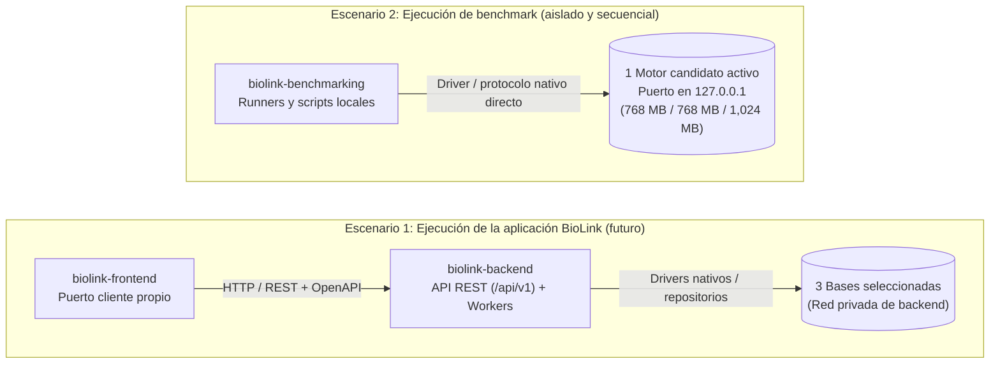

# BioLink — Despliegue Independiente y Comunicación entre Proyectos

**Versión:** 1.0  
**Fecha:** 20 de noviembre de 2026  
**Estado:** Política operativa de despliegue independiente; `biolink-backend` y `biolink-frontend` pendientes de implementación; reglas de Docker del benchmark definidas y preservadas.

---

## 1. Principios generales de despliegue

1. **Despliegue independiente por repositorio:** `biolink-frontend`, `biolink-backend` y `biolink-benchmarking` mantienen archivos de configuración, gestión de dependencias, `.env.example` y definiciones de contenedores completamente separados.
2. **Prohibición de Compose compartido:** `biolink-benchmarking` **nunca** compartirá archivo `compose.yaml` / `docker-compose.yaml`, red de contenedores ni volúmenes con `biolink-backend` ni con `biolink-frontend`.
3. **Presupuesto global de memoria:** el entorno local de pruebas está acotado a un máximo de **4 GB (4,096 MB)** para el conjunto de contenedores activos.
4. **No concurrencia entre benchmark y aplicación:** durante la ejecución de pruebas o campañas en `biolink-benchmarking`, el stack de `biolink-backend` y `biolink-frontend` debe permanecer detenido para no competir por RAM, CPU ni E/S de disco.
5. **Seguridad de configuración y red:** nunca almacenar contraseñas o tokens reales en el repositorio; usar archivos `.env` locales ignorados por Git a partir de `.env.example`, y exponer puertos en desarrollo únicamente en `127.0.0.1`.

---

## 2. Despliegue de `biolink-benchmarking`

El entorno `biolink-benchmarking` se despliega de forma totalmente autónoma para probar los seis candidatos de base de datos.

### 2.1 Reglas de Docker y límites de recursos acordados

| Regla | Especificación obligatoria |
|---|---|
| Techo global del entorno | Máximo **4 GB (4,096 MB)** para los contenedores de prueba. |
| Límite por modelo — Relacional (MySQL / PostgreSQL) | **768 MB** por contenedor. |
| Límite por modelo — Documental (MongoDB / CouchDB) | **768 MB** por contenedor. |
| Límite por modelo — Grafo (Neo4j / Memgraph) | **1,024 MB** por contenedor. |
| Ejecución de motores | **Estrictamente secuencial** (un candidato activo a la vez mediante perfiles o archivos Compose separados; nunca los seis simultáneamente). |
| Volúmenes de almacenamiento | Volúmenes nombrados independientes por cada motor; limpieza completa de datos de un candidato sin afectar a los demás. |
| Exposición de red | Puertos publicados exclusivamente en `127.0.0.1` (`127.0.0.1:<HOST_PORT>:<CONTAINER_PORT>`). |
| Fijación de versiones | Prohibido usar el tag `latest`. Usar versiones fijadas en documentación y registrar tag exacto y digest en cada ejecución. |
| Política ante fallos de recursos | **No aumentar los límites automáticamente** si un motor falla al iniciar, cargar o consultar bajo su límite; registrar el fallo como evidencia experimental. |
| Independencia de aplicación | Cero dependencia de `biolink-backend`, FastAPI, workers o `biolink-frontend` para iniciar contenedores o ejecutar benchmarks. |

### 2.2 Ciclo operativo por candidato

Cada corrida controlada en `biolink-benchmarking` sigue esta secuencia aislada:

1. Preparar `.env` local desde `.env.example` (sin credenciales reales versionadas).
2. Levantar **únicamente el perfil del candidato a evaluar** (por ejemplo, solo MySQL, luego detener/limpiar y levantar PostgreSQL).
3. Esperar confirmación de `healthcheck` y registrar versión exacta del motor, digest de la imagen, parámetros de memoria/CPU y estado del sistema anfitrión.
4. Ejecutar conexión directa, preparación de estructura, carga de dataset, creación de índices, calentamiento y workloads desde el runner de `biolink-benchmarking` mientras se monitorea memoria máxima, CPU y almacenamiento en volumen.
5. Exportar resultados (JSON de metadatos y CSV de mediciones individuales) con identificador único y fecha de ejecución.
6. Detener el contenedor y limpiar explícitamente su volumen antes de iniciar el siguiente candidato.

> Los comandos exactos de perfiles Compose y scripts de limpieza pertenecen al `README.md` propio del repositorio `biolink-benchmarking`.

---

## 3. Despliegue de `biolink-backend` *(etapa futura)*

El repositorio `biolink-backend` integrará en su propio despliegue la **API REST**, los **servicios de dominio/aplicación**, los **workers de ingestión y proyección**, y la conexión a los **tres motores definitivos** elegidos tras el benchmark.

### 3.1 Topología de despliegue prevista

- **Servicios en el Compose de `biolink-backend`:**
  - `api`: servidor FastAPI que expone `/api/v1` hacia `127.0.0.1:<BACKEND_PORT>` (o proxy inverso en despliegue productivo).
  - `worker`: proceso interno de ingestión y proyección del outbox relacional hacia la base de grafos (puede ejecutarse desde la misma imagen/código de `biolink-backend`).
  - `relational-db`: motor ganador entre MySQL 8.4 LTS y PostgreSQL 18.7.
  - `document-db`: motor ganador entre MongoDB Community 8.0 y Apache CouchDB 3.5.3.
  - `graph-db`: motor ganador entre Neo4j Community y Memgraph Community.
- **Aislamiento de red:** los tres motores viven en una red interna privada de Compose. No se exponen puertos de bases de datos a `biolink-frontend` ni a interfaces públicas (en desarrollo, cualquier acceso administrativo de mantenimiento se restringe a `127.0.0.1` y fuera de la ruta de usuario).
- **Presupuesto orientativo de memoria en operación integrada:**
  - Base relacional: `768 MB`
  - Base documental: `768 MB`
  - Base de grafos: `1,024 MB`
  - `api` + `worker` (`biolink-backend`): `512 MB`
  - Margen reservado para sistema operativo y herramientas del host: `1,024 MB`
  - **Total máximo objetivo:** `4,096 MB` (4 GB)

---

## 4. Despliegue de `biolink-frontend` *(etapa futura)*

El repositorio `biolink-frontend` se compila, empaqueta y despliega de manera independiente al backend y a los contenedores de bases de datos.

- **Configuración de enlace:** consume únicamente la URL base de la API REST (por ejemplo, `BIOLINK_API_BASE_URL=http://127.0.0.1:8000/api/v1` en entorno local) y configuraciones de interfaz.
- **CORS y acceso:** `biolink-backend` configura explícitamente los orígenes permitidos del frontend en su entorno de despliegue.
- **Cero secretos de persistencia:** `biolink-frontend` no recibe credenciales de MySQL, PostgreSQL, MongoDB, CouchDB, Neo4j ni Memgraph.

---

## 5. Comunicación entre proyectos en tiempo de ejecución

### Reglas de comunicación

| Flujo | Protocolo | Contrato / autenticación | Restricción |
|---|---|---|---|
| `biolink-frontend` → `biolink-backend` | HTTP / HTTPS (JSON) | Contrato OpenAPI (`/api/v1`); endpoints administrativos con autenticación de curadores/revisores. | Única vía de acceso de la interfaz al sistema. |
| `biolink-backend` → 3 Bases de datos | Drivers nativos / TCP interno | Credenciales por variables de entorno del backend; red privada de Compose. | Sin transacciones distribuidas; sincronización outbox relacional → grafo. |
| `biolink-benchmarking` → 1 Motor candidato | Conector nativo / `psycopg` / `pymongo` / HTTP CouchDB / Bolt | Credenciales de prueba locales en `.env` del benchmark; puerto en `127.0.0.1`. | **Nunca** pasa por `biolink-backend`; un solo motor levantado a la vez. |

---

## 6. Verificaciones de despliegue y reproducibilidad

1. **Antes de iniciar `biolink-benchmarking`:** confirmar mediante inspección de contenedores que no haya motores de aplicación ni otros candidatos ejecutándose simultáneamente.
2. **Validación de configuración:** verificar existencia de `.env` derivado de `.env.example`, etiquetas de imagen sin `latest` y límites de memoria declarados.
3. **Health checks obligatorios:** ninguna prueba o servicio dependiente debe iniciarse antes de que el contenedor reporte estado `healthy` mediante su comprobación nativa.
4. **Limpieza controlada:** al finalizar pruebas en `biolink-benchmarking`, exportar evidencias y eliminar contenedores y volúmenes del candidato probado para garantizar reproducibilidad en ejecuciones posteriores.
