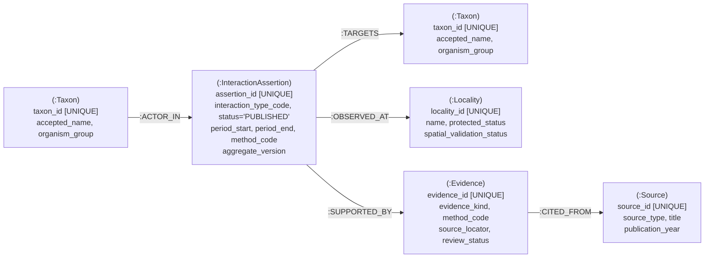

# Modelo de Datos de BioLink y Responsabilidades por Motor (`01_modelo_de_datos.md`)

**Fecha de corte:** 21 de noviembre de 2026  
**Ubicación:** `biolink-benchmarking/docs/docs/entrega_final/01_modelo_de_datos.md`  
**Fuentes verificadas:** Implementación real en `biolink-backend` (`database/` y `src/biolink_backend/`) y documentación arquitectónica en `biolink-backend/docs/`, `biolink-frontend/docs/` y `biolink-benchmarking/docs/docs/`.

---

## 0. Distribución de Responsabilidades y Verificación de Cumplimiento

La arquitectura oficial de BioLink (`biolink-benchmarking/docs/docs/architecture.md`, `03_etapa_3_arquitectura_y_seleccion_tecnologica_biolink.md` y `biolink-backend/docs/architecture.md`) asigna roles estrictamente separados a los tres motores seleccionados tras el benchmark:

| Motor (Versión fijada) | Responsabilidad prevista | Implementación verificada en `biolink-backend` | Cumplimiento |
|---|---|---|---|
| **PostgreSQL (`postgres:18.7`)** | Fuente relacional autoritativa (**SSOT**) para identidades taxonómicas, fuentes, localidades, evidencias, ocurrencias, afirmaciones de interacción, usuarios/sesiones, lotes, outbox y auditoría. | Esquema normalizado de **21 tablas** en `database/postgresql/migrations/`, repositorios SQL nativos sin ORM (`psycopg 3`), restricciones `CHECK`/`FK` y `Outbox` ACID. | **Cumplido** |
| **MongoDB (`mongo:8.0.38`)** | Almacenamiento documental flexible para expedientes taxonómicos (`taxon_dossier`), expedientes metodológicos de estudios (`study_dossier`) y registros de fuentes originales (`raw_source_record`). | Base `biolink_documents` con 3 esquemas `$jsonSchema` estrictos + colección histórica inmutable `taxon_dossier_versions`, accedida mediante `pymongo` nativo. | **Cumplido con matices operativos** (ver desviaciones 2 y 3) |
| **Neo4j Community (`neo4j:2026.10.2-community`)** | Proyección derivada del grafo formada exclusivamente por afirmaciones aprobadas (`PUBLISHED`), optimizada para vecindarios, subredes y conectividad; nunca fuente independiente de verdad. | Proyección idempotente vía `MERGE` desde `OutboxProjectionWorker` (`WHERE status = 'PUBLISHED'`), doble validación de consultas públicas contra PostgreSQL y reconciliación completa desde PostgreSQL. | **Cumplido con desviaciones menores** (ver desviaciones 1, 4, 6 y 7) |

### Desviaciones y matices verificados entre la arquitectura prevista y la implementación real

1. **Doble validación en consultas públicas (`OP-03`, `OP-05`, `OP-06`, `OP-07`) vs. lectura directa (`OP-04`):**
   - En `PublicQueryService` (`src/biolink_backend/application/services/public_query_service.py`), las operaciones de grafo consultan primero a Neo4j y luego validan los `assertion_id` devueltos contra PostgreSQL (`get_published_assertions_by_ids`) para impedir que un retiro reciente aún no drenado del Outbox aparezca en resultados públicos.
   - Sin embargo, si una afirmación ya fue aprobada (`PUBLISHED`) en PostgreSQL pero su evento Outbox sigue `PENDING`, `OP-04` (`GET /api/v1/interactions/{assertion_id}`) sí la devuelve directamente desde PostgreSQL marcando `graph_projected: false` y agregando una advertencia, mientras que `OP-03`, `OP-05`, `OP-06` y `OP-07` no la muestran hasta que el worker la proyecte en Neo4j.
2. **Desalineación entre `create_indexes.js` y la inicialización efectiva de MongoDB (`reference_seeder.py` / `docker-compose.yaml`):**
   - El script `biolink-backend/database/mongodb/indexes/create_indexes.js` define **18 índices** en las 4 colecciones, pero **no** está montado en `/docker-entrypoint-initdb.d` dentro de `biolink-backend/docker-compose.yaml` ni aplica los validadores `$jsonSchema`.
   - En la práctica, `apply_reference_fixture` (`src/biolink_backend/infrastructure/reference_seeder.py`) crea/modifica las 3 colecciones con `$jsonSchema` estricto y crea programáticamente **5 índices** (`idx_taxon_dossier_name`, `idx_taxon_dossier_claims_multikey`, índice único `(taxon_id, document_version)` en `taxon_dossier_versions`, `uq_study_dossier_source_id` y único `(import_batch_id, external_record_id)` en `raw_source_record`), sin crear los otros 13 índices definidos en `create_indexes.js`.
3. **Ausencia de archivo `$jsonSchema` para `taxon_dossier_versions`:**
   - En `biolink-backend/database/mongodb/schemas/` existen validadores para `taxon_dossier`, `study_dossier` y `raw_source_record`, pero no hay archivo `.schema.json` ni `collMod` con `$jsonSchema` para `taxon_dossier_versions`.
4. **Proyección de una sola evidencia (`evidence_ids[0]`) en Neo4j:**
   - PostgreSQL admite múltiples evidencias por afirmación mediante `assertion_evidence` (`PRIMARY`, `SUPPORTING`, `CONTEXTUAL`), y el payload del evento Outbox envía el arreglo completo `evidence_ids`. No obstante, `Neo4jProjectionRepository.project_assertion` (`src/biolink_backend/repositories/graph/projection_repository.py`, línea 146) toma únicamente `str(evidence_ids[0])` (la evidencia `PRIMARY` tras el ordenamiento SQL) al crear el nodo `:Evidence` y la arista `:SUPPORTED_BY` en Neo4j.
5. **Propiedades espaciales de `:Locality` creadas por proyección vs. seeder:**
   - `reference_seeder.py` puebla en los nodos `:Locality` los atributos `name`, `locality_type`, `protected_status` y `spatial_validation_status`. En cambio, `_PROJECT_ASSERTION_CYPHER` en `projection_repository.py` solo ejecuta `MERGE (loc:Locality {locality_id: $locality_id}) ON CREATE SET loc.projected_at = datetime()`. Si una localidad nueva se proyectara solo mediante un evento Outbox sin haberse sincronizado previamente sus atributos en Neo4j, `loc.protected_status` sería `null` y sería tratada como `'UNDETERMINED'` por `coalesce(loc.protected_status, 'UNDETERMINED')` en `Neo4jPublicNetworkRepository`.
6. **Coordinación secuencial sin 2PC en operaciones sobre MongoDB + PostgreSQL (`OP-09`, `OP-10`, `OP-13`):**
   - `OP-09` (`register_import_batch`) escribe primero en MongoDB (`raw_source_record`) y luego en PostgreSQL (`source_version`, `import_batch`, `import_record`); `OP-10` (`normalize_import_record`) confirma primero en PostgreSQL y luego actualiza `transformation_metadata` en MongoDB; `OP-13` (`update_taxon_dossier`) actualiza primero MongoDB y luego registra `dossier_version` en PostgreSQL (marcando `PENDING_RECONCILIATION` si falla PostgreSQL). Además, `reconcile_system_state` alinea versiones documentales hacia PostgreSQL (`taxon.dossier_version`), pero en `OP-10` el campo `raw_document_updated` indica si el metadato crudo fue actualizado al instante sin reintento automático posterior para `OP-10`.
7. **Vocabulario Outbox y reconciliación de retiros:**
   - La columna SQL `outbox_event.outbox_event_id` y `aggregate_id` se proyectan en el contrato HTTP (`OutboxEventDTO`) como `event_id` y `assertion_id`, y `status`/`error_message` como `processing_status`/`last_error`. Asimismo, existe `OutboxEventType.ASSERTION_REVISED` en `vocabularies.py` y `outbox_worker.py`, pero `transition_assertion_status` solo emite `ASSERTION_PUBLISHED` y `ASSERTION_WITHDRAWN`. Adicionalmente, `reconcile_system_state` llama a `mark_assertions_projection_synced(published_ids)` pasando solo IDs `PUBLISHED`; si existiera una afirmación `WITHDRAWN` retirada del grafo directamente por diferencia de conjuntos sin haber pasado por `drain_once`, su `projection_status` previo no sería actualizado por esa llamada final.

---

## 1. Modelo Relacional de PostgreSQL (`postgres:18.7`)

### 1.1 Migraciones y orden de construcción
El diseño físico SQL reside en `biolink-backend/database/postgresql/` y se ejecuta en tres migraciones idempotentes más un script de semilla científica:

1. **`migrations/001_create_schema.sql`:** crea `schema_migrations` y **20 tablas** operativas y de dominio (**21 tablas físicas en total**, aunque el registro de la migración `001` cita *"20 tablas relacionales"* refiriéndose al dominio/operación aparte de `schema_migrations`).
2. **`migrations/002_create_indexes.sql`:** crea **24 índices** secundarios y parciales/cubrientes orientados a búsqueda taxonómica, consulta filtrada `R2`, integridad referencial y polling del Outbox.
3. **`migrations/003_admin_curation_extensions.sql`:** agrega columnas para trazabilidad de lotes (`endpoint_or_file`, `provider_version`), normalización (`import_record`), versionado de agregado y proyección (`interaction_assertion`, `outbox_event`), control documental (`taxon`), índice parcial `idx_import_record_pending_or_unresolved` y amplía `idx_outbox_pending_polling` para cubrir `'PENDING'` y `'FAILED'`.
4. **`seeds/001_reference_fixture.sql`:** carga usuarios/roles de referencia, `BAT2007`, `MAMMAL2016`, `LOC_RBMA_SOUTH`, `LOC_PDLG`, `LOC_LACANDONA_UNDETERMINED`, 32 taxones, 21 afirmaciones `PUBLISHED`, 1 borrador `AST_SCI_DRAFT_001` (`DRAFT`) y 3 ocurrencias `OCC_SCI_001`–`003`. *(Nota: `reference_seeder.py` reemplaza además los hashes placeholder de usuarios por hashes PBKDF2 reales y actualiza `dossier_version` en 5 taxones).*

### 1.2 Inventario completo de tablas, columnas, claves y restricciones

#### A. Control de migraciones y seguridad (`ACT-02`, `ACT-03`)

1. **`schema_migrations`**
   - Columnas: `version VARCHAR(64) PK`, `applied_at TIMESTAMPTZ NOT NULL DEFAULT clock_timestamp()`, `description TEXT NOT NULL`.
2. **`app_user`**
   - Columnas: `user_id VARCHAR(64) PK`, `display_name VARCHAR(160) NOT NULL`, `email VARCHAR(255) NOT NULL UNIQUE`, `password_hash VARCHAR(255) NOT NULL`, `is_active BOOLEAN NOT NULL DEFAULT true`, `created_at TIMESTAMPTZ NOT NULL DEFAULT clock_timestamp()`, `updated_at TIMESTAMPTZ NOT NULL DEFAULT clock_timestamp()`.
   - Restricciones `CHECK`: `chk_app_user_email_nonempty` (`length(trim(email)) > 3`), `chk_app_user_name_nonempty` (`length(trim(display_name)) > 0`).
3. **`role`**
   - Columnas: `role_id VARCHAR(64) PK`, `code VARCHAR(64) NOT NULL UNIQUE`, `name VARCHAR(128) NOT NULL`, `description TEXT NOT NULL`.
   - `CHECK`: `chk_role_code_upper` (`code = upper(code)`).
4. **`user_role`**
   - Columnas: `user_id VARCHAR(64) FK -> app_user(user_id) ON DELETE CASCADE`, `role_id VARCHAR(64) FK -> role(role_id) ON DELETE RESTRICT`, `assigned_at TIMESTAMPTZ NOT NULL DEFAULT clock_timestamp()`.
   - `PRIMARY KEY (user_id, role_id)`.
5. **`user_session`**
   - Columnas: `session_id VARCHAR(128) PK`, `user_id VARCHAR(64) NOT NULL FK -> app_user(user_id) ON DELETE CASCADE`, `token_hash VARCHAR(128) NOT NULL UNIQUE`, `ip_address INET`, `user_agent TEXT`, `created_at TIMESTAMPTZ NOT NULL DEFAULT clock_timestamp()`, `expires_at TIMESTAMPTZ NOT NULL`, `revoked_at TIMESTAMPTZ`.
   - `CHECK`: `chk_session_expiry` (`expires_at > created_at`).

#### B. Fuentes bibliográficas, versiones y contexto geográfico

6. **`source`**
   - Columnas: `source_id VARCHAR(64) PK`, `source_type VARCHAR(64) NOT NULL`, `title TEXT NOT NULL`, `authors TEXT NOT NULL`, `publication_year INTEGER NOT NULL`, `doi VARCHAR(255)`, `uri TEXT`, `publisher VARCHAR(255)`, `citation_text TEXT NOT NULL`, `license_id VARCHAR(64) NOT NULL`, `created_at TIMESTAMPTZ NOT NULL DEFAULT clock_timestamp()`.
   - `CHECK`: `chk_source_type` (`PUBLICATION`, `THESIS`, `DATASET`, `REPOSITORY`, `OTHER`), `chk_source_year` (`BETWEEN 1753 AND 2100`).
7. **`source_version`**
   - Columnas: `source_version_id VARCHAR(64) PK`, `source_id VARCHAR(64) NOT NULL FK -> source(source_id) ON DELETE RESTRICT`, `provider_version VARCHAR(64) NOT NULL`, `release_date DATE`, `retrieved_at TIMESTAMPTZ NOT NULL DEFAULT clock_timestamp()`, `endpoint_or_file TEXT NOT NULL`, `query_parameters JSONB NOT NULL DEFAULT '{}'`, `filters JSONB NOT NULL DEFAULT '{}'`, `license_id VARCHAR(64) NOT NULL`, `checksum VARCHAR(128) NOT NULL`.
   - `CHECK`: `chk_source_version_checksum` (`length(trim(checksum)) >= 32`).
8. **`locality`**
   - Columnas: `locality_id VARCHAR(64) PK`, `name VARCHAR(255) NOT NULL`, `locality_type VARCHAR(64) NOT NULL`, `parent_locality_id VARCHAR(64) FK -> locality(locality_id) ON DELETE RESTRICT`, `protected_status VARCHAR(64) NOT NULL`, `spatial_validation_status VARCHAR(64) NOT NULL`, `geometry_reference TEXT`, `coordinate_precision VARCHAR(64)`, `source_id VARCHAR(64) NOT NULL FK -> source(source_id) ON DELETE RESTRICT`, `created_at TIMESTAMPTZ NOT NULL DEFAULT clock_timestamp()`.
   - `CHECK`: `chk_locality_type` (`PROTECTED_AREA`, `COMMUNITY_RESERVE`, `EJIDO`, `SAMPLING_SITE`, `FIELD_STATION`, `STUDY_AREA`, `OTHER`), `chk_locality_protected_status` (`INSIDE_ANP`, `OUTSIDE_ANP`, `ADJACENT`, `UNDETERMINED`, `NOT_REPORTED`, `PROTECTED_ANP`, `EXTERNAL_EJIDO`), `chk_locality_spatial_status` (`VERIFIED_POLYGON`, `POINT_COORDINATES`, `DESCRIPTIVE_ONLY`, `PENDING_VALIDATION`, `INVALID`, `INSIDE_ANP`, `OUTSIDE_ANP`).

#### C. Taxonomía canónica, nombres e identificadores externos

9. **`taxon`** *(incluye columnas agregadas en migración `003`)*
   - Columnas: `taxon_id VARCHAR(64) PK`, `accepted_name VARCHAR(255) NOT NULL`, `scientific_authorship VARCHAR(160) NOT NULL`, `taxonomic_rank VARCHAR(32) NOT NULL`, `organism_group VARCHAR(32) NOT NULL`, `taxonomic_status VARCHAR(64) NOT NULL`, `created_at TIMESTAMPTZ NOT NULL DEFAULT clock_timestamp()`, `updated_at TIMESTAMPTZ NOT NULL DEFAULT clock_timestamp()`, **`dossier_version INTEGER NOT NULL DEFAULT 0`** (`003`), **`dossier_sync_status VARCHAR(32) NOT NULL DEFAULT 'SYNCED'`** (`003`).
   - `CHECK`: `chk_taxon_rank` (`SPECIES`, `GENUS`, `FAMILY`, `ORDER`, `HIGHER_TAXON`, `MORPHOSPECIES`, `UNRESOLVED`), `chk_taxon_group` (`ANIMAL`, `PLANT`, `FUNGI`, `OTHER`), `chk_taxon_status` (`ACCEPTED`, `SYNONYM`, `DOUBTFUL`, `UNRESOLVED`, `UNRESOLVED_TO_SPECIES`, `NEEDS_RECONCILIATION`), `chk_taxon_dossier_version` (`>= 0`), `chk_taxon_dossier_sync_status` (`SYNCED`, `PENDING_RECONCILIATION`, `ERROR`).
10. **`taxon_name`**
    - Columnas: `taxon_name_id VARCHAR(64) PK`, `taxon_id VARCHAR(64) NOT NULL FK -> taxon(taxon_id) ON DELETE RESTRICT`, `name VARCHAR(255) NOT NULL`, `name_usage VARCHAR(32) NOT NULL`, `language VARCHAR(16) NOT NULL DEFAULT 'la'`, `source_id VARCHAR(64) NOT NULL FK -> source(source_id) ON DELETE RESTRICT`, `is_preferred BOOLEAN NOT NULL DEFAULT false`, `verbatim_name VARCHAR(255)`.
    - `CHECK`: `chk_taxon_name_usage` (`ACCEPTED`, `SYNONYM`, `COMMON_NAME`, `VERBATIM_ORIGINAL`, `BASIONYM`).
11. **`taxon_identifier`**
    - Columnas: `taxon_identifier_id VARCHAR(64) PK`, `taxon_id VARCHAR(64) NOT NULL FK -> taxon(taxon_id) ON DELETE RESTRICT`, `scheme VARCHAR(32) NOT NULL`, `external_id VARCHAR(128) NOT NULL`, `retrieved_at TIMESTAMPTZ NOT NULL DEFAULT clock_timestamp()`, `source_id VARCHAR(64) NOT NULL FK -> source(source_id) ON DELETE RESTRICT`.
    - `UNIQUE`: `uq_taxon_identifier_scheme_id (scheme, external_id)`.
    - `CHECK`: `chk_taxon_identifier_scheme` (`GBIF`, `ENCICLOVIDA`, `NCBI`, `COL`, `IPNI`, `ITIS`, `CUSTOM`).

#### D. Evidencias, ocurrencias, interacciones y revisión

12. **`interaction_type`**
    - Columnas: `interaction_type_id VARCHAR(64) PK`, `code VARCHAR(64) NOT NULL UNIQUE`, `label VARCHAR(128) NOT NULL`, `definition TEXT NOT NULL`, `actor_role VARCHAR(64) NOT NULL`, `target_role VARCHAR(64) NOT NULL`, `is_active BOOLEAN NOT NULL DEFAULT true`.
    - `CHECK`: `chk_interaction_type_code` (`CONSUMES_FRUIT_OF`, `REMOVES_FRUIT_OF`, `CONSUMES_OR_REMOVES_FRUIT_OF`, `DISPERSES_SEEDS_OF`), `chk_interaction_actor_role` (`ANIMAL`, `HERBIVORE`, `FRUGIVORE`, `OTHER`), `chk_interaction_target_role` (`PLANT`, `FRUIT`, `SEED`, `OTHER`). *(En V1, la capa de dominio bloquea `DISPERSES_SEEDS_OF` en `rules.py`).*
13. **`evidence`**
    - Columnas: `evidence_id VARCHAR(64) PK`, `source_id VARCHAR(64) NOT NULL FK -> source(source_id) ON DELETE RESTRICT`, `source_version_id VARCHAR(64) FK -> source_version(source_version_id) ON DELETE RESTRICT`, `source_locator VARCHAR(255) NOT NULL`, `evidence_kind VARCHAR(64) NOT NULL`, `method_code VARCHAR(64) NOT NULL`, `reported_term VARCHAR(128) NOT NULL`, `summary TEXT NOT NULL`, `interpretation_limit TEXT NOT NULL`, `period_start VARCHAR(32) NOT NULL`, `period_end VARCHAR(32) NOT NULL`, `license_id VARCHAR(64) NOT NULL`, `created_at TIMESTAMPTZ NOT NULL DEFAULT clock_timestamp()`.
    - `CHECK`: `chk_evidence_kind` (`SPECIMEN_SAMPLE`, `OBSERVATION`, `RECORDING`, `DATASET_ENTRY`, `LITERATURE_CITATION`), `chk_evidence_method` (`FECAL_SEED_IDENTIFICATION`, `CAMERA_TRAP`, `FIELD_OBSERVATION`, `DATASET_RECORD`, `LITERATURE_REPORT`, `OTHER_REVIEWED`), `chk_evidence_period` (`period_end >= period_start`).
14. **`occurrence`**
    - Columnas: `occurrence_id VARCHAR(64) PK`, `taxon_id VARCHAR(64) NOT NULL FK -> taxon(taxon_id) ON DELETE RESTRICT`, `source_id VARCHAR(64) NOT NULL FK -> source(source_id) ON DELETE RESTRICT`, `source_record_id VARCHAR(128)`, `locality_id VARCHAR(64) FK -> locality(locality_id) ON DELETE RESTRICT`, `event_date VARCHAR(32)`, `latitude NUMERIC(9, 6)`, `longitude NUMERIC(9, 6)`, `coordinate_uncertainty_meters NUMERIC(10, 2)`, `basis_of_record VARCHAR(64) NOT NULL`, `georeference_status VARCHAR(64) NOT NULL`, `created_at TIMESTAMPTZ NOT NULL DEFAULT clock_timestamp()`.
    - `CHECK`: `chk_occurrence_lat` (`NULL OR BETWEEN -90.0 AND 90.0`), `chk_occurrence_lon` (`NULL OR BETWEEN -180.0 AND 180.0`), `chk_occurrence_georef` (`GEOREFERENCED`, `APPROXIMATE`, `UNVERIFIED`, `NOT_GEOREFERENCED`).
15. **`interaction_assertion`** *(incluye columnas de migración `003`)*
    - Columnas: `assertion_id VARCHAR(64) PK`, `actor_taxon_id VARCHAR(64) NOT NULL FK -> taxon(taxon_id)`, `target_taxon_id VARCHAR(64) NOT NULL FK -> taxon(taxon_id)`, `interaction_type_id VARCHAR(64) NOT NULL FK -> interaction_type(interaction_type_id)`, `locality_id VARCHAR(64) NOT NULL FK -> locality(locality_id)`, `period_start VARCHAR(32) NOT NULL`, `period_end VARCHAR(32) NOT NULL`, `season_label VARCHAR(128) NOT NULL`, `method_code VARCHAR(64) NOT NULL`, `assertion_scope VARCHAR(64) NOT NULL`, `status VARCHAR(32) NOT NULL DEFAULT 'DRAFT'`, `created_by VARCHAR(64) NOT NULL FK -> app_user(user_id)`, `created_at TIMESTAMPTZ NOT NULL DEFAULT clock_timestamp()`, `reviewed_by VARCHAR(64) FK -> app_user(user_id)`, `reviewed_at TIMESTAMPTZ`, `updated_at TIMESTAMPTZ NOT NULL DEFAULT clock_timestamp()`, **`aggregate_version INTEGER NOT NULL DEFAULT 1`** (`003`), **`projection_status VARCHAR(32) NOT NULL DEFAULT 'NOT_APPLICABLE'`** (`003`), **`last_projected_at TIMESTAMPTZ`** (`003`).
    - `CHECK`: `chk_assertion_taxa_distinct` (`actor_taxon_id != target_taxon_id`), `chk_assertion_period` (`period_end >= period_start`), `chk_assertion_status` (`DRAFT`, `IN_REVIEW`, `PUBLISHED`, `REJECTED`, `WITHDRAWN`), `chk_assertion_method` (los 6 códigos de método), `chk_assertion_review_consistency` (`PUBLISHED` exige `reviewed_by IS NOT NULL AND reviewed_at IS NOT NULL`), `chk_assertion_projection_status` (`NOT_APPLICABLE`, `PENDING`, `SYNCED`, `FAILED`), `chk_assertion_aggregate_version` (`>= 1`).
16. **`assertion_evidence`**
    - Columnas: `assertion_id VARCHAR(64) NOT NULL FK -> interaction_assertion(assertion_id) ON DELETE CASCADE`, `evidence_id VARCHAR(64) NOT NULL FK -> evidence(evidence_id) ON DELETE RESTRICT`, `evidence_role VARCHAR(32) NOT NULL DEFAULT 'PRIMARY'`, `review_note VARCHAR(512)`, `assigned_at TIMESTAMPTZ NOT NULL DEFAULT clock_timestamp()`.
    - `PRIMARY KEY (assertion_id, evidence_id)`. `CHECK`: `chk_assertion_evidence_role` (`PRIMARY`, `SUPPORTING`, `CONTEXTUAL`).
17. **`review_event`**
    - Columnas: `review_event_id VARCHAR(64) PK`, `assertion_id VARCHAR(64) NOT NULL FK -> interaction_assertion(assertion_id) ON DELETE RESTRICT`, `user_id VARCHAR(64) NOT NULL FK -> app_user(user_id) ON DELETE RESTRICT`, `previous_status VARCHAR(32) NOT NULL`, `new_status VARCHAR(32) NOT NULL`, `reason TEXT NOT NULL`, `created_at TIMESTAMPTZ NOT NULL DEFAULT clock_timestamp()`.
    - `CHECK`: `chk_review_event_transition` (`previous_status != new_status`), `chk_review_event_status_vals` (ambos en los 5 estados válidos).

#### E. Ingestión, Outbox Transaccional y Auditoría

18. **`import_batch`** *(incluye columnas de migración `003`)*
    - Columnas: `import_batch_id VARCHAR(64) PK`, `source_id VARCHAR(64) NOT NULL FK -> source(source_id)`, `source_version_id VARCHAR(64) FK -> source_version(source_version_id)`, `started_by VARCHAR(64) NOT NULL FK -> app_user(user_id)`, `started_at TIMESTAMPTZ NOT NULL DEFAULT clock_timestamp()`, `finished_at TIMESTAMPTZ`, `query_parameters JSONB NOT NULL DEFAULT '{}'`, `filters JSONB NOT NULL DEFAULT '{}'`, `status VARCHAR(32) NOT NULL DEFAULT 'RUNNING'`, `received_count INTEGER NOT NULL DEFAULT 0`, `accepted_count INTEGER NOT NULL DEFAULT 0`, `rejected_count INTEGER NOT NULL DEFAULT 0`, **`endpoint_or_file TEXT`** (`003`), **`provider_version VARCHAR(64)`** (`003`).
    - `CHECK`: `chk_import_batch_status` (`RUNNING`, `COMPLETED`, `FAILED`, `PARTIAL`), `chk_import_batch_counts` (`received_count >= 0`, `accepted_count >= 0`, `rejected_count >= 0`, `accepted_count + rejected_count <= received_count`).
19. **`import_record`** *(incluye columnas de migración `003`)*
    - Columnas: `import_record_id VARCHAR(64) PK`, `import_batch_id VARCHAR(64) NOT NULL FK -> import_batch(import_batch_id) ON DELETE CASCADE`, `external_record_id VARCHAR(128) NOT NULL`, `raw_document_id VARCHAR(128)`, `validation_status VARCHAR(32) NOT NULL DEFAULT 'PENDING'`, `canonical_taxon_id VARCHAR(64) FK -> taxon(taxon_id) ON DELETE SET NULL`, `validation_notes TEXT`, `created_at TIMESTAMPTZ NOT NULL DEFAULT clock_timestamp()`, **`verbatim_name VARCHAR(255)`** (`003`), **`proposed_external_scheme VARCHAR(32)`** (`003`), **`proposed_external_id VARCHAR(128)`** (`003`), **`matching_rule VARCHAR(128)`** (`003`), **`normalized_by VARCHAR(64) FK -> app_user(user_id) ON DELETE SET NULL`** (`003`), **`normalized_at TIMESTAMPTZ`** (`003`).
    - `CHECK`: `chk_import_record_status` (`PENDING`, `VALID`, `INVALID`, `UNRESOLVED`, `DUPLICATE`), `chk_import_record_ext_scheme` (los 7 esquemas permitidos o `NULL`).
20. **`outbox_event`** *(incluye columnas de migración `003`)*
    - Columnas: `outbox_event_id VARCHAR(64) PK`, `aggregate_type VARCHAR(64) NOT NULL`, `aggregate_id VARCHAR(64) NOT NULL`, `event_type VARCHAR(64) NOT NULL`, `payload_json JSONB NOT NULL`, `status VARCHAR(32) NOT NULL DEFAULT 'PENDING'`, `attempts INTEGER NOT NULL DEFAULT 0`, `created_at TIMESTAMPTZ NOT NULL DEFAULT clock_timestamp()`, `processed_at TIMESTAMPTZ`, `error_message TEXT`, **`aggregate_version INTEGER NOT NULL DEFAULT 1`** (`003`), **`payload_version INTEGER NOT NULL DEFAULT 1`** (`003`).
    - `CHECK`: `chk_outbox_event_status` (`PENDING`, `PROCESSING`, `PROCESSED`, `FAILED`, `DEAD_LETTER`), `chk_outbox_attempts` (`attempts >= 0`), `chk_outbox_versions` (`aggregate_version >= 1 AND payload_version >= 1`).
21. **`audit_log`**
    - Columnas: `audit_id BIGSERIAL PK`, `entity_type VARCHAR(64) NOT NULL`, `entity_id VARCHAR(64) NOT NULL`, `action VARCHAR(32) NOT NULL`, `performed_by VARCHAR(64) FK -> app_user(user_id) ON DELETE SET NULL`, `performed_at TIMESTAMPTZ NOT NULL DEFAULT clock_timestamp()`, `details JSONB NOT NULL DEFAULT '{}'`.
    - `CHECK`: `chk_audit_action` (`INSERT`, `UPDATE`, `DELETE`, `LOGIN`, `LOGOUT`, `SECURITY`).

### 1.3 Índices implementados en PostgreSQL (`002` + `003`)

Existen **25 índices secundarios explícitos** (adicionales a PKs y `UNIQUE`):

- **Taxonomía (`OP-01`):** `idx_taxon_name_lower_lookup` (`lower(name), taxon_id`), `idx_taxon_name_taxon_fk`, `idx_taxon_accepted_name`, `idx_taxon_identifier_lookup` (`scheme, external_id, taxon_id`), `idx_taxon_identifier_taxon_fk`.
- **Afirmaciones filtradas y vecindario (`OP-03`, `OP-05` / `R2`):**
  - `idx_assertion_published_r2_covering` sobre `interaction_assertion (locality_id, period_start, assertion_id) INCLUDE (actor_taxon_id, target_taxon_id, interaction_type_id, method_code, period_end) WHERE status = 'PUBLISHED'`.
  - `idx_assertion_actor_published` (`actor_taxon_id, target_taxon_id, locality_id WHERE status = 'PUBLISHED'`) y `idx_assertion_target_published` (`target_taxon_id, actor_taxon_id, locality_id WHERE status = 'PUBLISHED'`).
- **Claves foráneas y consultas operativas:** `idx_locality_parent`, `idx_locality_source`, `idx_source_version_source`, `idx_evidence_source`, `idx_evidence_source_version`, `idx_occurrence_taxon_loc`, `idx_occurrence_source`, `idx_assertion_evidence_evidence_fk`, `idx_review_event_assertion` (`assertion_id, created_at DESC`), `idx_import_record_batch_status`, `idx_import_record_canonical_taxon`, `idx_user_role_role`, `idx_session_active` (`token_hash WHERE revoked_at IS NULL`), `idx_import_record_pending_or_unresolved` (`import_batch_id, created_at ASC WHERE validation_status IN ('PENDING', 'UNRESOLVED')` creado en `003`).
- **Outbox y auditoría:** `idx_outbox_pending_polling` (`created_at ASC WHERE status IN ('PENDING', 'FAILED')` redefinido en `003`), `idx_outbox_aggregate_lookup` (`aggregate_type, aggregate_id`) e `idx_audit_log_entity` (`entity_type, entity_id, performed_at DESC`).

### 1.4 Diagrama Entidad-Relación de PostgreSQL

```mermaid
erDiagram
    app_user ||--o{ user_role : "tiene"
    role ||--o{ user_role : "asigna"
    app_user ||--o{ user_session : "inicia"
    app_user ||--o{ import_batch : "registra"
    app_user ||--o{ import_record : "normaliza"
    app_user ||--o{ interaction_assertion : "crea_o_revisa"
    app_user ||--o{ review_event : "ejecuta"
    app_user ||--o{ audit_log : "audita"

    source ||--o{ source_version : "versiona"
    source ||--o{ locality : "documenta"
    source ||--o{ taxon_name : "respalda"
    source ||--o{ taxon_identifier : "origina"
    source ||--o{ evidence : "sustenta"
    source ||--o{ occurrence : "reporta"
    source ||--o{ import_batch : "provee"
    source_version ||--o{ evidence : "contextualiza"
    source_version ||--o{ import_batch : "describe"

    locality ||--o{ locality : "jerarquia_parent"
    locality ||--o{ interaction_assertion : "ubica"
    locality ||--o{ occurrence : "situa"

    taxon ||--o{ taxon_name : "nombres"
    taxon ||--o{ taxon_identifier : "ids_externos"
    taxon ||--o{ occurrence : "presencia"
    taxon ||--o{ import_record : "resuelve_canonico"
    taxon ||--o{ interaction_assertion : "actor_u_objetivo"

    interaction_type ||--o{ interaction_assertion : "tipifica"
    interaction_assertion ||--o{ assertion_evidence : "respalda"
    evidence ||--o{ assertion_evidence : "participa"
    interaction_assertion ||--o{ review_event : "transiciones"
    interaction_assertion ||--o{ outbox_event : "proyecta_por_aggregate_id"

    import_batch ||--o{ import_record : "contiene"

    app_user {
        varchar user_id PK
        varchar email
        varchar password_hash
        boolean is_active
    }
    role {
        varchar role_id PK
        varchar code
    }
    user_session {
        varchar session_id PK
        varchar user_id FK
        varchar token_hash
        timestamptz expires_at
        timestamptz revoked_at
    }
    source {
        varchar source_id PK
        varchar source_type
        varchar license_id
        integer publication_year
    }
    source_version {
        varchar source_version_id PK
        varchar source_id FK
        varchar provider_version
        jsonb query_parameters
        jsonb filters
        varchar checksum
    }
    locality {
        varchar locality_id PK
        varchar name
        varchar locality_type
        varchar parent_locality_id FK
        varchar protected_status
        varchar spatial_validation_status
        varchar source_id FK
    }
    taxon {
        varchar taxon_id PK
        varchar accepted_name
        varchar taxonomic_rank
        varchar organism_group
        varchar taxonomic_status
        integer dossier_version
        varchar dossier_sync_status
    }
    taxon_name {
        varchar taxon_name_id PK
        varchar taxon_id FK
        varchar name
        varchar name_usage
        varchar verbatim_name
        varchar source_id FK
    }
    taxon_identifier {
        varchar taxon_identifier_id PK
        varchar taxon_id FK
        varchar scheme
        varchar external_id
        varchar source_id FK
    }
    interaction_type {
        varchar interaction_type_id PK
        varchar code
        varchar actor_role
        varchar target_role
        boolean is_active
    }
    evidence {
        varchar evidence_id PK
        varchar source_id FK
        varchar source_version_id FK
        varchar source_locator
        varchar evidence_kind
        varchar method_code
        text interpretation_limit
    }
    occurrence {
        varchar occurrence_id PK
        varchar taxon_id FK
        varchar source_id FK
        varchar source_record_id
        varchar locality_id FK
        varchar georeference_status
    }
    interaction_assertion {
        varchar assertion_id PK
        varchar actor_taxon_id FK
        varchar target_taxon_id FK
        varchar interaction_type_id FK
        varchar locality_id FK
        varchar status
        integer aggregate_version
        varchar projection_status
        varchar created_by FK
        varchar reviewed_by FK
    }
    assertion_evidence {
        varchar assertion_id PK
        varchar evidence_id PK
        varchar evidence_role
    }
    review_event {
        varchar review_event_id PK
        varchar assertion_id FK
        varchar user_id FK
        varchar previous_status
        varchar new_status
        text reason
    }
    import_batch {
        varchar import_batch_id PK
        varchar source_id FK
        varchar source_version_id FK
        varchar started_by FK
        varchar status
        integer received_count
        integer accepted_count
        integer rejected_count
    }
    import_record {
        varchar import_record_id PK
        varchar import_batch_id FK
        varchar external_record_id
        varchar raw_document_id
        varchar validation_status
        varchar canonical_taxon_id FK
        varchar verbatim_name
        varchar matching_rule
        varchar normalized_by FK
    }
    outbox_event {
        varchar outbox_event_id PK
        varchar aggregate_type
        varchar aggregate_id
        varchar event_type
        integer aggregate_version
        integer payload_version
        jsonb payload_json
        varchar status
        integer attempts
    }
    audit_log {
        bigserial audit_id PK
        varchar entity_type
        varchar entity_id
        varchar action
        varchar performed_by FK
        jsonb details
    }
```



---

## 2. Modelo Documental de MongoDB (`mongo:8.0.38`, base `biolink_documents`)

MongoDB almacena documentos flexibles y payloads heterogéneos mediante `pymongo` nativo (`public_dossier_repository.py`, `admin_dossier_repository.py`) con caché WiredTiger acotada (`--wiredTigerCacheSizeGB 0.25` en `docker-compose.yaml`).

### 2.1 Colecciones, estructura, validaciones e índices

1. **`taxon_dossier`** (ficha descriptiva vigente por taxón; `_id = taxon_id`)
   - **Validación:** `$jsonSchema` en `database/mongodb/schemas/taxon_dossier.schema.json` aplicado con `validationLevel="strict"` y `validationAction="error"` en `reference_seeder.py`.
   - **Campos obligatorios (`required`):** `_id`, `document_type` (`"taxon_dossier"`), `schema_version` (`int >= 1`), `document_version` (`int >= 1`), `taxon_id`, `accepted_name`, `summary.description` (`value`, `source_refs[]`, opcional `locators[]`), `sections` (`morphology[]`, `ecology.{habitats,diet,activity_patterns,notes}`, `conservation[]`, `distribution[]`), `claims[]` (`claim_id`, `field`, `value`, `source_id`, `source_locator`, opcional `created_at`), `updated_at`.
   - **Campos adicionales:** `media[]` (`media_id`, `media_type`, `uri`, `license`, `attribution`, `source_ref`, opcional `checksum`), `dataset_tag`, `created_at`.
   - **Control de concurrencia:** `replace_one({"_id": taxon_id, "document_version": previous_version}, new_doc)` impide sobrescrituras concurrentes (`RD-15`).
2. **`taxon_dossier_versions`** (archivo histórico inmutable de versiones previas)
   - **Estructura (`admin_dossier_repository.py` / `reference_seeder.py`):** `_id` (`"{taxon_id}::v{old_version}"`), `taxon_id`, `document_version`, `archived_at`, `archived_by`, `change_reason`, `snapshot` (copia íntegra del documento previo). En reintentos ante `DuplicateKeyError`, nunca sobrescribe un snapshot existente.
   - **Validación:** sin archivo `$jsonSchema` dedicado.
3. **`study_dossier`** (expediente metodológico de cada fuente; `_id = "STD_{source_id}"`)
   - **Validación:** `$jsonSchema` en `database/mongodb/schemas/study_dossier.schema.json`.
   - **Campos obligatorios:** `_id`, `document_type` (`"study_dossier"`), `schema_version`, `source_id`, `research_question`, `sampling_design` (`methods[]`, `instruments[]`, opcional `effort`, `units`), `study_localities[]`, `focal_taxa[]`, `interpretation_limits[]`, `license_and_usage` (`license_id`, `can_redistribute_fulltext`, opcional `attribution`), `created_at`.
   - **Campos opcionales:** `doi_or_uri`, `study_period` (`period_start`, `period_end`, `temporal_notes`), `checksum`, `dataset_tag`.
4. **`raw_source_record`** (registro original inmutable de ingestión y ocurrencia/referencia; `_id = "RAW_{import_batch_id}_{external_record_id}"` o `"RAW_{assertion_id}"` en seeder)
   - **Validación:** `$jsonSchema` en `database/mongodb/schemas/raw_source_record.schema.json`.
   - **Campos obligatorios:** `_id`, `document_type` (`"raw_source_record"`), `schema_version`, `import_batch_id`, `source_id`, `external_record_id`, `provider`, `retrieved_at`, `checksum` (SHA-256 del `raw_payload` serializado con llaves ordenadas), `raw_payload` (`object`), `license_metadata` (`license_id`, `redistribution_permitted`, opcionales `terms_url`, `full_text_stored`, `attribution`), `transformation_metadata` (`normalized_at`, `target_canonical_taxon_id`, `validation_status` en `PENDING|VALID|INVALID|UNRESOLVED|DUPLICATE`, `warnings[]`), más `dataset_tag`.
   - **Inmutabilidad y protección de licencia (`RNF-04`, `RNF-08`):** en `OP-10` solo se actualiza `transformation_metadata` mediante `$set` sin alterar `raw_payload` ni `checksum`; en lectura pública (`get_raw_source_record_by_external_id`), si `redistribution_permitted == False`, se oculta `raw_payload` devolviendo `None` y conservando únicamente metadatos y `checksum`.

- **Índices declarados (`create_indexes.js`) vs. creados en `reference_seeder.py`:**
  - `taxon_dossier`: `create_indexes.js` declara 6 índices; `reference_seeder.py` crea `idx_taxon_dossier_name` y `idx_taxon_dossier_claims_multikey` (el campo `_id = taxon_id` ya garantiza unicidad por índice primario `_id_`).
  - `taxon_dossier_versions`: `create_indexes.js` declara 2 índices; `reference_seeder.py` crea el índice único `(taxon_id, document_version)`.
  - `study_dossier`: `create_indexes.js` declara 4 índices; `reference_seeder.py` crea `uq_study_dossier_source_id`.
  - `raw_source_record`: `create_indexes.js` declara 5 índices; `reference_seeder.py` crea el índice único `(import_batch_id, external_record_id)`.

### 2.2 Diagrama del Modelo Documental de MongoDB

```mermaid
classDiagram
    class taxon_dossier {
        +string _id "taxon_id (PK)"
        +string document_type "taxon_dossier"
        +int schema_version
        +int document_version
        +string taxon_id "Ref -> PG taxon.taxon_id"
        +string accepted_name
        +object summary_description "value, source_refs[], locators[]"
        +object sections "morphology[], ecology{}, conservation[], distribution[]"
        +array claims "claim_id, field, value, source_id, source_locator"
        +array media "media_id, media_type, uri, license, checksum"
        +string updated_at
    }

    class taxon_dossier_versions {
        +string _id "taxon_id::vN"
        +string taxon_id "Ref -> PG taxon.taxon_id"
        +int document_version
        +string archived_at
        +string archived_by "Ref -> PG app_user.user_id"
        +string change_reason
        +object snapshot "Copia integra de taxon_dossier vN"
    }

    class study_dossier {
        +string _id "STD_source_id"
        +string document_type "study_dossier"
        +int schema_version
        +string source_id "Ref -> PG source.source_id (UNIQUE)"
        +string doi_or_uri
        +string research_question
        +object sampling_design "effort, units, instruments[], methods[]"
        +array study_localities "Refs -> PG locality.locality_id"
        +object study_period "period_start, period_end, temporal_notes"
        +array focal_taxa "Refs -> PG taxon.taxon_id"
        +array interpretation_limits
        +object license_and_usage "license_id, can_redistribute_fulltext"
    }

    class raw_source_record {
        +string _id "RAW_batch_ext_id"
        +string document_type "raw_source_record"
        +int schema_version
        +string import_batch_id "Ref -> PG import_batch.import_batch_id"
        +string source_id "Ref -> PG source.source_id"
        +string external_record_id
        +string provider
        +string checksum "SHA-256 inmutable"
        +object raw_payload "Payload crudo original"
        +object license_metadata "license_id, redistribution_permitted"
        +object transformation_metadata "validation_status, target_canonical_taxon_id"
    }

    taxon_dossier "1" --> "0..*" taxon_dossier_versions : "archiva snapshot previo"
```

---

## 3. Modelo de Grafo de Neo4j (`neo4j:2026.10.2-community`)

Neo4j materializa una proyección reificada de cada interacción aprobada (`InteractionAssertion {status: 'PUBLISHED'}`) como nodo intermedio enlazado a ambos taxones, su localidad y su evidencia/fuente (`project_assertion.cypher`, `projection_repository.py`, `public_network_repository.py`).

### 3.1 Etiquetas de nodos y propiedades verificadas

1. **`:Taxon`**
   - Clave única: `taxon_id`.
   - Propiedades escritas en `MERGE ON CREATE SET`: `accepted_name`, `organism_group` (`'ANIMAL'` en actor, `'PLANT'` en objetivo dentro de V1), `projected_at`.
2. **`:InteractionAssertion`** *(nodo reificado)*
   - Clave única: `assertion_id`.
   - Propiedades escritas: `interaction_type_code`, `period_start`, `period_end`, `season_label`, `method_code`, `status` (siempre `'PUBLISHED'`), `assertion_scope`, `aggregate_version` (`projection_repository.py`), `projected_at`, `updated_at`.
3. **`:Locality`**
   - Clave única: `locality_id`.
   - Propiedades escritas en `reference_seeder.py`: `name`, `locality_type`, `protected_status`, `spatial_validation_status`. Propiedad escrita por `project_assertion`: `projected_at`.
4. **`:Evidence`**
   - Clave única: `evidence_id`.
   - Propiedades escritas: `evidence_kind`, `method_code`, `source_locator`, `review_status` (`'VERIFIED'`), `projected_at`.
5. **`:Source`**
   - Clave única: `source_id`.
   - Propiedades escritas: `source_type`, `title`, `publication_year`, `projected_at`.

### 3.2 Tipos de relaciones dirigidas

- `(:Taxon)-[:ACTOR_IN]->(:InteractionAssertion)` (sin propiedades de relación).
- `(:InteractionAssertion)-[:TARGETS]->(:Taxon)` (sin propiedades de relación).
- `(:InteractionAssertion)-[:OBSERVED_AT]->(:Locality)` (sin propiedades de relación).
- `(:InteractionAssertion)-[:SUPPORTED_BY]->(:Evidence)` (sin propiedades de relación).
- `(:Evidence)-[:CITED_FROM]->(:Source)` (sin propiedades de relación).

### 3.3 Restricciones e índices (`biolink-backend/database/neo4j/`)

- **5 restricciones `UNIQUE` (`001_create_constraints.cypher`):** `uq_taxon_id`, `uq_assertion_id`, `uq_locality_id`, `uq_evidence_id`, `uq_source_id`.
- **6 índices secundarios (`001_create_indexes.cypher`):** `idx_taxon_accepted_name` (`Taxon.accepted_name`), `idx_taxon_organism_group` (`Taxon.organism_group`), `idx_assertion_type_code` (`InteractionAssertion.interaction_type_code`), `idx_assertion_period` (`InteractionAssertion.(period_start, period_end)`), `idx_assertion_method` (`InteractionAssertion.method_code`) y `idx_locality_protected_status` (`Locality.protected_status`).

### 3.4 Consultas relevantes implementadas

- **Proyección idempotente (`_PROJECT_ASSERTION_CYPHER`):** exige `WHERE st = 'PUBLISHED'`, ejecuta `MERGE` por ID canónico y protege actualizaciones con guarda de versión `coalesce(assertion.aggregate_version, 0) <= coalesce($aggregate_version, 1)`.
- **Retiro puntual y por lotes (`_WITHDRAW_ASSERTION_CYPHER`, `_WITHDRAW_BATCH_CYPHER`):** `DETACH DELETE a` individual o mediante `UNWIND $batch_assertion_ids AS aid CALL { WITH aid MATCH (a:InteractionAssertion {assertion_id: aid}) DETACH DELETE a } IN TRANSACTIONS OF 1000 ROWS` (mitigación de `MemoryPoolOutOfMemoryError`).
- **Vecindario por taxón (`OP-03`, `list_taxon_interactions`):** recorre `(actor:Taxon)-[:ACTOR_IN]->(a:InteractionAssertion)-[:TARGETS]->(target:Taxon), (a)-[:OBSERVED_AT]->(loc:Locality)` filtrando por `status = 'PUBLISHED'`, rol (`actor`/`target`/`any`), localidad, periodo y `source_id` (`EXISTS { MATCH (a)-[:SUPPORTED_BY]->(:Evidence)-[:CITED_FROM]->(:Source) }`), con paginación `SKIP $skip LIMIT $limit`.
- **Subred multi-salto (`OP-05`, `get_filtered_subgraph`):** para `max_depth` entre `2` y `3` calcula `raw_hops = max_depth * 2` sobre el patrón `[:ACTOR_IN|TARGETS*1..{raw_hops}]` asegurando `ALL(n IN nodes(p) WHERE NOT n:InteractionAssertion OR n.status = 'PUBLISHED')` y excluyendo localidades `'UNDETERMINED'`/`'NOT_REPORTED'` salvo solicitud explícita.
- **Comparación de localidades y conectividad (`OP-06`, `OP-07`):** `get_locality_assertions` y `get_taxon_connectivity_edges` extraen las aristas proyectadas `PUBLISHED` para cálculo en `PublicQueryService` previa confirmación contra PostgreSQL.

### 3.5 Diagrama del Modelo de Grafo en Neo4j



---

## 4. Sincronización Multi-Motor y Patrón Transactional Outbox

### 4.1 Patrón Transactional Outbox implementado (`OP-12`)

`biolink-backend` implementa íntegramente el patrón **Transactional Outbox** sin broker externo ni transacciones distribuidas 2PC (`PostgresAdminCurationRepository.transition_assertion_status`, `PostgresOutboxRepository` y `OutboxProjectionWorker`):

1. **Publicación o retiro transaccional en PostgreSQL:**
   - Al aprobar (`IN_REVIEW -> PUBLISHED`) o retirar una afirmación publicada (`PUBLISHED -> WITHDRAWN`), dentro de la **misma transacción ACID** en PostgreSQL (`FOR UPDATE OF ia`) se ejecutan:
     1. `UPDATE interaction_assertion` incrementando `aggregate_version = aggregate_version + 1` y fijando **`projection_status = 'PENDING'`**.
     2. `INSERT INTO review_event` con estado previo, nuevo estado, usuario y motivo.
     3. `INSERT INTO outbox_event` con `status = 'PENDING'`, `aggregate_type = 'InteractionAssertion'`, `aggregate_version`, `payload_version = 1`, `attempts = 0` y `payload_json` autocontenido.
     4. `INSERT INTO audit_log`.
   - La respuesta HTTP de `OP-12` devuelve `relational_committed: true` y `projection_status: "PENDING"` con la nota explícita `graph_sync_note` aclarando que la sincronización con Neo4j es asíncrona.
2. **Consumo seguro por el Worker (`workers/outbox_worker.py`):**
   - El proceso `python -m biolink_backend.workers.outbox_worker` sondea `outbox_event` cada `OUTBOX_POLL_INTERVAL_SEC` (`2.0 s` por defecto) en lotes de hasta `OUTBOX_BATCH_SIZE` (`50`).
   - `PostgresOutboxRepository.claim_pending_events` utiliza **`FOR UPDATE SKIP LOCKED`** filtrando `status IN ('PENDING', 'FAILED') AND attempts < max_attempts` y cambia inmediatamente las filas reclamadas a `'PROCESSING'` para evitar doble procesamiento concurrente.
   - `OutboxProjectionWorker._process_batch` aplica **deduplicación intra-lote** por la tupla `(aggregate_id, aggregate_version, event_type)`.
3. **Proyección, retiro, reintentos y Dead Letter:**
   - Para `ASSERTION_PUBLISHED` (y `ASSERTION_REVISED`, contemplado en vocabulario): ejecuta `project_assertion` (`MERGE` idempotente en Neo4j con guarda de `aggregate_version`).
   - Para `ASSERTION_WITHDRAWN`: ejecuta `withdraw_assertion` (`DETACH DELETE` en Neo4j).
   - Al completarse Neo4j, `mark_processed` actualiza en PostgreSQL `outbox_event.status = 'PROCESSED'`, `processed_at`, y en `interaction_assertion` fija `projection_status = 'SYNCED'` y `last_projected_at` (`WHERE assertion_id = %s AND aggregate_version <= %s`).
   - Si Neo4j está caído o falla, `mark_failed` incrementa `attempts = attempts + 1`, guarda `error_message` (hasta `2000` chars), cambia `interaction_assertion.projection_status = 'FAILED'` y coloca el evento en **`FAILED`** (o **`DEAD_LETTER`** al alcanzar `OUTBOX_MAX_ATTEMPTS = 5`). El bucle continuo del worker aplica backoff exponencial acotado (`min(poll * 2^(failures-1), 30.0)` segundos).

### 4.2 Mecanismo de reconciliación administrativa (`POST /api/v1/admin/reconcile`)

`AdminCurationService.reconcile_system_state` (accesible para `REVIEWER` y `ADMIN`) ejecuta tres fases secuenciales:
1. **Reencolado y drenado Outbox:** llama `reset_failed_and_dead_letter_events()` (reinicia a `PENDING` con `attempts = 0` los eventos `FAILED`, `DEAD_LETTER` o `PROCESSING` atascados) y ejecuta `worker.drain_once(max_batches=20)`.
2. **Reconciliación completa PostgreSQL → Neo4j (`reconcile_published_assertions`):** compara todos los `assertion_id` presentes en Neo4j contra la lista autoritativa de afirmaciones `PUBLISHED` en PostgreSQL; retira las huérfanas por lotes de `1000` filas (`withdraw_assertions_batch`) y re-proyecta idempotentemente todas las `PUBLISHED`, marcando `projection_status = 'SYNCED'` en PostgreSQL.
3. **Reconciliación documental MongoDB ↔ PostgreSQL:** compara `taxon.dossier_version` y `dossier_sync_status` en PostgreSQL frente a la colección `taxon_dossier` de MongoDB y actualiza en PostgreSQL las discrepancias detectadas (`SYNCED`).

### 4.3 Posibles inconsistencias entre motores identificadas

- **Ventana de consistencia eventual (Publicación vs. Grafo):** entre el `COMMIT` de `OP-12` y la corrida del worker, una afirmación `PUBLISHED` con `projection_status = 'PENDING'` es visible en `OP-04` (`graph_projected: false`) pero aún no aparece en `OP-03`/`OP-05`/`OP-06`/`OP-07` hasta proyectarse en Neo4j.
- **Ventana de retiro (Grafo vs. Consultas públicas):** si se retira en PostgreSQL una afirmación `PUBLISHED -> WITHDRAWN` mientras Neo4j está temporalmente caído, Neo4j conserva el nodo hasta que se recupere y actúe el worker; sin embargo, `PublicQueryService` filtra en PostgreSQL (`get_published_assertions_by_ids`) impidiendo que se devuelva al público.
- **Fallo parcial entre MongoDB y PostgreSQL:** en `OP-09`, si falla PostgreSQL tras escribir `raw_source_record` en MongoDB, pueden quedar documentos huérfanos en MongoDB (reintentables de forma idempotente por `replace_one`); en `OP-13`, un fallo tras escribir en MongoDB deja `taxon.dossier_sync_status = 'PENDING_RECONCILIATION'` hasta ejecutar `/admin/reconcile`; en `OP-10`, si falla MongoDB después de confirmar PostgreSQL, el método `reconcile_system_state` actual **no** resincroniza `raw_source_record.transformation_metadata`.

### 4.4 Diagrama de Interacción y Sincronización Multi-Motor

```mermaid
sequenceDiagram
    autonumber
    participant CLI as "Cliente / Curador / Revisor"
    participant API as "FastAPI (biolink-backend)"
    participant PG as "PostgreSQL 18.7 (SSOT)"
    participant MNG as "MongoDB 8.0.38"
    participant WRK as "OutboxProjectionWorker"
    participant NEO as "Neo4j 2026.10.2"

    Note over CLI,MNG: Flujo OP-09 / OP-13 (Ingestion cruda y Fichas versionadas)
    CLI->>API: "PUT /api/v1/admin/taxa/{id}/dossier (OP-13)"
    API->>PG: "Verifica taxon_id y source_ids"
    API->>MNG: "INSERT taxon_dossier_versions (snapshot) + replace_one (v+1)"
    API->>PG: "UPDATE taxon (dossier_version, SYNCED) + audit_log"
    alt Fallo al actualizar PG tras escribir MongoDB
        API->>PG: "UPDATE taxon.dossier_sync_status = PENDING_RECONCILIATION"
    end

    Note over CLI,NEO: Flujo OP-12 + Transactional Outbox hacia Grafo
    CLI->>API: "POST /api/v1/admin/assertions/{id}/review (APPROVE/WITHDRAW)"
    API->>PG: "Transaccion ACID: UPDATE interaction_assertion (projection=PENDING)<br/>+ INSERT review_event + INSERT outbox_event (PENDING) + audit_log"
    API-->>CLI: "200 OK (relational_committed=true, projection_status=PENDING)"

    loop Sondeo continuo cada OUTBOX_POLL_INTERVAL_SEC (2.0 s)
        WRK->>PG: "SELECT ... FOR UPDATE SKIP LOCKED -> status=PROCESSING"
        alt Neo4j disponible
            WRK->>NEO: "MERGE (:Taxon)-[:ACTOR_IN]->(:InteractionAssertion {PUBLISHED}) ...<br/>o DETACH DELETE si WITHDRAWN"
            NEO-->>WRK: "Confirmacion de proyeccion"
            WRK->>PG: "UPDATE outbox_event=PROCESSED + interaction_assertion=SYNCED"
        else Neo4j no disponible
            WRK->>PG: "attempts+1 -> status=FAILED o DEAD_LETTER; assertion=FAILED"
        end
    end

    Note over CLI,NEO: Consultas publicas (OP-03..OP-07) y Reconciliacion
    CLI->>API: "GET /api/v1/network/subgraph (OP-05)"
    API->>NEO: "MATCH subgrafo PUBLISHED (excluyendo UNDETERMINED)"
    NEO-->>API: "assertion_ids candidatos"
    API->>PG: "get_published_assertions_by_ids (doble validacion autoritativa)"
    PG-->>CLI: "Respuesta enriquecida solo con afirmaciones PUBLISHED vigentes"
```

---

## 5. Trazabilidad de los Datos Científicos

1. **Conservación del origen de los registros (`OP-09`, `OP-10`, `RNF-04`, `RNF-08`):**
   - Cada ingestión crea un registro en `source_version` (con `provider_version`, `endpoint_or_file`, `query_parameters`, `filters`, `license_id` y `checksum` SHA-256), un lote `import_batch` (conteos de recibidos, aceptados y rechazados) y registros `import_record` en PostgreSQL que apuntan por `raw_document_id` al documento `raw_source_record` en MongoDB.
   - En `raw_source_record` se conserva el `raw_payload` original sin alteraciones junto con su `checksum` SHA-256; la normalización (`OP-10`) solo añade `matching_rule`, `canonical_taxon_id`, `verbatim_name`, `normalized_by`, `normalized_at` y `transformation_metadata` sin sobrescribir el payload crudo ni crear autopublicación (`auto_publish=True` es rechazado con error `RD-13`).
   - Si `license_metadata.redistribution_permitted` es `false`, los endpoints públicos devuelven el `checksum`, `license_id` y referencia al documento, redactando `raw_payload: null`.
2. **Representación de la evidencia (`RD-02`, `RD-13`):**
   - Cada afirmación (`interaction_assertion`) requiere al menos una evidencia asociada mediante la tabla puente `assertion_evidence` (`PRIMARY`, `SUPPORTING`, `CONTEXTUAL`) vinculada a `evidence` (`source_id`, `source_version_id`, `source_locator`, `evidence_kind`, `method_code`, `reported_term`, `summary`, `interpretation_limit`, periodo y licencia) y complementada con el expediente metodológico `study_dossier` en MongoDB.
   - En `taxon_dossier`, tanto `summary.description` como cada elemento de `claims[]` exigen `source_id`/`source_refs` y `source_locator` (`ensure_taxon_and_sources_exist` verifica su existencia previa en PostgreSQL en `OP-13`).
3. **Distinción entre interacción documentada e inferencia (`RD-01`, `RD-04`, `RD-05`, `RD-06`):**
   - Las presencias u observaciones de especies sin interacción documentada se almacenan en la tabla independiente **`occurrence`** (`OP-15`) y devuelven siempre `is_interaction_evidence: false`; nunca se proyectan como nodos o aristas en Neo4j.
   - `ensure_not_occurrence_only` impide crear afirmaciones sin evidencia explícita, `validate_v1_actor_target_groups` (`RD-03`) exige `actor` `ANIMAL` distinto de `target` `PLANT`, y `validate_interaction_type_for_v1` bloquea `DISPERSES_SEEDS_OF` en V1 permitiendo únicamente `CONSUMES_FRUIT_OF`, `REMOVES_FRUIT_OF` y `CONSUMES_OR_REMOVES_FRUIT_OF`, acompañados de avisos explícitos (`DISCLAIMER_FRUGIVORY_NO_DISPERSAL` y `DISCLAIMER_CONNECTIVITY_NOT_ABUNDANCE`).
4. **Conservación de localidad y reconstrucción completa de procedencia (`RD-07`, `RD-08`, `OP-14`):**
   - La tabla `locality` separa mediante `protected_status` y `spatial_validation_status` la Reserva de la Biosfera Montes Azules (`LOC_RBMA_SOUTH`, `PROTECTED_ANP` / `INSIDE_ANP`), localidades externas como el Ejido Playón de la Gloria (`LOC_PDLG`, `EXTERNAL_EJIDO` / `OUTSIDE_ANP`) y sitios sin delimitación (`LOC_LACANDONA_UNDETERMINED`, `UNDETERMINED` / `PENDING_VALIDATION`).
   - En `OP-05` (`/network/subgraph`), las afirmaciones con localidad `UNDETERMINED` o `NOT_REPORTED` se excluyen por defecto cuando no se solicitan explícitamente y su conteo se informa aparte en `undetermined_locality_excluded_count`.
   - `OP-14` (`GET /api/v1/admin/provenance/{entity_type}/{entity_id}`) reconstruye la línea temporal completa de procedencia cruzando PostgreSQL (`source`, `source_version`, `import_batch`, `import_record`, `evidence`, `review_event`, `outbox_event`, `audit_log`) y MongoDB (`taxon_dossier_versions` cuando `entity_type == "taxon"`).
