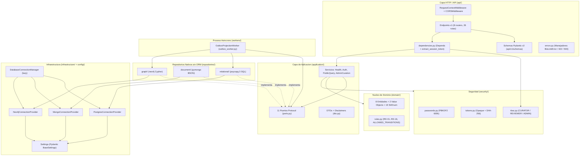
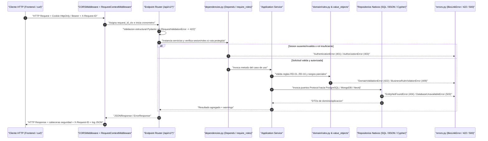
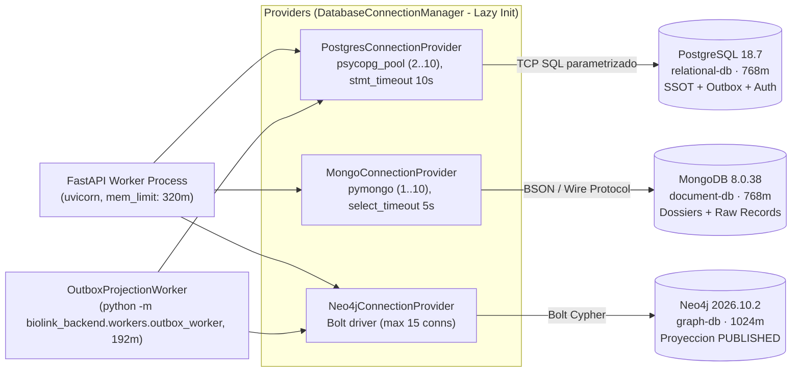

# Arquitectura Técnica del Backend (`02_arquitectura_backend.md`)

**Fecha de corte:** 21 de noviembre de 2026  
**Repositorio analizado:** `biolink-backend` (rama `development`, commit `34c5c2c`)  
**Alcance:** Implementación real en `biolink-backend/src/biolink_backend/`, `biolink-backend/contracts/openapi-v1.json`, `biolink-backend/Dockerfile`, `biolink-backend/docker-compose.yaml` y `biolink-backend/pyproject.toml`.

---

## 1. Arquitectura General y Estado de Implementación

`biolink-backend` implementa un **monolito modular** en Python con separación estricta de capas inspirada en **arquitectura hexagonal (Puertos y Adaptadores)** y acceso **nativo sin ORM** hacia los tres motores de bases de datos. Conforme a la arquitectura SOA de BioLink, la **API REST (`/api/v1`)** reside dentro de este mismo repositorio y el proceso del **Outbox Worker** se ejecuta de forma independiente compartiendo los paquetes de dominio, infraestructura y repositorios.

### Clasificación explícita del alcance implementado

| Componente / Capacidad | Estado | Evidencia en `biolink-backend` |
|---|---|---|
| API REST v1 (`/api/v1`, 26 rutas) y contrato `openapi-v1.json` | **Implementado** | `src/biolink_backend/api/v1/router.py`, `endpoints/*.py`, `contracts/openapi-v1.json` |
| Dominio puro, entidades, value objects, vocabularios y reglas `RD-01`..`RD-16` | **Implementado** | `src/biolink_backend/domain/{entities,value_objects,vocabularies,rules}.py` |
| Servicios `HealthService`, `AuthService`, `PublicQueryService`, `AdminCurationService` | **Implementado** | `src/biolink_backend/application/services/*.py` |
| Repositorios nativos SQL (`psycopg 3`), BSON (`pymongo`) y Cypher (`neo4j`) sin ORM | **Implementado** | `src/biolink_backend/repositories/{relational,document,graph}/*.py` |
| Transactional Outbox Pattern y Worker `OutboxProjectionWorker` | **Implementado** | `repositories/relational/outbox_repository.py`, `workers/outbox_worker.py` |
| Seguridad PBKDF2-HMAC-SHA256, sesiones SHA-256 (`user_session`), RBAC y cabeceras HTTP | **Implementado** | `src/biolink_backend/security/*.py`, `api/{dependencies,middleware}.py` |
| Empaquetado Docker (`Dockerfile` y `docker-compose.yaml` con 5 servicios `<= 3,072 MiB`) | **Implementado** | `Dockerfile`, `docker-compose.yaml`, `config/settings.py` |
| Listado general paginado de fuentes (`GET /api/v1/sources`) y listado SQL directo (`GET /api/v1/interactions`) | **No implementado en V1** | Solo existen `GET /sources/{source_id}`, `GET /interactions/{assertion_id}` y filtrado vía `/network/subgraph` (`OP-05`) |
| Emisión de eventos `ASSERTION_REVISED` y reconciliación de `OP-10` en MongoDB | **Parcialmente implementado** | `ASSERTION_REVISED` existe en `vocabularies.py`/`outbox_worker.py` sin ruta que lo emita; `/admin/reconcile` no resincroniza `raw_source_record.transformation_metadata` |
| Configuraciones de despliegue productivo HTTPS (`APP_ENV=production`, TLS/proxy) | **Pendiente de entorno destino** | Validado por `Settings` (`SESSION_COOKIE_SECURE=true`), sin manifiestos de servidor/proxy productivo en el repo |

---

## 2. Organización de Carpetas y Módulos

```text
biolink-backend/
├── src/biolink_backend/
│   ├── __init__.py
│   ├── main.py                              # Fabrica create_app(), lifespan, CORS, OpenAPI personalizado, entrypoint run()
│   ├── config/
│   │   └── settings.py                      # Settings Pydantic v2 y get_settings() (@lru_cache)
│   ├── shared/
│   │   ├── exceptions.py                    # Jerarquia BioLinkError y mapeo a codigos HTTP
│   │   ├── ids.py                           # Generador prefijado por entidad (ADR-002)
│   │   ├── logging.py                       # StructuredJsonFormatter con X-Request-ID y redaccion
│   │   └── time.py                          # utc_now() y validacion de fechas parciales ISO-8601 (RD-09)
│   ├── domain/
│   │   ├── vocabularies.py                  # 19 StrEnum oficiales del dominio
│   │   ├── value_objects.py                 # PartialDateRange y ChecksumSHA256
│   │   ├── entities.py                      # 8 entidades inmutables (@dataclass frozen/slots)
│   │   └── rules.py                         # Reglas RD-01..RD-16 y ALLOWED_TRANSITIONS
│   ├── application/
│   │   ├── dto.py                           # Dataclasses DTO y 4 constantes DISCLAIMER_*
│   │   ├── ports.py                         # 11 contratos Protocol entre servicios y repositorios
│   │   └── services/
│   │       ├── health_service.py            # Liveness, readiness y diagnostico consolidado
│   │       ├── auth_service.py              # Login interno, sesiones opacas y logout
│   │       ├── public_query_service.py      # Orquestacion OP-01..OP-08 y OP-15
│   │       └── admin_curation_service.py    # Orquestacion OP-09..OP-14, RBAC y /admin/reconcile
│   ├── infrastructure/
│   │   ├── manager.py                       # DatabaseConnectionManager (inicio lazy y cierre ordenado)
│   │   ├── postgresql.py                    # PostgresConnectionProvider (psycopg_pool.ConnectionPool)
│   │   ├── mongodb.py                       # MongoConnectionProvider (MongoClient)
│   │   ├── neo4j.py                         # Neo4jConnectionProvider (GraphDatabase.driver Bolt)
│   │   └── reference_seeder.py              # apply_reference_fixture() multi-modelo
│   ├── repositories/
│   │   ├── relational/                      # SQL nativo (psycopg 3) sin ORM
│   │   │   ├── health_repository.py
│   │   │   ├── auth_repository.py
│   │   │   ├── public_catalog_repository.py
│   │   │   ├── admin_curation_repository.py
│   │   │   └── outbox_repository.py
│   │   ├── document/                        # BSON nativo (pymongo)
│   │   │   ├── health_repository.py
│   │   │   ├── public_dossier_repository.py
│   │   │   └── admin_dossier_repository.py
│   │   └── graph/                           # Cypher nativo (neo4j)
│   │       ├── health_repository.py
│   │       ├── public_network_repository.py
│   │       └── projection_repository.py
│   ├── security/
│   │   ├── passwords.py                     # hash_password / verify_password (PBKDF2-HMAC-SHA256)
│   │   ├── tokens.py                        # generate_session_token / hash_session_token (SHA-256)
│   │   └── rbac.py                          # AuthenticatedUser, ensure_authenticated, ensure_has_any_role
│   ├── api/
│   │   ├── dependencies.py                  # Inyeccion FastAPI Depends() y extract_session_token
│   │   ├── errors.py                        # Manejadores globales BioLinkError, 422 y 500
│   │   ├── middleware.py                    # RequestContextMiddleware (X-Request-ID, seguridad, latencia)
│   │   └── v1/
│   │       ├── router.py                    # Agregador api_v1_router (8 routers)
│   │       ├── schemas/                     # Modelos Pydantic de entrada y salida HTTP
│   │       └── endpoints/                   # Controladores FastAPI v1
│   └── workers/
│       └── outbox_worker.py                 # OutboxProjectionWorker y CLI main()
├── database/                                # Migraciones SQL, schemas JSON MongoDB y scripts Cypher
├── contracts/openapi-v1.json                # Especificacion OpenAPI 3.1.0 exportada
├── tests/                                   # 11 modulos de prueba (41 funciones / 44 casos pytest)
├── docs/                                    # Documentacion interna de arquitectura, config, seguridad, conexiones
├── Dockerfile                               # python:3.14-slim-bookworm con usuario no privilegiado biolink
├── docker-compose.yaml                      # 5 servicios: relational-db, document-db, graph-db, api, worker
├── pyproject.toml                           # Empaquetado setuptools y entrypoints biolink-api / biolink-worker
└── requirements.lock                        # 37 paquetes fijados
```

---

## 3. Responsabilidad de Cada Capa

| Capa | Paquete | Responsabilidad verificada | Restricciones de dependencia |
|---|---|---|---|
| **Presentación HTTP** | `api/` | Enrutamiento `/api/v1`, validación estructural Pydantic, extracción de cookies/tokens, inyección de dependencias (`Depends`), cabeceras de seguridad, CORS y formato uniforme `ErrorResponse`. | No contiene SQL, BSON ni Cypher; delega en `application/services/` y `security/rbac.py`. |
| **Aplicación** | `application/` | Orquesta casos de uso entre los tres motores, define `11` puertos (`Protocol`) y DTOs inmutables, aplica `DISCLAIMER_*` y controla divergencias parciales. | Depende de `domain/`, `security/` y `ports.py`; nunca importa `psycopg`, `pymongo` ni `neo4j`. |
| **Dominio** | `domain/` | Modela entidades puras, value objects, vocabularios y reglas científicas (`RD-01`..`RD-16`, máquina de estados). | Cero dependencias hacia FastAPI, Pydantic HTTP o drivers de bases de datos. |
| **Repositorios** | `repositories/` | Implementa los puertos mediante consultas nativas parametrizadas (`SQL` en `relational/`, `pymongo` en `document/`, `Cypher` en `graph/`) y traduce excepciones nativas a `DatabaseUnavailableError`. | Sin ORM (`SQLAlchemy` prohibido). |
| **Infraestructura** | `infrastructure/` | Administra pools/drivers y ciclo de vida (`DatabaseConnectionManager`), además del seeder `apply_reference_fixture`. | Lee parámetros exclusivamente desde `Settings`. |
| **Seguridad** | `security/` | Hashing salado de contraseñas, generación y digest de tokens de sesión y validación de roles RBAC. | Independiente de FastAPI (invocable desde dependencias y servicios). |
| **Workers** | `workers/` | Ejecuta `OutboxProjectionWorker` como proceso separado del mismo código base consumiendo `PostgresOutboxRepository` y `Neo4jProjectionRepository`. | Comparte código con el backend sin HTTP ni broker externo. |
| **Transversal** | `config/`, `shared/` | Configuración tipada fail-fast, logging JSON con redacción de secretos, excepciones HTTP mapeadas, generador de IDs y manejo temporal parcial. | Disponible para todas las capas. |

### Diagrama 1: Arquitectura interna del backend



---

## 4. Modelos de Dominio (`src/biolink_backend/domain/`)

### 4.1 Entidades inmutables (`entities.py`, `@dataclass(frozen=True, slots=True)`)
1. **`Taxon`:** `taxon_id`, `accepted_name`, `scientific_authorship`, `taxonomic_rank`, `organism_group`, `taxonomic_status`.
2. **`Locality`:** `locality_id`, `name`, `locality_type`, `protected_status`, `spatial_validation_status`, `source_id`, `parent_locality_id`, `coordinate_precision`.
3. **`Source`:** `source_id`, `source_type`, `title`, `authors`, `publication_year`, `citation_text`, `license_id`, `doi`, `uri`.
4. **`Evidence`:** `evidence_id`, `source_id`, `source_locator`, `evidence_kind`, `method_code`, `reported_term`, `summary`, `interpretation_limit`, `period: PartialDateRange`, `license_id`, `source_version_id`.
5. **`InteractionAssertion`:** `assertion_id`, `actor_taxon_id`, `target_taxon_id`, `interaction_type_code`, `locality_id`, `period: PartialDateRange`, `season_label`, `method_code`, `assertion_scope`, `status`, `created_by`, `created_at`, `reviewed_by`, `reviewed_at`.
6. **`ReviewEvent`:** `review_event_id`, `assertion_id`, `user_id`, `previous_status`, `new_status`, `reason`, `created_at`.
7. **`OutboxEvent`:** `outbox_event_id`, `aggregate_type`, `aggregate_id`, `event_type`, `payload_json`, `status`, `attempts`, `created_at`, `aggregate_version`, `payload_version`, `processed_at`, `error_message` *(expone propiedades alias `event_id`, `assertion_id`, `processing_status`, `last_error`)*.
8. **`InternalUser`:** `user_id`, `display_name`, `email`, `is_active`, `roles: frozenset[RoleCode]`.

### 4.2 Value Objects (`value_objects.py`) y Vocabularios (`vocabularies.py`)
- **`PartialDateRange(period_start, period_end)`:** valida formato `YYYY`, `YYYY-MM` o `YYYY-MM-DD` sin inventar días (`RD-09`) y exige `period_end >= period_start`.
- **`ChecksumSHA256(value)`:** normaliza a minúsculas y valida exactamente `64` caracteres hexadecimales (`^[a-fA-F0-9]{64}$`, `RNF-04`).
- **19 `StrEnum` en `vocabularies.py`:** `InteractionTypeCode`, `AssertionStatus`, `EvidenceMethodCode`, `EvidenceKind`, `TaxonomicRank`, `TaxonomicStatus`, `OrganismGroup`, `LocalityType`, `ProtectedStatus`, `SpatialValidationStatus`, `RoleCode`, `OutboxStatus`, `OutboxEventType`, `ImportBatchStatus`, `ImportRecordValidationStatus`, `ProjectionStatus`, `DossierSyncStatus`, `ReviewAction`, `TaxonIdentifierScheme`.

---

## 5. Esquemas HTTP y Validaciones (`api/v1/schemas/` y `application/dto.py`)

FastAPI utiliza **Pydantic v2** en `api/v1/schemas/` para validar tanto el cuerpo JSON como las respuestas serializadas desde los DTOs internos mediante `model_validate(asdict(...))`:

- **`common.py`:** `ErrorDetail` (`code`, `message`, `details`, `request_id`) y `ErrorResponse`.
- **`health.py`:** `EngineHealthSchema`, `LivenessResponse` (`status: "alive"`), `ReadinessResponse` (`"ready" | "not_ready"`) y `ConsolidatedHealthResponse` (`"ok" | "degraded"`, `memory_budget_mb`).
- **`public_queries.py`:** `PaginationMeta`, `TaxonSummarySchema`, `TaxonSearchResponse`, `TaxonNameSchema`, `TaxonIdentifierSchema`, `TaxonDossierClaimSchema`, `TaxonDossierMediaSchema`, `TaxonDossierSchema`, `TaxonDetailResponse`, `LocalitySummarySchema`, `SourceSummarySchema`, `InteractionListItemSchema`, `TaxonInteractionsResponse`, `EvidenceDetailSchema`, `RawSourceReferenceSchema`, `StudyDossierSchema`, `InteractionDetailResponse`, `SubgraphNodeSchema`, `SubgraphEdgeSchema`, `SubgraphResponse`, `LocalityNetworkMetricsSchema`, `SharedInteractionPairSchema`, `LocalityComparisonResponse`, `PartnerConnectivitySchema`, `ConnectivityResponse`, `SourceVersionSchema`, `SourceDetailResponse`, `OccurrenceItemSchema`, `OccurrenceListResponse`.
- **`admin_curation.py`:**
  - Auth: `LoginRequestSchema` (`email` `4..255`, `password` `8..256`), `AuthenticatedUserSchema`, `AuthSessionResponseSchema` (`token_type: "Bearer"`), `LogoutResponseSchema`.
  - `OP-09`: `ImportRecordCreateSchema` (`raw_payload` con `min_length=1`), `ImportBatchCreateRequestSchema` (`records` `1..500`, `release_date` patrón `^\d{4}-\d{2}-\d{2}$`), `ImportRecordResponseSchema`, `ImportBatchResponseSchema`, `ImportBatchDetailResponseSchema`.
  - `OP-10`: `NormalizeImportRecordRequestSchema` (`validation_status` en `VALID | INVALID | UNRESOLVED | DUPLICATE`, `matching_rule` `2..128`), `NormalizeImportRecordResponseSchema`.
  - `OP-11`/`OP-12`: `AssertionEvidenceInputSchema`, `CreateAssertionRequestSchema` (`evidences` `min_length=1`, `initial_status` en `DRAFT | IN_REVIEW`), `SubmitAssertionRequestSchema` (`reason` `3..1000`), `ReviewAssertionRequestSchema` (`action` en `APPROVE | REJECT | WITHDRAW | REOPEN`, `reason` `3..2000`), `OutboxEventSchema`, `ReviewEventSchema`, `AdminAssertionResponseSchema`, `ReviewAssertionResponseSchema`.
  - `OP-13`: `DossierClaimInputSchema`, `DossierMediaInputSchema` (`media_type` en `image | audio | video | document`), `UpdateTaxonDossierRequestSchema` (`summary_source_refs` `min_length=1`, `expected_version >= 0`), `TaxonDossierVersionSchema`, `UpdateTaxonDossierResponseSchema`.
  - `OP-14` y Reconciliación: `AuditLogEntrySchema`, `ProvenanceHistoryResponseSchema`, `ReconciliationResponseSchema`.

---

## 6. Servicios de Aplicación (`application/services/`)

1. **`HealthService` (`health_service.py`):**
   - `check_liveness()`: verifica el proceso FastAPI y calcula `uptime_seconds` con `time.monotonic()` sin consultar bases de datos.
   - `check_readiness()`: consulta `check_health()` en los tres motores; retorna `ready=True` solo si todos reportan `healthy=True`.
   - `check_consolidated()`: combina liveness, readiness y `settings.memory_budget_summary()`.
2. **`AuthService` (`auth_service.py`):**
   - `authenticate_internal_user()`: consulta usuario por email, verifica contraseña con PBKDF2 en tiempo constante, valida `is_active`, genera token de 256 bits, almacena su SHA-256 en `user_session` con expiración configurable (`SESSION_TTL_HOURS=12`).
   - `resolve_session()` y `logout()`: validan o revocan el token por su digest SHA-256 en `user_session`.
3. **`PublicQueryService` (`public_query_service.py`):**
   - Coordina `OP-01` (`search_taxa`), `OP-02` (`get_taxon_fiche` integrando PostgreSQL + MongoDB con advertencias de rango taxonómico), `OP-03` (`list_taxon_interactions` Neo4j + validación autoritativa en PostgreSQL), `OP-04` (`get_interaction_detail` PostgreSQL + `study_dossier` + `raw_source_reference` redactado + bandera `graph_projected` en Neo4j), `OP-05` (`filter_documented_subgraph` Neo4j + PostgreSQL + conteo separado de indeterminadas), `OP-06` (`compare_localities` Neo4j + PostgreSQL), `OP-07` (`calculate_descriptive_connectivity` Neo4j + PostgreSQL), `OP-08` (`get_source_detail` PostgreSQL + MongoDB) y `OP-15` (`list_occurrences` PostgreSQL + referencia cruda opcional con `is_interaction_evidence=False`).
4. **`AdminCurationService` (`admin_curation_service.py`):**
   - Aplica control RBAC en servicio (`ensure_has_any_role`) adicional al nivel HTTP para `register_import_batch` (`OP-09`), `get_import_batch_detail`, `list_import_records`, `normalize_import_record` (`OP-10`), `create_assertion` (`OP-11`), `get_assertion_detail`, `submit_assertion_for_review`, `review_assertion` (`OP-12`), `update_taxon_dossier` (`OP-13`, con manejo controlado de divergencia `PENDING_RECONCILIATION`), `get_provenance_history` (`OP-14`) y `reconcile_system_state`.

### Diagrama 2: Flujo de una solicitud desde la API hasta los repositorios



---

## 7. Repositorios y Puertos (`application/ports.py` y `repositories/`)

El archivo `ports.py` define **11 contratos `Protocol`** implementados por **11 clases repositorio concretas** sin ORM:

| Paradigma | Puerto(s) implementado(s) | Repositorio concreto | Responsabilidad verificada |
|---|---|---|---|
| **Relacional (PostgreSQL)** | `RelationalHealthPort` | `PostgresHealthRepository` | Ejecuta `SELECT 1 AS ok, current_setting('server_version') AS version`. |
| **Relacional (PostgreSQL)** | `AuthRepositoryPort` | `PostgresAuthRepository` | Consulta `app_user` + `user_role`, crea/revoca `user_session` y registra `audit_log` (`LOGIN`/`LOGOUT`). |
| **Relacional (PostgreSQL)** | `CatalogRelationalPort` | `PostgresPublicCatalogRepository` | Búsqueda ILIKE en `taxon`/`taxon_name`/`taxon_identifier` (`OP-01`), detalle `PUBLISHED` (`get_published_assertions_by_ids`), evidencias, fuentes, ocurrencias y conteo de localidades indeterminadas. |
| **Relacional (PostgreSQL)** | `AdminRelationalPort` | `PostgresAdminCurationRepository` | Transacciones ACID para `OP-09`..`OP-14`, `FOR UPDATE OF ir/ia`, `review_event`, inserción de `outbox_event`, `audit_log` y reconstrucción de procedencia (`OP-14`). |
| **Relacional (PostgreSQL)** | `OutboxRepositoryPort` | `PostgresOutboxRepository` | `claim_pending_events` (`FOR UPDATE SKIP LOCKED`), `mark_processed`, `mark_failed`, `reset_failed_and_dead_letter_events` y `list_events_for_aggregate`. |
| **Documental (MongoDB)** | `DocumentHealthPort` | `MongoHealthRepository` | Ejecuta `db.command("ping")` y `server_info()`. |
| **Documental (MongoDB)** | `DossierDocumentPort` | `MongoPublicDossierRepository` | Lee `taxon_dossier`, `taxon_dossier_versions` (conteo), `study_dossier` y `raw_source_record` (ocultando `raw_payload` si `redistribution_permitted == False`). |
| **Documental (MongoDB)** | `AdminDocumentPort` | `MongoAdminDossierRepository` | Inserta `raw_source_record` con SHA-256 (`OP-09`), actualiza solo `transformation_metadata` (`OP-10`), archiva snapshot previo y aplica reemplazo optimista en `taxon_dossier` (`OP-13`). |
| **Grafo (Neo4j)** | `GraphHealthPort` | `Neo4jHealthRepository` | Ejecuta `RETURN 1 AS ok` y `CALL dbms.components()`. |
| **Grafo (Neo4j)** | `NetworkGraphPort` | `Neo4jPublicNetworkRepository` | Consultas Cypher de vecindario paginado (`OP-03`), subgrafo `1..3` saltos (`OP-05`), aserciones por localidad (`OP-06`), conectividad (`OP-07`) y existencia de proyección (`is_assertion_projected`). |
| **Grafo (Neo4j)** | `GraphProjectionPort` | `Neo4jProjectionRepository` | Proyección idempotente `MERGE` (`WHERE status = 'PUBLISHED'`), retiro puntual `DETACH DELETE`, retiro masivo `IN TRANSACTIONS OF 1000 ROWS` y reconciliación por diferencia de conjuntos. |

---

## 8. Conexiones con PostgreSQL, MongoDB y Neo4j (`infrastructure/`)

`DatabaseConnectionManager` (`infrastructure/manager.py`) adopta **inicialización perezosa (`lazy`)** en `startup()` para evitar abrir sockets antes de que un endpoint o worker los utilice, y cierra los tres proveedores de forma controlada en `shutdown()`.

| Motor | Proveedor (`infrastructure/`) | Librería y Pool | Parámetros por defecto verificados (`config/settings.py`) |
|---|---|---|---|
| **PostgreSQL 18.7** | `PostgresConnectionProvider` (`postgresql.py`) | `psycopg_pool.ConnectionPool` (`row_factory=dict_row`, `open=False`) | `min_size=2`, `max_size=10`, `connect_timeout=5.0 s`, `statement_timeout=10,000 ms` por sesión. |
| **MongoDB 8.0.38** | `MongoConnectionProvider` (`mongodb.py`) | `pymongo.MongoClient` | `minPoolSize=1`, `maxPoolSize=10`, `connectTimeoutMS=5000`, `serverSelectionTimeoutMS=5000`, `socketTimeoutMS=10000`, `authSource=admin`. |
| **Neo4j 2026.10.2** | `Neo4jConnectionProvider` (`neo4j.py`) | `neo4j.GraphDatabase.driver` (`bolt://`) | `max_connection_pool_size=15`, `connection_timeout=5.0 s`, `max_transaction_retry_time=15.0 s`. |

### Diagrama 3: Interacción del backend con los tres motores



---

## 9. Configuración y Variables de Entorno (`config/settings.py`)

La clase `Settings(BaseSettings)` carga variables desde `.env` (UTF-8, insensible a mayúsculas) y ejecuta **validación fail-fast al arranque**:

- **Aplicación y Red:** `APP_NAME` (`biolink-backend`), `APP_ENV` (`development | test | staging | production`), `APP_VERSION` (`0.1.0`), `API_V1_PREFIX` (`/api/v1`), `LOG_LEVEL`, `LOG_FORMAT` (`json | text`), `BACKEND_HOST` (`127.0.0.1`), `BACKEND_PORT` (`8000`), `CORS_ALLOWED_ORIGINS` (acepta CSV o lista JSON; **prohíbe el comodín `*`** y exige esquema `http://` o `https://`).
- **Seguridad:** `AUTH_SECRET_KEY` (`SecretStr`, longitud mínima `32` caracteres), `SESSION_COOKIE_NAME` (`biolink_session`), `SESSION_TTL_HOURS` (`12`, rango `1..168`), `SESSION_COOKIE_SECURE` (`false` por defecto).
- **Motores y Worker Outbox:**
  - PostgreSQL: `POSTGRES_HOST`, `POSTGRES_PORT` (`5432`), `POSTGRES_DB` (`biolink`), `POSTGRES_USER` (`biolink_app`), `POSTGRES_PASSWORD`, `POSTGRES_POOL_MIN_SIZE` (`2`), `POSTGRES_POOL_MAX_SIZE` (`10`), `POSTGRES_CONNECT_TIMEOUT_SEC` (`5.0`), `POSTGRES_STATEMENT_TIMEOUT_MS` (`10000`).
  - MongoDB: `MONGODB_HOST`, `MONGODB_PORT` (`27017`), `MONGODB_DB` (`biolink_documents`), `MONGODB_USER` (`biolink_app`), `MONGODB_PASSWORD`, `MONGODB_AUTH_SOURCE` (`admin`), `MONGODB_MIN_POOL_SIZE` (`1`), `MONGODB_MAX_POOL_SIZE` (`10`), `MONGODB_CONNECT_TIMEOUT_MS` (`5000`), `MONGODB_SERVER_SELECTION_TIMEOUT_MS` (`5000`), `MONGODB_SOCKET_TIMEOUT_MS` (`10000`).
  - Neo4j: `NEO4J_HOST`, `NEO4J_BOLT_PORT` (`7687`), `NEO4J_HTTP_PORT` (`7474`), `NEO4J_USER` (`neo4j`), `NEO4J_PASSWORD`, `NEO4J_MAX_CONNECTION_POOL_SIZE` (`15`), `NEO4J_CONNECTION_TIMEOUT_SEC` (`5.0`), `NEO4J_MAX_TRANSACTION_RETRY_TIME_SEC` (`15.0`), además de memoria JVM `NEO4J_HEAP_INITIAL` (`256m`), `NEO4J_HEAP_MAX` (`384m`), `NEO4J_PAGECACHE` (`256m`), `NEO4J_TX_TOTAL_MAX` (`256m`) y `NEO4J_TX_MAX` (`64m`).
  - Worker Outbox: `OUTBOX_POLL_INTERVAL_SEC` (`2.0`, rango `> 0.1` y `<= 300.0`), `OUTBOX_BATCH_SIZE` (`50`, rango `1..500`), `OUTBOX_MAX_ATTEMPTS` (`5`, rango `1..50`).
- **Regla de presupuesto de memoria (4,096 MiB):**
  - `BACKEND_MEM_LIMIT_MB` (`320`) + `WORKER_MEM_LIMIT_MB` (`192`) `<= 512 MiB`.
  - `POSTGRES_MEM_LIMIT_MB` (`768` max `768`), `MONGODB_MEM_LIMIT_MB` (`768` max `768`), `NEO4J_MEM_LIMIT_MB` (`1024` max `1024`).
  - Suma total de los 5 contenedores `<= 3,072 MiB` (preservando `>= 1,024 MiB` para el host).
- **Imágenes Docker:** `POSTGRES_IMAGE`, `MONGODB_IMAGE`, `NEO4J_IMAGE` rechazan `:latest` y etiquetas sin versión explícita (`_reject_latest_tag`).
- **Endurecimiento en `APP_ENV=production`:** rechaza marcadores de ejemplo (`CHANGE_ME`, `REPLACE_WITH`, `DEV_ONLY`) en secretos/contraseñas y exige `SESSION_COOKIE_SECURE=true`.
- **Enmascaramiento:** `postgres_masked_dsn`, `mongodb_masked_uri` y `StructuredJsonFormatter` redactan (`***REDACTED***`) claves que contengan `password`, `token`, `secret`, `authorization` o `cookie`.

---

## 10. Manejo de Errores (`shared/exceptions.py` y `api/errors.py`)

Toda excepción controlada o de validación produce el esquema JSON uniforme `ErrorResponse` (`{"error": {"code", "message", "details", "request_id"}}`):

| Excepción Python / Origen | Código HTTP | `error.code` devuelto | Nivel de log |
|---|---|---|---|
| `DomainValidationError` | `422` | `DOMAIN_VALIDATION_ERROR` | Warning |
| `RequestValidationError` (FastAPI/Pydantic) | `422` | `REQUEST_VALIDATION_ERROR` | *(validación de entrada HTTP)* |
| `BusinessRuleViolationError(rule_id, ...)` | `409` | `RULE_VIOLATION_RD_XX` (ej. `RULE_VIOLATION_RD_02`) | Warning |
| `EntityNotFoundError` | `404` | `ENTITY_NOT_FOUND` | Warning |
| `AuthenticationError` | `401` | `AUTHENTICATION_REQUIRED` | Warning |
| `AuthorizationError` | `403` | `AUTHORIZATION_DENIED` | Warning |
| `DatabaseUnavailableError` | `503` | `DATABASE_UNAVAILABLE` (`details.engine`) | Error |
| `Exception` no controlada | `500` | `INTERNAL_SERVER_ERROR` | Error con traceback (`logger.exception`) |

---

## 11. Validaciones y Reglas de Negocio (`domain/rules.py` y aplicación)

| Regla | Significado en el dominio | Dónde se aplica en código real |
|---|---|---|
| **`RD-01`, `RD-06`** | Presencia/ocurrencia no equivale a interacción. | `ensure_not_occurrence_only` (`rules.py`), `is_interaction_evidence=False` en `occurrence` (`public_catalog_repository.py`), `DISCLAIMER_OCCURRENCE_NOT_INTERACTION`. |
| **`RD-02`** | Afirmación publicada o actualización de ficha exige evidencia/fuente verificable. | `validate_publication_requirements` (`rules.py`), `PublicQueryService.get_interaction_detail`, `AdminCurationService.update_taxon_dossier`, `Neo4jProjectionRepository.project_assertion`. |
| **`RD-03`** | Actor distinto de objetivo y en V1 `ANIMAL -> PLANT`. | `validate_v1_actor_target_groups` (`rules.py`) + `CHECK (actor_taxon_id != target_taxon_id)` en PostgreSQL. |
| **`RD-04`, `RD-05`** | Frugivoría/remoción según fuente sin inferir dispersión efectiva en V1. | `validate_interaction_type_for_v1` bloquea `DISPERSES_SEEDS_OF` (`rules.py`), `DISCLAIMER_FRUGIVORY_NO_DISPERSAL`. |
| **`RD-07`, `RD-08`** | Separación Montes Azules (`INSIDE_ANP`) vs. Playón de la Gloria (`OUTSIDE_ANP`) e indeterminadas aparte. | `PublicQueryService.filter_documented_subgraph` y `compare_localities`, `count_undetermined_published_assertions`, `DISCLAIMER_LOCALITY_SEPARATION`. |
| **`RD-09`** | Fechas ISO parciales (`YYYY`, `YYYY-MM`, `YYYY-MM-DD`) sin inventar días. | `PartialDateRange` (`value_objects.py`), `validate_partial_iso_date` y `partial_date_upper_bound` (`shared/time.py`). |
| **`RD-10` (y preservación nominal)** | Preservar rango taxonómico original (`GENUS`, `MORPHOSPECIES`) y sinónimos/grafías (`RD-11` funcional). | `get_taxon_fiche` emite aviso explícito `RD-10`; `search_taxa` busca en `taxon`, `taxon_name` (`SYNONYM`, `VERBATIM_ORIGINAL`) y `taxon_identifier` *(nota: las cadenas `RD-01`..`RD-10`, `RD-12`..`RD-16`, `RNF-04` y `RNF-08` aparecen explícitamente en `src/`, mientras la trazabilidad de sinónimos opera sin etiqueta `RD-11` explícita en código)*. |
| **`RD-12`** | Conectividad descriptiva != abundancia poblacional. | `calculate_descriptive_connectivity` separa `distinct_partner_taxa_count` de `documented_assertions_count` + `DISCLAIMER_CONNECTIVITY_NOT_ABUNDANCE`. |
| **`RD-13`** | Flujo editorial controlado (`DRAFT -> IN_REVIEW -> PUBLISHED/REJECTED`, `PUBLISHED -> WITHDRAWN`) y prohibición de autopublicación. | `ALLOWED_TRANSITIONS` + `validate_state_transition` (`rules.py`); `auto_publish=True` rechazado en `create_import_batch` (`OP-09`); restricción `OP-11` (`DRAFT` o `IN_REVIEW`). |
| **`RD-14`** | Unicidad y consistencia de identificadores externos. | `uq_taxon_identifier_scheme_id` en PostgreSQL + verificación en `normalize_import_record` (`OP-10`). |
| **`RD-15`** | Control optimista de versiones en `taxon_dossier`. | Verificación de `expected_version` y `replace_one({"_id", "document_version"})` en `update_taxon_dossier_versioned` (`admin_dossier_repository.py`). |
| **`RD-16`** | Solo afirmaciones `PUBLISHED` se proyectan a Neo4j. | `should_project_to_graph` (`rules.py`) y guarda `WHERE st = 'PUBLISHED'` en `Neo4jProjectionRepository.project_assertion`. |
| **`RNF-04`, `RNF-08`** | Inmutabilidad SHA-256 de registros crudos y protección de licencias no redistribuibles. | `ChecksumSHA256`, actualización exclusiva de `transformation_metadata` (`OP-10`) y ocultamiento de `raw_payload` cuando `redistribution_permitted == False`. |

---

## 12. Procesos Asíncronos y Workers (`workers/outbox_worker.py`)

Aunque los controladores HTTP de FastAPI están definidos como funciones síncronas (`def`) sobre drivers síncronos (`psycopg`, `pymongo`, `neo4j`), el repositorio sí implementa un **proceso worker asíncrono desacoplado** respecto al flujo HTTP transaccional:

- **Ejecutable:** `python -m biolink_backend.workers.outbox_worker` (también script `biolink-worker` en `pyproject.toml` y servicio `worker` en `docker-compose.yaml` con límite `192 MiB`).
- **Ciclo de procesamiento (`OutboxProjectionWorker`):**
  1. **Reclamo concurrente seguro:** `claim_pending_events(limit=OUTBOX_BATCH_SIZE, max_attempts=OUTBOX_MAX_ATTEMPTS)` utiliza `FOR UPDATE SKIP LOCKED` sobre eventos en `'PENDING'` o `'FAILED'` con `attempts < 5`, pasando su estado a `'PROCESSING'`.
  2. **Deduplicación intra-lote:** evita aplicar repetidamente una misma tupla `(aggregate_id, aggregate_version, event_type)`.
  3. **Aplicación en Neo4j:** `ASSERTION_PUBLISHED` / `ASSERTION_REVISED` llaman a `project_assertion`; `ASSERTION_WITHDRAWN` llama a `withdraw_assertion`.
  4. **Confirmación o fallo controlado:** si Neo4j confirma, `mark_processed` actualiza `outbox_event` a `'PROCESSED'` y `interaction_assertion.projection_status` a `'SYNCED'`. Si falla (por ejemplo, caída de Neo4j), `mark_failed` incrementa `attempts`, guarda `error_message`, marca `interaction_assertion.projection_status = 'FAILED'` y pasa el evento a `'FAILED'` (o `'DEAD_LETTER'` al alcanzar `max_attempts`).
  5. **Resiliencia del bucle (`run_forever`):** ante fallos aplica backoff exponencial `min(poll_interval_sec * 2^(failures - 1), 30.0)` y escucha señales `SIGINT`/`SIGTERM` para cierre limpio de pools.
- **Reconciliación manual (`POST /api/v1/admin/reconcile`):** ejecuta `reset_failed_and_dead_letter_events()` + `drain_once(max_batches=20)` + `reconcile_from_source_of_truth()`.

### Diagrama 4: Publicación de una interacción hacia Neo4j (Transactional Outbox + Worker)

```mermaid
sequenceDiagram
    autonumber
    participant REV as "Revisor (REVIEWER)"
    participant API as "POST /api/v1/admin/assertions/{id}/review"
    participant PG as "PostgreSQL 18.7"
    participant WRK as "OutboxProjectionWorker"
    participant NEO as "Neo4j 2026.10.2"

    REV->>API: "{ action: 'APPROVE', reason: '...' }"
    API->>PG: "BEGIN; SELECT ... FOR UPDATE OF ia"
    Note over API: "Valida RD-13 (IN_REVIEW -> PUBLISHED)<br/>y RD-02 (>= 1 evidencia + reviewed_by)"
    API->>PG: "UPDATE interaction_assertion (PUBLISHED, version+1, projection_status='PENDING')"
    API->>PG: "INSERT review_event + INSERT outbox_event (ASSERTION_PUBLISHED, PENDING) + audit_log"
    PG-->>API: "COMMIT"
    API-->>REV: "200 OK (relational_committed=true, projection_status='PENDING')"

    WRK->>PG: "claim_pending_events (FOR UPDATE SKIP LOCKED) -> PROCESSING"
    alt Neo4j disponible
        WRK->>NEO: "MERGE Taxon, Locality, Source, Evidence, InteractionAssertion y relaciones"
        NEO-->>WRK: "projected_assertion_id"
        WRK->>PG: "mark_processed -> outbox='PROCESSED', projection_status='SYNCED'"
    else Neo4j no disponible
        NEO-->>WRK: "DriverError / Neo4jError"
        WRK->>PG: "mark_failed -> attempts+1, status='FAILED'/'DEAD_LETTER', projection_status='FAILED'"
    end
```

---

## 13. Seguridad y Autenticación Implementadas

- **Sin registro público en V1:** las cuentas internas (`USR_*`) existen en `app_user` y roles `role` (`CURATOR`, `REVIEWER`, `ADMIN`) en PostgreSQL.
- **Hashing de contraseñas (`security/passwords.py`):** `PBKDF2-HMAC-SHA256` con `600,000` iteraciones, salt aleatorio de `16 bytes` (`secrets.token_bytes(16)`), clave derivada de `32 bytes` y comparación en tiempo constante (`hmac.compare_digest`).
- **Sesiones stateful sin `localStorage` (`security/tokens.py`, `auth_service.py`, `api/endpoints/auth.py`):**
  - Token opaco de 256 bits (`secrets.token_urlsafe(32)`).
  - En PostgreSQL (`user_session`) se almacena únicamente el hash **SHA-256** (`token_hash`) junto a `ip_address`, `user_agent`, `expires_at` y `revoked_at`.
  - El endpoint `/auth/login` emite cookie **`HttpOnly`**, `SameSite=lax`, `Secure=SESSION_COOKIE_SECURE` y también retorna `access_token` en cuerpo JSON para clientes programáticos (`extract_session_token` acepta `Authorization: Bearer <token>` o cookie).
- **Autorización RBAC en doble capa:** dependencia FastAPI `require_roles(...)` más validación en `AdminCurationService` (`ensure_has_any_role`). Un `CURATOR` recibe `403` si intenta aprobar/revisar (`OP-12`); un `REVIEWER` recibe `403` si intenta importar, normalizar, crear afirmaciones o editar fichas (`OP-09`, `OP-10`, `OP-11`, `OP-13`).
- **Endurecimiento HTTP (`middleware.py` y `main.py`):** propaga `X-Request-ID`, agrega `X-Content-Type-Options: nosniff`, `X-Frame-Options: DENY`, `Referrer-Policy: strict-origin-when-cross-origin`, `Cache-Control: no-store` y aplica `CORSMiddleware` solo sobre orígenes explícitos en `CORS_ALLOWED_ORIGINS` (`allow_credentials=True`).
