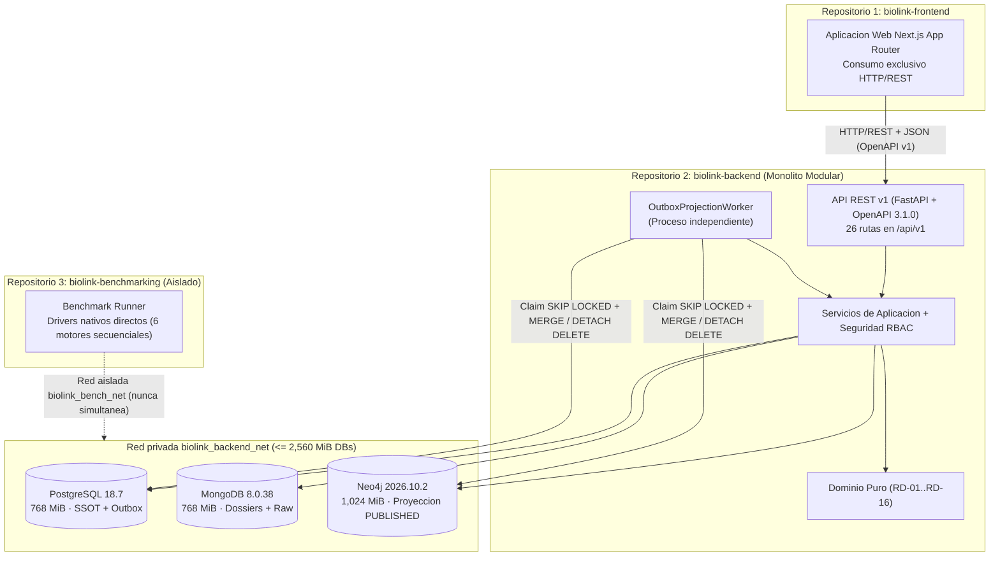

# Informe Técnico y Académico de BioLink — Borrador de Capítulos Estables (`05_borrador_capitulos_estables.md`)

> [!WARNING]
> **Documento en desarrollo (corte al 21 de noviembre de 2026) — No constituye versión final cerrada.**  
> Este documento redacta formalmente los **12 capítulos cuyo respaldo documental, arquitectónico, de implementación o experimental ya es verificable** dentro de los tres repositorios oficiales (`biolink-backend`, `biolink-frontend` y `biolink-benchmarking`). Las secciones correspondientes al diseño definitivo del frontend, su implementación final, la integración sin *mocks*, el despliegue productivo, las pruebas en el entorno desplegado y el manual de usuario final se mantienen **explícitamente marcadas como provisionales y pendientes**. No se declara el proyecto completamente terminado.

---

## Capítulo 1. Introducción

La gestión de datos sobre biodiversidad e interacciones ecológicas enfrenta un reto estructural doble: por un lado, requiere rigor científico para preservar la procedencia bibliográfica, las condiciones espaciales y temporales de muestreo y los límites metodológicos de cada observación; por otro, demanda modelos de almacenamiento capaces de sostener simultáneamente integridad referencial transaccional, descripciones taxonómicas y metodológicas de estructura variable y recorridos eficientes sobre redes de interacción.

En el marco del proyecto integrador *Diseño, desarrollo e integración de tres modelos de bases de datos* de la **Universidad Politécnica de Chiapas (2026)**, se concibe **BioLink** como una plataforma académica orientada a consultar, curar y explorar interacciones ecológicas documentadas entre animales y plantas, tomando como núcleo inicial la evidencia publicada sobre frugivoría —consumo y remoción de frutos por murciélagos filostómidos y mamíferos terrestres— en el sector sur de la **Reserva de la Biosfera Montes Azules (Chiapas)**, contrastada con una localidad comparativa externa en el **Ejido Playón de la Gloria**.

Lejos de fragmentar artificialmente una tabla única en tres motores, BioLink asigna responsabilidades complementarias a cada paradigma de persistencia bajo una arquitectura orientada a servicios (**SOA**) dividida en tres repositorios independientes: `biolink-backend` (monolito modular en Python/FastAPI con acceso nativo sin ORM a PostgreSQL, MongoDB y Neo4j más un *worker* asíncrono), `biolink-frontend` (cliente web desacoplado que consume exclusivamente HTTP/REST OpenAPI v1) y `biolink-benchmarking` (entorno autónomo de evaluación empírica directa de seis motores candidatos). El presente borrador consolida los capítulos estables del informe académico hasta la fase actual de desarrollo e identifica con transparencia las brechas pendientes antes de su cierre definitivo.

---

## Capítulo 2. Planteamiento del Problema

### 2.1 Problema científico y documental en estudios de frugivoría

La información ecológica relativa a especies e interacciones planta-animal se encuentra dispersa entre artículos científicos arbitrados, tesis, catálogos taxonómicos, repositorios de ocurrencias (como EncicloVida o GBIF) y agregadores de interacciones bióticas (como GloBI). Cuando estos insumos se consolidan sin controles semánticos estrictos surgen cinco problemas documentales críticos:

1. **Confusión entre presencia e interacción ecológica (`RD-01`, `RD-06`):** el registro de ocurrencia de una especie animal y una especie vegetal en una misma región no demuestra interacción trófica. De igual modo, detectar un mamífero cruzando frente a una cámara trampa instalada bajo un árbol focal no equivale a documentar consumo ni remoción de frutos.
2. **Mezcla indebida de contextos geográficos (`RD-07`, `RD-08`):** en estudios locales de la Selva Lacandona coexisten registros obtenidos dentro del polígono de la Reserva de la Biosfera Montes Azules y registros procedentes de sitios externos colindantes o cercanos, como el Ejido Playón de la Gloria. Agregarlos bajo una sola etiqueta geográfica distorsiona los análisis ecológicos y atribuye al área natural protegida evidencia externa a ella.
3. **Sobreinterpretación metodológica (`RD-04`, `RD-05`):** la recuperación de semillas en excretas documenta ingestión y excreción, y una grabación o observación agrupada como consumo o remoción de fruto no siempre permite distinguir ambos comportamientos; transformar automáticamente esas observaciones en "dispersión efectiva" o "establecimiento de plántulas" introduce inferencias no respaldadas por la fuente.
4. **Pérdida de resolución taxonómica y sinonimia (`RD-10`, `RD-11`, `RD-14`):** los estudios de campo incluyen identificaciones a nivel de género (*Ficus* sp., *Clidemia* sp.), morfoespecies (*Piper* sp. morfoespecie 2 y 3) y grafías o sinónimos antiguos (como *Sturnira parvidens* respecto a *Sturnira lilium*). Forzar resoluciones a nivel de especie o sobrescribir el nombre original de la fuente rompe la auditabilidad científica.
5. **Ausencia de trazabilidad granular e interpretaciones sesgadas (`RD-02`, `RD-12`):** sin referencias explícitas a tabla, página o figura, un estudiante o investigador no puede verificar si el conteo de interacciones refleja riqueza de socios documentados o una intensidad de muestreo desigual.

### 2.2 Problema de ingeniería de datos

Desde el punto de vista de ingeniería de software y bases de datos, atender simultáneamente los requisitos del dominio expone las limitaciones de utilizar un único paradigma de persistencia:

- Un **modelo exclusivamente relacional** administra con solidez cuentas, roles, importaciones, estados de revisión y claves foráneas, pero obliga a normalizar en tablas rígidas o columnas genéricas atributos ecológicos y morfológicos heterogéneos entre grupos biológicos, expedientes metodológicos de estudios y cargas útiles originales (*payloads*) de proveedores externos. Asimismo, expresar recorridos de subredes multi-salto requiere uniones recursivas costosas y poco naturales frente a consultas sobre grafos.
- Un **modelo exclusivamente documental** facilita conservar expedientes flexibles y payloads crudos, pero carece de la red de restricciones referenciales fuertes, llaves foráneas cruzadas y controles de transición editorial propios de un sistema autoritativo transaccional, además de no estar optimizado para exploraciones topológicas multi-salto.
- Un **modelo exclusivamente orientado a grafos** sobresale en recorridos de vecindarios, conectividad y filtrado de subredes, pero no sustituye un libro maestro transaccional auditable para gestión de usuarios, lotes de importación, licenciamiento y control de borradores frente a versiones públicas, ni ofrece validación documental jerárquica para expedientes descriptivos extensos.

En consecuencia, el problema técnico central consiste en **diseñar, justificar empíricamente e implementar una arquitectura híbrida en tres motores** donde exista una única fuente de verdad autoritativa por tipo de dato, sincronización explícita y reproducible ante fallos parciales, y una frontera API REST que oculte los motores físicos al cliente final dentro de un presupuesto estricto de memoria de **4,096 MiB (4 GiB)**.

---

## Capítulo 3. Justificación

### 3.1 Pertinencia académica y científica

BioLink responde a la necesidad de contar con una plataforma docente y de consulta bibliográfica donde cada arista ecológica presentada al público esté respaldada por evidencia verificable y conserve sus advertencias metodológicas. Permite a estudiantes explorar ejemplos reales de redes de frugivoría en Chiapas sin confundir consumo con germinación exitosa; a docentes exponer diferencias documentadas entre localidades dentro y fuera del área protegida; a investigadores inspeccionar citas, localizadores y límites interpretativos por estudio; y a curadores o revisores incorporar nuevos registros mediante un flujo editorial controlado que impide la autopublicación automática.

### 3.2 Prueba de suficiencia de los tres paradigmas de persistencia

De acuerdo con la *Guía del Proyecto Final* (§4.2) y el análisis realizado en la Etapa 1 (`01_etapa_1_biolink.md`, §11), se justifica la participación simultánea de los tres modelos evaluando qué capacidad esencial se degrada si se suprime alguno de ellos:

- **Si se elimina el modelo relacional:** se pierde el control transaccional ACID sobre identidades taxonómicas canónicas, usuarios, sesiones, lotes de importación, restricciones de evidencia obligatoria (`RD-02`), máquina de estados editoriales (`RD-13`) y bitácora de auditoría e historial de revisión.
- **Si se elimina el modelo documental:** se fuerza la heterogeneidad de fichas biológicas (`taxon_dossier`), diseños metodológicos (`study_dossier`) y registros crudos de proveedores externos (`raw_source_record`) dentro de esquemas tabulares rígidos o se pierde la conservación íntegra e inmutable del payload original (`RNF-04`).
- **Si se elimina el modelo de grafo:** la exploración de vecindarios de un taxón (`OP-03`), la construcción de subredes multi-salto (`OP-05`) y el cálculo descriptivo de socios taxonómicos distintos (`OP-07`) degeneran en auto-uniones repetidas sobre tablas de afirmaciones sin explotar la representación nativa de nodos y aristas dirigidas.

Adicionalmente, la incorporación de una etapa experimental previa en `biolink-benchmarking` justifica la selección tecnológica de los motores con métricas reales de latencia, memoria y estabilidad bajo restricción de 4 GiB, evitando elegir productos por preferencia subjetiva.

---

## Capítulo 4. Objetivos

### 4.1 Objetivo general

Desarrollar una plataforma que integre y permita explorar información taxonómica y relaciones ecológicas documentadas, preservando la procedencia, el contexto espacial y temporal, el método de observación y el nivel de evidencia de cada registro (`01_etapa_1_biolink.md`, §2.2).

### 4.2 Objetivos específicos

1. **OE-1:** Reunir referencias taxonómicas y registros de presencia útiles para contextualizar los taxones del dominio.
2. **OE-2:** Registrar relaciones planta-animal sustentadas por publicaciones o conjuntos de datos identificables.
3. **OE-3:** Permitir la exploración de redes de frugivoría por taxón, localidad, periodo y tipo de evidencia.
4. **OE-4:** Mantener separadas las observaciones de presencia y las afirmaciones de interacción.
5. **OE-5:** Facilitar la revisión de la evidencia original detrás de cada relación presentada.
6. **OE-6:** Demostrar una integración funcional de los modelos relacional, documental y de grafo, cada uno con responsabilidades justificadas (`01_etapa_1_biolink.md`, §2.3).

### 4.3 Situación de cumplimiento al corte actual

Los objetivos **OE-2, OE-3, OE-4, OE-5 y OE-6** cuentan con respaldo de diseño físico e implementación funcional en `biolink-backend` y con validación experimental de motores en `biolink-benchmarking` utilizando el conjunto científico de referencia (`32` taxones y `21` afirmaciones `PUBLISHED`). El objetivo **OE-1** se cumple de forma acotada para dicho núcleo de referencia (`3` ocurrencias `OCC_SCI_001`–`003`), quedando pendiente la implementación de conectores automatizados hacia repositorios externos (`ACT-04`) y el cierre definitivo de interfaz e integración E2E sin *mocks* para demostrar de principio a fin **OE-6** en entorno integrado y desplegado.

---

## Capítulo 5. Alcance y Delimitación

### 5.1 Delimitación geográfica

BioLink V1 toma como área natural de referencia la **Reserva de la Biosfera Montes Azules (Chiapas)**, identificada en la ficha oficial SIMEC de la CONANP con una superficie de **331,200 hectáreas** distribuidas en los municipios de Las Margaritas, Maravilla Tenejapa y Ocosingo, incluyendo selva alta perennifolia, bosque mesófilo de montaña, bosque de coníferas, pastizal y vegetación hidrófila. Para delimitar espacialmente la pertenencia al polígono oficial se documenta como referencia institucional el conjunto de polígonos de Áreas Naturales Protegidas de la CONANP en formato Shapefile (versión consultada de junio de 2026).

Dentro de este marco se diferencian explícitamente tres contextos en la tabla `locality`:
- **Dentro del Área Natural Protegida (`LOC_RBMA_SOUTH`, `PROTECTED_ANP` / `INSIDE_ANP`):** sector sur de la Reserva de la Biosfera Montes Azules.
- **Localidad comparativa externa (`LOC_PDLG`, `EXTERNAL_EJIDO` / `OUTSIDE_ANP`):** Ejido Playón de la Gloria, mosaico de fragmentos de selva, cacaotales, potreros y acahuales colindante con el río Lacantún, el cual nunca se presenta como interior al ANP.
- **Contextos indeterminados o sin validación (`LOC_LACANDONA_UNDETERMINED`, `UNDETERMINED` / `PENDING_VALIDATION`):** registros generales excluidos por defecto de las subredes y contabilizados por separado (`RD-07`, `RD-08`).

### 5.2 Delimitación ecológica y corpus científico de respaldo

La primera versión se acota exclusivamente a relaciones de **frugivoría y consumo o remoción de frutos** entre plantas y mamíferos frugívoros (murciélagos y mamíferos terrestres), sustentadas en dos fuentes primarias verificadas:

1. **Olea-Wagner et al. (2007)** (*Revista Mexicana de Biodiversidad*, 78, 191–200; DOI `10.22201/ib.20078706e.2007.001.393`): estudia tres murciélagos frugívoros (*Artibeus lituratus*, *Carollia perspicillata* y *Sturnira lilium*) entre enero y julio de 2004 en el sector sur de Montes Azules y Playón de la Gloria, recolectando **207 muestras de excretas de 115 individuos** con identificación de **19 taxones vegetales** (incluyendo niveles a género y morfoespecie como *Ficus* sp., *Clidemia* sp. y *Piper* sp.).
2. **Camargo-Sanabria y Mendoza (2016)** (*Acta Oecologica*, 73, 45–52; DOI `10.1016/j.actao.2016.02.005`, complementado con la tesis doctoral UNAM 2016): monitorea **13 árboles focales** (*Licania platypus* y *Pouteria sapota*) en Montes Azules mediante cámaras trampa durante **278 días-cámara** (~**2,500 fotografías** agrupadas en **235 eventos**), registrando **13 especies de mamíferos**, de las cuales **8** (*Conepatus semistriatus*, *Cuniculus paca*, *Dasyprocta punctata*, *Didelphis marsupialis*, *Eira barbara*, *Nasua narica*, *Pecari tajacu* y *Tapirus bairdii*) aportaron evidencia directa de consumo o remoción de frutos (`CONSUMES_OR_REMOVES_FRUIT_OF`).

A partir de estas fuentes y su matriz derivada (`01_matriz_evidencias_biolink.csv`), el script de semilla científica (`001_reference_fixture.sql` y `reference_seeder.py`) puebla actualmente **32 taxones** (`11` animales y `21` plantas), **2 fuentes** (`BAT2007`, `MAMMAL2016`), **3 localidades**, **21 afirmaciones publicadas**, **1 borrador (`AST_SCI_DRAFT_001`)** y **3 ocurrencias (`OCC_SCI_001`–`003`)**. Se aclara expresamente que aún no se ha ejecutado una extracción automatizada masiva desde EncicloVida, GBIF, GloBI ni cruce geométrico con el Shapefile de CONANP.

### 5.3 Alcance funcional incluido y exclusiones de V1

**Incluye en V1:** búsqueda taxonómica con sinonimia e identificadores externos (`OP-01`), consulta de fichas híbridas (`OP-02`), exploración y filtrado de interacciones y subredes publicadas (`OP-03`, `OP-05`), detalle trazable de evidencia (`OP-04`), comparación de localidades (`OP-06`), conectividad descriptiva (`OP-07`), consulta de fuentes (`OP-08`), administración curatorial y flujo editorial controlado (`OP-09`–`OP-14`) y consulta independiente de ocurrencias (`OP-15`).

**Exclusiones explícitas de V1 (`02_etapa_2_modelado_y_requisitos_biolink.md`, §2.2):** no contempla predicción de interacciones no observadas, estimación de abundancia poblacional, inferencia automática de dispersión efectiva o germinación (`DISPERSES_SEEDS_OF` bloqueado por `RD-05`), otros gremios ecológicos (polinización, parasitismo, depredación), simulación predictiva de extinciones/remoción de nodos como función principal, cuentas públicas de usuario ni sensores/aplicación móvil en tiempo real.

---

## Capítulo 6. Fundamentos Teóricos

### 6.1 Ecología de redes planta-animal y trazabilidad científica

Las redes ecológicas bipartitas de frugivoría modelan asociaciones observadas entre animales consumidores y especies vegetales productoras de frutos. Sin embargo, en informática de la biodiversidad se distingue entre **registros de presencia/ocurrencia** (que documentan dónde y cuándo se detectó un taxón bajo un protocolo como Darwin Core) y **afirmaciones de interacción biótica** (que vinculan dos taxones mediante un término conductual controlado, método, periodo y fuente primaria). A diferencia de matrices binarias simples de presencia-ausencia, BioLink adopta el principio de **reificación de afirmaciones**, donde cada vínculo ecológico posee identidad propia, estado de revisión y respaldo probatorio verificable antes de proyectarse como arista consultable.

### 6.2 Persistencia políglota

La arquitectura de BioLink se fundamenta en la **persistencia políglota** (selección del paradigma de datos más apto para cada subdominio de operaciones):

- **Modelo relacional:** garantiza propiedades **ACID** (atomicidad, consistencia, aislamiento y durabilidad), integridad referencial mediante llaves primarias y foráneas, dominios restringidos (`CHECK`) y bloqueos pesimistas transaccionales (`SELECT ... FOR UPDATE`), resultando idóneo como **fuente única de verdad (SSOT)** para catálogos canónicos, estados editoriales y auditoría.
- **Modelo documental:** organiza entidades semestructuradas en documentos JSON/BSON que permiten arreglos anidados y secciones variables entre grupos biológicos sin alterar esquemas tabulares, validados mediante reglas **`$jsonSchema`** estrictas e índices multikey.
- **Modelo de grafo de propiedades:** representa nodos etiquetados, propiedades tipadas y relaciones dirigidas evaluadas declarativamente mediante el lenguaje **Cypher**, favoreciendo recorridos multi-salto y cálculos locales de vecindario sin uniones tabulares repetidas.

### 6.3 Arquitectura orientada a servicios (SOA), arquitectura hexagonal y desacoplamiento por contrato

Para evitar el acoplamiento entre interfaz, lógica científica y motores de datos, BioLink adopta una **arquitectura orientada a servicios (SOA)** separando cliente web, servicio backend y entorno experimental de benchmarking. Dentro del servicio servidor, la **arquitectura hexagonal (Puertos y Adaptadores)** aísla el núcleo de dominio (reglas puras e invariantes científicas) detrás de interfaces abstractas (*ports*), permitiendo que los adaptadores de infraestructura encapsulen consultas nativas SQL, BSON y Cypher **sin dependencia de un ORM**. La frontera de comunicación entre repositorios se formaliza mediante un contrato versionado **OpenAPI 3.1.0**.

### 6.4 Consistencia eventual controlada y patrón Transactional Outbox

Dado que las transacciones distribuidas de dos fases (**2PC**) introducen acoplamiento temporal y fragilidad operativa entre motores heterogéneos bajo recursos acotados, BioLink resuelve la sincronización entre PostgreSQL y Neo4j mediante el patrón **Transactional Outbox**. En lugar de escribir directamente en el grafo durante la petición HTTP de revisión, el cambio de estado relacional y el evento de integración se confirman en una misma transacción ACID local. Posteriormente, un proceso *worker* consume eventos pendientes con **`FOR UPDATE SKIP LOCKED`**, aplica proyecciones **idempotentes** (`MERGE` / `DETACH DELETE` con guarda de versión) y actualiza el estado de proyección, exponiendo explícitamente cualquier demora o fallo mediante estados `PENDING`, `FAILED` y herramientas administrativas de reconciliación.

### 6.5 Evaluación empírica de bases de datos mediante benchmarking aislado

A diferencia de las pruebas de carga sobre endpoints HTTP —que evalúan latencia combinada de enrutamiento, serialización, seguridad y orquestación multi-motor—, un **benchmark de motores de base de datos** mide la respuesta aislada de cada gestor a través de su protocolo y controlador nativo bajo volúmenes crecientes y cuotas homogéneas de CPU y RAM. El rigor experimental exige ejecutar un único motor por vez, controlar iteraciones de calentamiento (*warmup*), reportar distribuciones mediante percentiles (`p50`, `p95`, mínimo y máximo), validar determinísticamente la corrección funcional (`correctness_rate_pct`) y registrar tanto fallos como limitaciones de comparabilidad entre métricas físicas internas.

---

## Capítulo 7. Requisitos y Modelado del Dominio

### 7.1 Actores (`ACT-01` a `ACT-04`) y casos de uso (`CU-01` a `CU-13`)

La especificación funcional definida en `02_etapa_2_modelado_y_requisitos_biolink.md` distingue cuatro actores y trece casos de uso formales (a los que se añaden posteriormente `OP-08` para consulta de fuente y `OP-15` para ocurrencias dentro del catálogo operativo):

| Actor | Papel en el sistema | Casos de uso asociados |
|---|---|---|
| **`ACT-01` Usuario público** | Estudiantes, docentes e investigadores en acceso de solo lectura pública sin cuenta obligatoria en V1. | `CU-01` Buscar taxón, `CU-02` Consultar ficha de taxón, `CU-03` Explorar interacciones de un taxón, `CU-04` Filtrar red documentada, `CU-05` Comparar localidades, `CU-06` Consultar evidencia de una interacción, `CU-07` Consultar conectividad del taxón. |
| **`ACT-02` Curador de datos** | Personal autenticado que incorpora fuentes, normaliza nombres y redacta borradores o fichas versionadas. | `CU-08` Registrar lote de importación, `CU-09` Revisar y normalizar registros, `CU-10` Proponer afirmación de interacción, `CU-12` Actualizar ficha flexible, `CU-13` Auditar procedencia. |
| **`ACT-03` Revisor/editor** | Personal autenticado responsable de aprobar, rechazar, retirar o reabrir afirmaciones propuestas. | `CU-11` Publicar o rechazar afirmación, `CU-13` Auditar procedencia. |
| **`ACT-04` Servicio de ingestión** | Componente automatizado previsto para descarga programada desde fuentes externas *(documentado, aún no implementado)*. | `CU-08` Registrar lote de importación. |

### 7.2 Síntesis de requisitos funcionales (`RF-01`–`RF-16`), no funcionales (`RNF-01`–`RNF-12`) y reglas (`RD-01`–`RD-16`)

Se especificaron **16 requisitos funcionales** que cubren búsqueda por sinonimia e IDs externos (`RF-01`), conservación de género/morfoespecie (`RF-02`), fichas flexibles (`RF-03`), interacciones publicadas por rol (`RF-04`), filtrado multi-criterio (`RF-05`), detalle probatorio (`RF-06`), comparación entre localidades (`RF-07`), conectividad descriptiva (`RF-08`), registro auditable de lotes (`RF-09`), conservación del payload crudo (`RF-10`), normalización controlada sin forzar coincidencias (`RF-11`), obligatoriedad de evidencia (`RF-12`), flujo editorial completo (`RF-13`), proyección exclusiva de afirmaciones aprobadas al grafo (`RF-14`), versionado de fichas (`RF-15`) y consulta bibliográfica de fuentes (`RF-16`).

Junto a ellos rigen **12 requisitos no funcionales** (`RNF-01` Trazabilidad, `RNF-02` Integridad, `RNF-03` Reproducibilidad, `RNF-04` Inmutabilidad de origen, `RNF-05` Consistencia entre modelos, `RNF-06` Auditabilidad, `RNF-07` Seguridad, `RNF-08` Licenciamiento, `RNF-09` Claridad científica, `RNF-10` Portabilidad, `RNF-11` Rendimiento medible y `RNF-12` Accesibilidad), **16 reglas de dominio (`RD-01` a `RD-16`)** y **14 escenarios de aceptación (`AC-01` a `AC-14`)** que operacionalizan los principios científicos del proyecto.

### 7.3 Catálogo de operaciones del sistema (`OP-01` a `OP-15`)

Las operaciones del sistema especificadas en [02_catalogo_operaciones_biolink.csv](../02_catalogo_operaciones_biolink.csv) articulan los modelos relacional, documental y de grafo:

- **Consultas públicas:** `OP-01` Buscar taxones *(Relacional)*, `OP-02` Consultar ficha *(Relacional + Documental)*, `OP-03` Listar interacciones de un taxón *(Grafo + Relacional)*, `OP-04` Detalle/evidencia de interacción *(Relacional + Documental + Grafo)*, `OP-05` Filtrar subred *(Grafo + Relacional)*, `OP-06` Comparar localidades *(Grafo + Relacional)*, `OP-07` Conectividad descriptiva *(Grafo)*, `OP-08` Consultar fuente/estudio *(Relacional + Documental)* y `OP-15` Consultar ocurrencias *(Relacional + Documental)*.
- **Operaciones administrativas:** `OP-09` Registrar lote de importación *(Relacional + Documental)*, `OP-10` Validar y normalizar registro *(Relacional + Documental)*, `OP-11` Crear afirmación *(Relacional + Documental)*, `OP-12` Revisar/publicar afirmación *(Relacional + Grafo)*, `OP-13` Actualizar ficha de taxón *(Documental + Relacional)* y `OP-14` Consultar historial de procedencia *(Relacional + Documental + cotejo en Grafo)*.

### 7.4 Modelo conceptual y modelos lógicos por responsabilidad

El **modelo conceptual** (`02_etapa_2_modelado_y_requisitos_biolink.md`, §9) define **14 entidades principales**: `Taxón`, `Nombre taxonómico`, `Identificador externo`, `Localidad`, `Fuente`, `Versión de fuente/dataset`, `Evidencia`, `Ocurrencia`, `Tipo de interacción`, `Afirmación de interacción`, `Lote de importación`, `Registro de importación`, `Usuario interno` y `Rol`. Su diseño refleja dos invariantes centrales: (1) una `Ocurrencia` se relaciona con `Taxón`, `Fuente` y `Localidad` de forma separada a `Afirmación de interacción`, impidiendo derivar aristas por coexistencia; y (2) `Afirmación de interacción` exige al menos una `Evidencia` revisada vinculada antes de transitar a `PUBLISHED`.

Los **modelos lógicos** traducen este dominio sin contradicciones:
- **Lógico relacional:** 17 entidades lógicas núcleo (ampliadas en diseño físico a 21 tablas al incluir sesiones, outbox, migraciones y auditoría).
- **Lógico documental:** tres estructuras (`taxon_dossier`, `study_dossier` y `raw_source_record`) identificadas mediante `taxon_id`, `source_id` e `import_batch_id` + `external_record_id`, con `schema_version` y metadatos de licencia por recurso.
- **Lógico de grafo:** esquema reificado donde el nodo intermedio `:InteractionAssertion` evita colapsar relaciones múltiples entre un mismo par animal-planta cuando varían localidad, periodo, método o fuente, mediante las relaciones `(:Taxon)-[:ACTOR_IN]->(:InteractionAssertion)-[:TARGETS]->(:Taxon)`, `:OBSERVED_AT -> :Locality`, `:SUPPORTED_BY -> :Evidence` y `:CITED_FROM -> :Source`. *(Nota: la relación jerárquica `:Locality-[:WITHIN_OR_PART_OF]->:Locality` propuesta en §10.3 no se encuentra proyectada en la implementación actual).*

La trazabilidad completa de cada requisito hacia el código, la estructura de base de datos, la prueba asociada y su estado real de implementación se detalla en [05_matriz_trazabilidad.csv](./05_matriz_trazabilidad.csv).

---

## Capítulo 8. Arquitectura del Sistema

### 8.1 Arquitectura SOA de tres repositorios independientes

BioLink adopta oficialmente una arquitectura orientada a servicios dividida en tres repositorios autónomos:

1. **`biolink-frontend`:** cliente web en Next.js App Router que se comunica únicamente mediante HTTP/REST (`/api/v1`) usando el contrato compartido `contracts/openapi-v1.json`. Carece por completo de controladores y credenciales hacia bases de datos.
2. **`biolink-backend`:** monolito modular en Python que integra en un mismo repositorio la API REST FastAPI, el núcleo de dominio, los servicios de aplicación, los repositorios nativos por paradigma, los esquemas/migraciones físicas y el proceso `OutboxProjectionWorker`.
3. **`biolink-benchmarking`:** suite experimental autónoma conectada directamente por *drivers* y protocolos nativos contra contenedores aislados de seis motores candidatos, manteniendo separación absoluta de redes, puertos y volúmenes frente a `biolink-backend`.

### 8.2 Contrato OpenAPI v1 y arquitectura interna del backend

La especificación [openapi-v1.json](../../../../biolink-backend/contracts/openapi-v1.json) (OpenAPI `3.1.0`) es **bit a bit idéntica** entre `biolink-backend` y `biolink-frontend` (digest SHA-256 `58587855B534CAB6AE53B081CE4067B78481E899CF4D8137E806F6E302F6A838`). Internamente, `biolink-backend` implementa una estructura hexagonal en ocho módulos principales (`api/`, `application/`, `domain/`, `repositories/`, `infrastructure/`, `workers/`, `security/`, `config/` y `shared/`) gobernada por **11 contratos `Protocol`** (`ports.py`) y **11 repositorios nativos concretos** sin ORM.

### 8.3 Presupuesto de memoria y reglas de aislamiento

El diseño operativo se sujeta a un presupuesto estricto de **4,096 MiB (4 GiB)** globales para contenedores en el entorno local de desarrollo y pruebas:

| Servicio / Contenedor (`biolink-backend/docker-compose.yaml`) | Límite asignado (`mem_limit`) | Parámetros clave de contención |
|---|---:|---|
| `relational-db` (`postgres:18.7`) | `768 MiB` | `shared_buffers=192MB`, `work_mem=8MB`, `max_connections=50` |
| `document-db` (`mongo:8.0.38`) | `768 MiB` | `--wiredTigerCacheSizeGB 0.25` |
| `graph-db` (`neo4j:2026.10.2-community`) | `1,024 MiB` | `heap 256m–384m`, `pagecache 256m`, `tx.total.max=256m`, `tx.max=64m` |
| `api` (`uvicorn`) | `320 MiB` | Pools acotados (`psycopg` max 10, `pymongo` max 10, Bolt max 15) |
| `worker` (`outbox_worker`) | `192 MiB` | `OUTBOX_BATCH_SIZE=50`, `IN TRANSACTIONS OF 1000 ROWS` |
| **Total combinado de contenedores** | **3,072 MiB** | **Margen libre reservado para sistema anfitrión y cliente: 1,024 MiB** |

Por regla operativa de `Settings` (`config/settings.py`), superar los `3,072 MiB` en el stack o utilizar etiquetas `:latest` detiene el arranque de la aplicación, y `biolink-benchmarking` nunca se ejecuta simultáneamente con `biolink-backend`.

### 8.4 Decisiones arquitectónicas (`ADR-01` a `ADR-13` y actualización post-benchmark)

Las trece decisiones arquitectónicas definidas en la Etapa 3 (`03_etapa_3_arquitectura_y_seleccion_tecnologica_biolink.md`, §10) establecieron el monolito modular (`ADR-01`), la API REST integrada (`ADR-02`), la asignación de fuentes de verdad por paradigma (`ADR-03`–`ADR-05`), el patrón Transactional Outbox sin 2PC (`ADR-06`), el uso de Python/FastAPI (`ADR-10`), la separación en tres repositorios (`ADR-11`), el contrato OpenAPI (`/api/v1`, `ADR-12`) y el aislamiento de drivers en el benchmark (`ADR-13`). Como hallazgo clave del proceso iterativo, las preselecciones provisionales `ADR-08` (MongoDB 8.0) y `ADR-09` (Neo4j Community) fueron confirmadas por el benchmark, mientras **`ADR-07` cambió de MySQL 8.4 LTS hacia PostgreSQL 18.7** tras observar una reducción de `4.9×` en consumo de RAM pico (`124.80 MiB` vs. `614.80 MiB`), soporte nativo de `JSONB` y mayor velocidad en búsquedas y transacciones Outbox. Asimismo, frente a la opción preliminar de SQLAlchemy citada en Etapa 3 §7.4, la implementación final en `biolink-backend` prescindió por completo de ORM utilizando `psycopg 3` nativo.

---

## Capítulo 9. Diseño e Implementación de las Bases de Datos

### 9.1 Responsabilidades reales y desviaciones documentadas

Conforme a la verificación exhaustiva registrada en [01_modelo_de_datos.md](./01_modelo_de_datos.md), `biolink-backend` respeta la distribución oficial de responsabilidades entre motores: **PostgreSQL `18.7`** actúa como única fuente autoritativa (**SSOT**), **MongoDB `8.0.38`** conserva expedientes flexibles y payloads crudos, y **Neo4j `2026.10.2-community`** materializa únicamente una proyección derivada de afirmaciones `PUBLISHED`. No obstante, la auditoría técnica identificó siete matices reales entre la especificación ideal y el código actual:

1. Mientras `OP-03`, `OP-05`, `OP-06` y `OP-07` consultan Neo4j y validan en PostgreSQL (impidiendo que un retiro pendiente aparezca en red), `OP-04` (`GET /api/v1/interactions/{assertion_id}`) sí muestra una afirmación recién aprobada directamente desde PostgreSQL indicando `graph_projected: false` hasta que actúe el worker.
2. El script `database/mongodb/indexes/create_indexes.js` (18 índices) no se ejecuta automáticamente en `docker-compose.yaml`; `reference_seeder.py` crea programáticamente los 3 validadores `$jsonSchema` y **5** índices esenciales en tiempo de inicialización.
3. La colección histórica `taxon_dossier_versions` carece de archivo `.schema.json` dedicado en `database/mongodb/schemas/`.
4. `Neo4jProjectionRepository.project_assertion` proyecta en grafo únicamente `str(evidence_ids[0])` (la evidencia `PRIMARY`), aunque PostgreSQL permite múltiples evidencias en `assertion_evidence`.
5. Los nodos `:Locality` creados exclusivamente desde un evento Outbox reciben `locality_id` y `projected_at` sin poblar `name` ni `protected_status` si la localidad no existía previamente en Neo4j, haciendo que consultas Cypher la clasifiquen temporalmente vía `coalesce(..., 'UNDETERMINED')`.
6. En operaciones secuenciales sin 2PC sobre MongoDB + PostgreSQL (`OP-09`, `OP-10`, `OP-13`), `/admin/reconcile` resincroniza `taxon.dossier_version` y la proyección Neo4j, pero no reintenta automáticamente `raw_source_record.transformation_metadata` si falla MongoDB durante `OP-10`.
7. El vocabulario contempla `OutboxEventType.ASSERTION_REVISED` sin endpoint emisor en la API actual, y la limpieza final de reconciliación actualiza el estado `SYNCED` sobre los IDs `PUBLISHED` vigentes sin actualizar el flag de afirmaciones `WITHDRAWN` eliminadas por diferencia de conjuntos.

### 9.2 Modelo relacional en PostgreSQL (`postgres:18.7`)

El esquema SQL en `biolink-backend/database/postgresql/` comprende **tres migraciones idempotentes (`001`–`003`)** que definen **21 tablas físicas** (`schema_migrations`, `app_user`, `role`, `user_role`, `user_session`, `source`, `source_version`, `locality`, `taxon`, `taxon_name`, `taxon_identifier`, `interaction_type`, `evidence`, `occurrence`, `interaction_assertion`, `assertion_evidence`, `review_event`, `import_batch`, `import_record`, `outbox_event`, `audit_log`) y **25 índices secundarios** explícitos.

Entre las restricciones clave implementadas en DDL destacan `chk_assertion_taxa_distinct` (`actor_taxon_id != target_taxon_id`), `chk_assertion_review_consistency` (`PUBLISHED` exige `reviewed_by IS NOT NULL AND reviewed_at IS NOT NULL`), `chk_assertion_period`, `chk_evidence_period`, `chk_import_batch_counts`, `uq_taxon_identifier_scheme_id (scheme, external_id)` y `chk_outbox_event_status` (`PENDING`, `PROCESSING`, `PROCESSED`, `FAILED`, `DEAD_LETTER`). Para mitigar la degradación detectada durante el benchmark `R2`, la migración `002` incorpora el índice parcial cubriente **`idx_assertion_published_r2_covering`** (`ON interaction_assertion (locality_id, period_start, assertion_id) INCLUDE (actor_taxon_id, target_taxon_id, interaction_type_id, method_code, period_end) WHERE status = 'PUBLISHED'`), mientras `003` amplía el índice parcial `idx_outbox_pending_polling` sobre `'PENDING'` y `'FAILED'`.

### 9.3 Modelo documental en MongoDB (`mongo:8.0.38`, base `biolink_documents`)

MongoDB aloja cuatro colecciones operadas mediante `pymongo`:
- **`taxon_dossier`** (`_id = taxon_id`, `$jsonSchema` estricto): almacena `document_version`, resumen con `source_refs[]`, secciones flexibles (`morphology`, `ecology`, `conservation`, `distribution`), arreglo `claims[]` con procedencia obligatoria y multimedia; se actualiza mediante reemplazo optimista sobre `(taxon_id, previous_version)` (`RD-15`).
- **`taxon_dossier_versions`** (`_id = "{taxon_id}::v{old_version}"`): archiva copias inmutables antes de cada actualización exitosa en `OP-13`.
- **`study_dossier`** (`_id = "STD_{source_id}"`, `$jsonSchema` estricto): documenta pregunta de investigación, diseño muestral, instrumentos, localidades focales, límites de interpretación y licencia.
- **`raw_source_record`** (`_id = "RAW_{import_batch_id}_{external_record_id}"`, `$jsonSchema` estricto): preserva inmutablemente `raw_payload` y `checksum` SHA-256; durante `OP-10` únicamente muta `transformation_metadata` mediante `$set`, y en consultas públicas redacta `raw_payload = None` cuando `redistribution_permitted == False` (`RNF-08`).

### 9.4 Modelo de grafo en Neo4j (`neo4j:2026.10.2-community`)

Neo4j materializa cinco etiquetas de nodos (**`:Taxon`**, **`:InteractionAssertion`**, **`:Locality`**, **`:Evidence`**, **`:Source`**) con **5 restricciones `UNIQUE`**, **6 índices secundarios** y cinco tipos de relaciones dirigidas sin propiedades (`:ACTOR_IN`, `:TARGETS`, `:OBSERVED_AT`, `:SUPPORTED_BY`, `:CITED_FROM`). Todas las escrituras desde `OutboxProjectionWorker` ejecutan consultas `MERGE` idempotentes condicionadas a `WHERE st = 'PUBLISHED'` y guarda de versión (`aggregate_version`). Ante retiros o reconciliaciones masivas, `withdraw_assertions_batch` ejecuta `DETACH DELETE` mediante lotes Cypher `IN TRANSACTIONS OF 1000 ROWS` para evitar el agotamiento del pool transaccional observado en el benchmark de 50,000 afirmaciones.

### 9.5 Mecanismo de sincronización y trazabilidad de extremo a extremo

Durante `OP-12` (`POST /api/v1/admin/assertions/{assertion_id}/review`), la aprobación (`IN_REVIEW -> PUBLISHED`) o el retiro (`PUBLISHED -> WITHDRAWN`) actualizan `interaction_assertion` (`projection_status = 'PENDING'`), insertan `review_event`, registran `audit_log` y crean la fila `outbox_event (status = 'PENDING')` dentro de la misma transacción ACID en PostgreSQL. El servicio retorna de inmediato `relational_committed: true` y `projection_status: "PENDING"`. Posteriormente, `OutboxProjectionWorker` sondea cada `2.0 s` en lotes de `50` usando `FOR UPDATE SKIP LOCKED`, actualiza Neo4j y marca `PROCESSED` / `SYNCED` (o incrementa `attempts` hasta `5` pasando por `FAILED` / `DEAD_LETTER` con backoff exponencial acotado a `30 s`). La reconciliación manual `POST /api/v1/admin/reconcile` permite reencolar eventos fallidos y alinear la totalidad del grafo y versiones documentales contra PostgreSQL.

---

## Capítulo 10. Implementación del Backend y Contrato API REST

### 10.1 Stack implementado y estructura modular (`biolink-backend`)

El repositorio `biolink-backend` (commit `34c5c2c`, rama `development`) está empaquetado para **Python `>=3.12,<3.16`** (imagen Docker `python:3.14-slim-bookworm`) con `37` dependencias fijadas en `requirements.lock`, entre ellas `fastapi==0.165.0`, `pydantic==2.14.4`, `pydantic-settings==2.16.3`, `uvicorn==0.54.0`, `psycopg==3.3.9` (`psycopg-pool==3.3.3`), `pymongo==4.20.1`, `neo4j==6.4.1` y `pytest==9.2.0`.

La lógica de negocio se organiza en capas puras ([02_arquitectura_backend.md](./02_arquitectura_backend.md)):
- **`domain/`:** `8` entidades inmutables (`Taxon`, `Locality`, `Source`, `Evidence`, `InteractionAssertion`, `ReviewEvent`, `OutboxEvent`, `InternalUser`), `2` *value objects* (`PartialDateRange` para precisión `YYYY`/`YYYY-MM`/`YYYY-MM-DD` sin inventar días, y `ChecksumSHA256`), `19` enumeraciones `StrEnum` y `rules.py` con la máquina de estados `ALLOWED_TRANSITIONS` (`DRAFT`, `IN_REVIEW`, `PUBLISHED`, `REJECTED`, `WITHDRAWN`) y validaciones `RD-01`–`RD-16`.
- **`application/`:** `4` servicios (`HealthService`, `AuthService`, `PublicQueryService`, `AdminCurationService`), DTOs con las 4 constantes `DISCLAIMER_*` y `11` puertos `Protocol`.
- **`infrastructure/` y `repositories/`:** `DatabaseConnectionManager` con inicio perezoso (`lazy`) en `lifespan` y `11` repositorios concretos nativos parametrizados sin ORM.
- **`api/` y `shared/`:** `RequestContextMiddleware` (propagación de `X-Request-ID`, cabeceras `nosniff`, `DENY`, `no-store` y logging JSON con redacción de credenciales) y manejadores globales que unifican errores bajo `ErrorResponse` (`401`, `403`, `404`, `409 RULE_VIOLATION_RD_XX`, `422`, `503 DATABASE_UNAVAILABLE`, `500`).

### 10.2 Seguridad, autenticación y control de acceso RBAC

En concordancia con V1, no existe registro público de usuarios. Las cuentas internas (`app_user`) emplean derivación **`PBKDF2-HMAC-SHA256` de `600,000` iteraciones** con *salt* aleatorio de `16 bytes` (`secrets.token_bytes`) y comparación en tiempo constante (`hmac.compare_digest`). Tras validar credenciales, `/api/v1/auth/login` emite un token opaco de `256 bits` almacenado únicamente como digest **SHA-256** en la tabla `user_session`, devuelto al navegador mediante cookie `HttpOnly` (`SameSite=lax`) y como Bearer en respuesta JSON. La autorización aplica doble verificación —dependencia FastAPI `require_roles(...)` más `ensure_has_any_role` en servicio— separando estrictamente competencias de `CURATOR`, `REVIEWER` y `ADMIN`. En `APP_ENV=production`, `Settings` impide el arranque si detecta secretos de ejemplo, longitudes `< 32` o `SESSION_COOKIE_SECURE=false`.

### 10.3 Contrato REST v1 implementado (`26` rutas) y brechas identificadas

La API publicada bajo `/api/v1` ([02_catalogo_api_rest.md](./02_catalogo_api_rest.md)) implementa **26 endpoints**: `3` de salud (`/health/live`, `/health/ready`, `/health`), `3` de autenticación (`/auth/login`, `/auth/logout`, `/auth/me`), `9` públicos de consulta (`OP-01` a `OP-08` y `OP-15`) y `11` administrativos (`OP-09` a `OP-14` más `POST /api/v1/admin/reconcile`).

Las limitaciones funcionales verificadas en código respecto a la especificación previa son:
1. **Filtro por temporada en `OP-05` (`RF-05`):** los endpoints `/network/subgraph` y `/taxa/{taxon_id}/interactions` filtran por intervalo `period_start`/`period_end`, localidad, estatus de protección, método, tipo y fuente, pero no aceptan parámetro query `season_label`; tampoco existe un endpoint relacional independiente `GET /api/v1/interactions` (supliéndose en cliente mediante `OP-05`).
2. **Catálogo paginado de fuentes en `OP-08` (`RF-16`):** existe consulta individual `GET /api/v1/sources/{source_id}`, pero no un endpoint listado `GET /api/v1/sources`.
3. **Servicio automatizado de ingestión (`ACT-04` / `RF-09`):** existe alta manual/API por lote (`POST /api/v1/admin/import-batches`), sin clientes ni *workers* de extracción automática hacia EncicloVida, GBIF, GloBI o Shapefile CONANP.

---

## Capítulo 11. Metodología, Resultados y Limitaciones del Benchmarking

### 11.1 Diseño experimental y separación frente a la API

El repositorio `biolink-benchmarking` (commit `1af5b77`, rama `development`) evaluó por parejas **seis motores candidatos en contenedores Docker secuenciales aislados** (uno activo a la vez sobre la red `biolink_bench_net` con `2.0` vCPU, puertos desplazados en `127.0.0.1` y limpieza `docker compose down -v` entre corridas) usando **exclusivamente controladores nativos sin pasar por `biolink-backend`**:

- **Relacional (límite `768 MiB`):** `mysql:8.4.13` (`mysql-connector-python 26.10.0`) vs. `postgres:18.7` (`psycopg 3.3.9`). *(Ajuste documentado: la referencia preliminar `8.4.12` no existía en Docker Hub).*
- **Documental (límite `768 MiB`):** `mongo:8.0.38` (`pymongo 4.20.1`) vs. `couchdb:3.5.3` (`httpx 0.28.1`).
- **Grafo (límite `1,024 MiB`):** `neo4j:2026.10.2-community` (`neo4j 6.4.1`) vs. `memgraph/memgraph:3.14.0` (`neo4j 6.4.1` Bolt).

Las mediciones se ejecutaron el `21 de noviembre de 2026` en dos fases no comparables entre sí:
- **Fase 1 (`01:38Z`–`01:45Z`, Docker `29.7.2`, Python `3.14.7`):** `8` corridas de conectividad `smoke` y `7` sobre `scientific_fixture_v1` (`21` afirmaciones, `warmup=0`, `iterations=1`).
- **Fase 2 (`04:34Z`–`05:01Z`, Docker `29.9.3`, Python `3.14.10`, duración total `27 min 19 s` frente al límite de `120 min`):** `18` corridas secuenciales sobre datasets sintéticos (`SYNTHETIC_BENCHMARK`, semilla `20261120`, manifiestos SHA-256) de **`10,000` → `1,000` → `50,000`** afirmaciones, con `5` iteraciones de calentamiento y `30` medidas (`concurrency = 1`) para cada una de las `4` cargas representativas por paradigma (`R1`–`R4`, `D1`–`D4`, `G1`–`G4`), totalizando `2,160` mediciones oficiales con **100.00% de corrección verificada**, **0 timeouts**, **0 `OOMKilled`** y **0 discrepancias** al contrastar los `33` CSV brutos contra los `33` resúmenes JSON en disco.

### 11.2 Resultados comparativos a escala máxima (`50,000` afirmaciones — Fase 2)

#### A. Paradigma Relacional (`50,000` afirmaciones; límite `768.0 MiB`)

| Métrica / Operación (`50k`) | `PostgreSQL 18.7` | `MySQL 8.4.13` | Observación técnica |
|---|---:|---:|---|
| Carga (`load_ms`) / Índices (`index_ms`) | **`6,484.71`** / **`180.87`** ms | `8,744.70` / `727.67` ms | PostgreSQL carga `25.8%` más rápido e indexa `4.0×` más rápido |
| Limpieza (`cleanup_ms`) | **`88,953.18` ms** | `3,974.51` ms | Desfavorable a PG por falta de índices en columnas FK hijas en el adaptador de prueba |
| Pico RAM / Promedio RAM | **`124.80`** / `117.63` MiB | `614.80` / `532.90` MiB | PostgreSQL consume **`4.9×` menos RAM pico** (`16.3%` vs. `80.1%` del límite) |
| `R1_taxon_search` (`p50` / `p95` / `ops/s`) | **`0.520`** / **`0.694`** ms / **`1,790.56`** | `1.255` / `1.549` ms / `774.01` | Ventaja estable en PostgreSQL (`2.4×` menor mediana) |
| `R2_filtered_assertions` (`p50` / `p95` / `ops/s`) | `6.727` / `9.403` ms / `157.90` | **`1.746`** / **`3.600`** ms / **`481.82`** | **Degradación en PG** (`3.85×` más lento); motivó `idx_assertion_published_r2_covering` en backend |
| `R3_transactional_assertion_outbox` (`p50` / `p95`) | **`2.797`** / **`3.868`** ms | `5.280` / `7.954` ms | Ventaja PG en escritura ACID con `JSONB` (`340.64 ops/s`) |
| `R4_batch_import_insert` (`p50` / `p95`) | **`3.185`** / **`3.805`** ms | `4.935` / `5.925` ms | Ventaja PG en inserción de lotes de `50` registros (`307.60 ops/s`) |

#### B. Paradigma Documental (`50,000` registros crudos y `1,300` expedientes; límite `768.0 MiB`)

| Métrica / Operación (`50k`) | `MongoDB 8.0.38` | `CouchDB 3.5.3` | Observación técnica |
|---|---:|---:|---|
| Carga (`load_ms`) / Índices (`index_ms`) | **`773.56`** / `102.92` ms | `5,015.91` / **`40.78`** ms | MongoDB carga **`6.5×` más rápido** con pico CPU `29.47%` vs. `196.53%` |
| Limpieza (`cleanup_ms`) | **`232.25` ms** | `8,635.60` ms | Eliminación masiva `37×` más veloz en MongoDB |
| Pico RAM / Promedio RAM | `269.90` / `264.25` MiB | **`212.80`** / `187.10` MiB | CouchDB usa menos RAM pico en `50k` *(Mongo alcanzó `418.20 MiB` en `10k`)* |
| `D1_read_taxon_dossier` (`p50` / `p95` / `ops/s`) | **`0.562`** / **`0.629`** ms / **`1,757.46`** | `3.554` / `5.018` ms / `252.17` | Lectura puntual `6.3×` más rápida en protocolo binario BSON |
| `D2_nested_attribute_query` (`p50` / `p95`) | **`0.864`** / **`1.220`** ms | `12.432` / `66.207` ms | **`14.4×` mejor `p50`** y **`54.3×` mejor `p95`** (índice multikey `idx_claims_nested` vs. escaneo Mango) |
| `D3_versioned_dossier_update` (`p50` / `p95`) | **`1.831`** / **`2.320`** ms | `17.670` / `43.944` ms | Actualización versionada `9.6×` más rápida en `p50` |
| `D4_bulk_raw_source_insert` (`p50` / `p95`) | **`1.121`** / **`1.372`** ms | `11.930` / `32.021` ms | Inserción por lotes de `50` docs `10.6×` más rápida en MongoDB |

#### C. Paradigma Orientado a Grafos (`50,000` afirmaciones / `42,523` `PUBLISHED`; límite `1,024.0 MiB`)

| Métrica / Operación (`50k`) | `Neo4j 2026.10.2` | `Memgraph 3.14.0` | Observación técnica |
|---|---:|---:|---|
| Carga (`load_ms`) / Índices (`index_ms`) | **`13,839.91`** / `55.44` ms | `954,975.00` ms (`15m 55s`) / `60.51` ms | Cuello de botella `O(N^2)` en carga de Memgraph por índices diferidos (`69×` más lento) |
| Limpieza (`cleanup_ms`) | **`0.00` ms (FALLÓ)** | **`448.95` ms** | **Fallo explícito en Neo4j:** `MemoryPoolOutOfMemoryError` al borrar lotes de `2,000` |
| Pico RAM / Promedio RAM | `934.20` / `769.83` MiB | **`191.20`** / `118.01` MiB | Neo4j consumió `91.2%` del límite `1,024 MiB` (`OOMKilled: False`) |
| `G1_taxon_neighbors` (`p50` / `p95` / `ops/s`) | `54.597` / `58.400` ms / `18.15` | **`38.853`** / **`45.499`** ms / **`25.00`** | Menor latencia en recorrido *in-memory* de Memgraph |
| `G2_filtered_subgraph` (`p50` / `p95` / `ops/s`) | **`12.944`** / **`15.975`** ms / **`75.71`** | `16.674` / `25.898` ms / `56.56` | **Neo4j superior** en subgrafo filtrado (`1.34×` throughput) |
| `G3_distinct_partner_count` (`p50` / `p95`) | `70.802` / `78.250` ms | **`32.575`** / **`34.645`** ms | Ventaja Memgraph en conteo de socios distintos |
| `G4_idempotent_assertion_upsert` (`p50` / `p95` / `ops/s`) | **`4.823`** / **`9.505`** ms / **`190.03`** | `15.340` / `16.886` ms / `64.47` | **Neo4j `2.95×` superior** en *upsert* idempotente clave para Outbox |

### 11.3 Fallos experimentales, comparabilidad de métricas y limitaciones

El análisis crítico ([03_limitaciones_benchmarking.md](./03_limitaciones_benchmarking.md)) documenta explícitamente que no deben ocultarse ni malinterpretarse los siguientes hallazgos:

1. **Fallos reales registrados:** en Fase 1, `20261121T014334Z_smoke_memgraph_3b7eb4` arrojó `KeyError: 'name'` en `get_storage_bytes()` (corregido y repetido en `014458Z`); en Fase 2, `20261121T044507Z_bench_neo4j_a63d11` (`50k`) completó todas las cargas y `140` operaciones `G1`–`G4` con `100%` de corrección, pero abortó en `cleanup_test_data` con **`Neo.TransientError.General.MemoryPoolOutOfMemoryError`** (`267.0 MiB` usados frente al límite interno `268.8 MiB` de `dbms.memory.transaction.total.max`).
2. **`storage_bytes` no es comparable entre motores:** en Neo4j mide **conteo de nodos** (`86,428` en `50k`, no bytes), en Memgraph mide **`memory_tracked` en RAM** (`154.8 MB`) y en MySQL reporta estimación InnoDB sin `ANALYZE TABLE` (mostrando inversión `2.03 MB` → `1.74 MB` entre `1k` y `10k`).
3. **Asimetrías experimentales y límites metodológicos:** (a) Memgraph ejecutó `CREATE INDEX` después de `load_dataset`, induciendo su carga de `15 min 55 s`; (b) MySQL operó con `innodb_buffer_pool_size = 128 MiB` efectivo porque Docker Desktop Windows invalidó los permisos de `my.cnf`; (c) `couchdb_adapter.py` careció de índice Mango equivalente a `idx_claims_nested` de MongoDB; (d) entre `10k` y `50k`, el generador sintético fijó tope de `1,300` taxones y `1,300` expedientes, por lo que `R1`, `D1`–`D3` no miden crecimiento de cardinalidad principal más allá de `10k`; y (e) toda la campaña operó secuencialmente (`concurrency = 1`) levantando un solo contenedor a la vez, por lo que no mide contención concurrente ni interferencia de los 5 servicios coexistiendo simultáneamente.

### 11.4 Justificación de la selección final y mitigaciones implementadas

Dentro de sus límites metodológicos verificados, los resultados respaldan la adopción de:
- **PostgreSQL `18.7`** en reemplazo de MySQL por su consumo mínimo de memoria (`124.80 MiB`), ventaja en transacciones Outbox (`R3`) y búsqueda (`R1`), mitigando físicamente la degradación `R2` en `biolink-backend` mediante el índice cubriente `idx_assertion_published_r2_covering`.
- **MongoDB Community `8.0.38`** confirmado en lectura, inserción por lote y consultas anidadas (`D1`–`D4`) a cambio de asumir y documentar su licencia **SSPL** para uso académico/autoalojado.
- **Neo4j Community `2026.10.2`** confirmado por ser `2.95×` más rápido en proyección idempotente (`G4`), liderar `G2` en `50k` y persistir en disco sin depender de carga `in-memory` de `15.9` minutos, con la condición arquitectónica estricta de mantenerlo como proyección derivada y acotar sus cuotas transaccionales (`NEO4J_TX_TOTAL_MAX=256m`, `NEO4J_TX_MAX=64m` y retiros `IN TRANSACTIONS OF 1000 ROWS`). Tanto el índice cubriente `R2` como la limpieza por micro-lotes de Neo4j quedan pendientes de re-validación empírica a `50,000` filas.

---

## Capítulo 12. Pruebas y Verificación con Evidencia Disponible

### 12.1 Inventario honesto de pruebas frente a evidencia ejecutada

Al corte del `21 de noviembre de 2026`, la verificación debe distinguir estrictamente entre tres niveles de evidencia observada en los repositorios ([00_auditoria_estado_actual.md](./00_auditoria_estado_actual.md)):

1. **Evidencia empírica persistida y auditada en disco (`biolink-benchmarking`):**
   - `33` corridas ejecutadas (`15` de Fase 1 y `18` de Fase 2) con sus respectivos CSV, JSON, logs y `44` reportes Markdown, con `0` discrepancias CSV↔JSON y `100.00%` de corrección en `2,160` mediciones oficiales. Adicionalmente, la recolección `pytest` validó `16` casos de prueba (`10` unitarios + `6` `@pytest.mark.live` por motor).
2. **Suites automatizadas definidas en código sin bitácora formal guardada en disco (`biolink-backend` y `biolink-frontend`):**
   - **`biolink-backend`:** existen `11` módulos de prueba con **`44` casos `pytest` recolectados** (`42` pruebas unitarias/servicio/API/repositorio/configuración con puertos falsos en memoria + `2` pruebas integrales `@pytest.mark.live`: `test_live_all_nine_public_operations_with_scientific_fixture` cubriendo `OP-01`–`OP-08`/`OP-15` y `test_live_admin_workflow_rbac_outbox_and_reconciliation` cubriendo auth, RBAC, `OP-09`–`OP-14`, Outbox y reconciliación). Aunque durante la auditoría se validó su recolección y se observaron respuestas HTTP `200 OK` manuales en `/api/v1/health/ready` y `/api/v1/network/compare-localities` sobre el stack Docker levantado, **no existe aún en disco una bitácora o reporte formal firmado de ejecución completa (`saved reports: []`)**.
   - **`biolink-frontend`:** existen **`17` pruebas Vitest** (`accessibility.test.tsx`: `3` pruebas `axe-core` WCAG 2.2 AA; `components.test.tsx`: `8`; `features.test.tsx`: `4`; `sync-states.test.tsx`: `2`) y **`5` especificaciones Playwright E2E** en `biolink.spec.ts` (`10` corridas desktop + móvil) que interceptan `/api/v1/**` mediante `page.route` (*mocks*). Dicha suite pasó previamente a las modificaciones locales sin *commit* en `next.config.ts` (`allowedDevOrigins`) y `README.md`, y **no existe todavía una suite E2E automatizada sin *mocks*** contra los tres contenedores reales.

### 12.2 Resumen cuantitativo de la matriz de trazabilidad (`05_matriz_trazabilidad.csv`)

La auditoría cruzada de **40 elementos trazables** (`16` requisitos funcionales `RF-01`–`RF-16`, `2` operaciones dedicadas adicionales `OP-14` y `OP-15`, `12` requisitos no funcionales `RNF-01`–`RNF-12`, `2` capacidades documentadas no implementadas, `5` hitos pendientes de cierre y `3` exclusiones oficiales de V1) arroja la siguiente distribución:

| Clasificación oficial | Cantidad | Elementos incluidos | Significado probatorio al corte |
|---|---:|---|---|
| **`Implementado y verificado`** | **1** | `RNF-11` | Cuenta con código, datasets SHA-256 y `33` corridas persistidas y verificadas en disco (benchmark directo). |
| **`Implementado sin evidencia de prueba suficiente`** | **18** | `RF-01`, `RF-02`, `RF-03`, `RF-04`, `RF-06`, `RF-07`, `RF-08`, `RF-10`, `RF-11`, `RF-12`, `RF-13`, `RF-15`, `OP-14`, `OP-15`, `RNF-01`, `RNF-04`, `RNF-06`, `RNF-08` | Lógica completa en backend/BD y pruebas escritas en código, pero sin bitácora formal guardada de `pytest` en vivo ni E2E sin *mocks*. |
| **`Parcialmente implementado`** | **11** | `RF-05`, `RF-09`, `RF-14`, `RF-16`, `RNF-02`, `RNF-03`, `RNF-05`, `RNF-07`, `RNF-09`, `RNF-10`, `RNF-12` | Presenta brechas funcionales o técnicas concretas verificadas (`season_label`, `GET /sources`, `ACT-04`, `evidence_ids[0]`, `create_indexes.js`, TLS prod, UI sin cerrar). |
| **`Documentado, pero no implementado`** | **2** | `ACT-04`, `WITHIN_OR_PART_OF / ASSERTION_REVISED` | Capacidades descritas en Etapas 1–3 o vocabularios sin implementación operativa en el servicio/worker. |
| **`Pendiente`** | **5** | Diseño definitivo frontend, Suite formal integración/E2E sin *mocks*, Validación post-benchmark `50k`, Despliegue y pruebas prod, Manual de usuario final | Hitos obligatorios para cierre final según Guía UPChiapas (§7.7, §7.8, §9) y `00_pendientes_y_dependencias.md`. |
| **`No aplica`** | **3** | Simulación remoción de nodo, `DISPERSES_SEEDS_OF` en V1, Cuentas públicas / predicción / tiempo real | Exclusiones explícitas del alcance de la versión V1 en Etapa 2 (`§2.2`, `§4`, `§8.1`). |
| **Total trazado** | **40** | — | — |

### 12.3 Cobertura frente a las 7 pruebas obligatorias de la Guía UPChiapas (§9)

| Categoría obligatoria (Guía §9) | Cobertura verificada hoy | Lo que falta para evidenciar cierre completo |
|---|---|---|
| **1. Conectividad** | `test_health_and_errors.py`, `test_database_connections.py`, `smoke` de `biolink-benchmarking` y `/health/ready` (`200 OK`) observado localmente. | Archivar bitácora formal de `pytest -m live` y verificar conectividad segura bajo despliegue objetivo. |
| **2. Funcional** | Tests de servicio/API (`OP-01`–`OP-15`), `test_public_queries_live.py`, `test_admin_workflow_live.py`, Vitest/Playwright mockeados. | Ejecutar y guardar reporte formal de `pytest -m "not live"`, `pytest -m live` y Playwright E2E sin *mocks*. |
| **3. Integridad** | `test_domain_and_security.py`, restricciones SQL `CHECK`/`FK`, `$jsonSchema` en MongoDB y `UNIQUE` en Neo4j; `100%` validación en benchmark. | Completar esquema `$jsonSchema` para `taxon_dossier_versions` y validar `create_indexes.js` en Compose. |
| **4. Integración** | `test_public_queries_live.py` y `test_admin_workflow_live.py` diseñan coordinación PG+MongoDB+Neo4j; falta E2E real con frontend. | Ejecutar suite E2E completa `biolink-frontend` ↔ `biolink-backend` ↔ 3 motores en Docker sin *mocks*. |
| **5. Consistencia** | `test_admin_curation_and_sync.py` (con mocks) y `test_admin_workflow_live.py` prueban Outbox, caída Neo4j y `/admin/reconcile`. | Ejecutar y registrar evidencia en vivo de caída/recuperación real de Neo4j desde la UI administrativa. |
| **6. Errores** | `test_health_and_errors.py` (`404`, `409`, `422`, `503`), `test_public_queries_api.py`, `biolink.spec.ts` (mockeado). | Confirmar manejo de errores HTTP reales entre cliente compilado y backend levantado. |
| **7. Rendimiento** | **Verificado en `biolink-benchmarking`** (`33` corridas hasta `50,000` afirmaciones en entorno 4 GiB). | Medir en vivo `EXPLAIN (ANALYZE, BUFFERS)` de `idx_assertion_published_r2_covering` y retiro `1000 ROWS` en `50k`. |

---

## [SECCIÓN PROVISIONAL — PENDIENTE DE CIERRE] Capítulo 13. Diseño Definitivo del Frontend

> [!IMPORTANT]
> **Sección provisional:** no redactar como definitiva hasta validar visualmente y congelar la interfaz de `biolink-frontend` (`00_pendientes_y_dependencias.md`, §2).

Actualmente existe en `biolink-frontend` una propuesta funcional base con paleta y tokens tipográficos en `styles/globals.css`, formateo nomenclatural en cursiva (`ScientificName.tsx`), diferenciación visual de los estados editoriales/Outbox (`StatusBadge.tsx`, `sync-states.test.tsx`) y controles orientados a WCAG 2.2 AA (`accessibility.test.tsx`). Queda pendiente: (1) aprobar formalmente el diseño visual y la experiencia de usuario definitiva con docentes o revisores; (2) consolidar o descartar los cambios locales en `next.config.ts` (`allowedDevOrigins`) y `README.md`; y (3) recolectar capturas definitivas de todas las vistas públicas y administrativas.

---

## [SECCIÓN PROVISIONAL — PENDIENTE DE CIERRE] Capítulo 14. Implementación Definitiva del Frontend

> [!IMPORTANT]
> **Sección provisional:** su contenido final depende del congelamiento de diseño del Capítulo 13 y de la re-ejecución íntegra de pruebas sobre la versión definitiva.

La base actual implementa `11` módulos bajo `biolink-frontend/features/` y rutas App Router conectadas por `contracts/openapi-v1.json` (`/`, `/taxa`, `/taxa/[taxonId]`, `/interactions`, `/interactions/[assertionId]`, `/networks` con `CytoscapeNetworkCanvas` + `AccessibleNetworkTable`, `/localities/compare`, `/sources`, `/sources/[sourceId]`, `/occurrences` y `/administration`). Permanecen pendientes: (1) incorporar o justificar la ausencia de listado general `GET /api/v1/sources` y filtro `season_label`; (2) decidir la creación de un `Dockerfile` propio para `biolink-frontend`; y (3) re-ejecutar con bitácora persistida `npm run typecheck`, `npm run lint`, `npm test` (`Vitest` + `axe-core`) y `npm run build` tras el último ajuste visual.

---

## [SECCIÓN PROVISIONAL — PENDIENTE DE CIERRE] Capítulo 15. Integración Final

> [!IMPORTANT]
> **Sección provisional:** pendiente de ejecutar y documentar pruebas integradas en vivo sin *mocks* entre ambos repositorios de aplicación y los tres motores reales.

Deberá documentar la evidencia reproducible de la operación integrada completa (`biolink-frontend` + `biolink-backend` + `OutboxProjectionWorker` + PostgreSQL `18.7` + MongoDB `8.0.38` + Neo4j `2026.10.2`) ejecutando: (1) corrida formal y bitácora archivada de `pytest -m "not live"` (`42`) y `pytest -m live` (`2`); (2) batería E2E en Playwright contra el backend real sin `page.route` verificando `OP-01`–`OP-15`, autenticación PBKDF2/RBAC, transición `PENDING` → `SYNCED` y resiliencia ante caída/reconciliación de Neo4j; y (3) verificación `EXPLAIN (ANALYZE, BUFFERS)` del índice cubriente `idx_assertion_published_r2_covering` y retiro en micro-lotes de Neo4j.

---

## [SECCIÓN PROVISIONAL — PENDIENTE DE CIERRE] Capítulo 16. Despliegue

> [!IMPORTANT]
> **Sección provisional:** pendiente de definir infraestructura destino, terminación TLS y empaquetado final de producción.

Mientras `biolink-backend` ya dispone de `Dockerfile` y `docker-compose.yaml` local con presupuesto acotado a `3,072 MiB`, este capítulo permanece abierto hasta definir: (1) variables productivas reales bajo `APP_ENV=production`, `SESSION_COOKIE_SECURE=true` y `CORS_ALLOWED_ORIGINS` HTTPS; (2) configuración de proxy inverso y certificados TLS protegiendo puertos internos de PostgreSQL, MongoDB y Neo4j; (3) inclusión eventual del servicio `biolink-frontend` contenedorizado; y (4) procedimientos de respaldo y restauración de volúmenes persistentes.

---

## [SECCIÓN PROVISIONAL — PENDIENTE DE CIERRE] Capítulo 17. Pruebas en el Entorno Desplegado

> [!IMPORTANT]
> **Sección provisional:** bloqueada hasta completar el Capítulo 16 en el servidor u entorno destino.

Recogerá las pruebas de humo post-despliegue sobre HTTPS (`/api/v1/health/live`, `/api/v1/health/ready`), validación de cookies `HttpOnly` + `Secure`, comprobación funcional de consultas públicas (`OP-01`–`OP-08`, `OP-15`) y ciclo curatorial RBAC (`OP-09`–`OP-14`) bajo condiciones reales del entorno desplegado, así como mediciones básicas de latencia HTTP en el stack integrado.

---

## [SECCIÓN PROVISIONAL — PENDIENTE DE CIERRE] Capítulo 18. Manual de Usuario Basado en la Interfaz Final

> [!IMPORTANT]
> **Sección provisional:** redactable únicamente cuando el diseño visual del frontend (Capítulos 13 y 14) y el entorno final (Capítulos 15–17) estén congelados.

Aunque ya existe la guía técnica de ejecución local [ejecucion_local.md](../../../../docs/ejecucion_local.md) para desarrolladores, el manual académico para usuarios finales (estudiantes, docentes, investigadores, curadores y revisores) requiere flujos ilustrados paso a paso con capturas de la interfaz definitiva, explicación de glosario e interpretaciones científicas permitidas y guía operativa de la consola RBAC `/administration`.

---

## Conclusiones Preliminares y Trabajo Futuro

Al corte del `21 de noviembre de 2026`, el proyecto **BioLink** cuenta con un núcleo de arquitectura e ingeniería sólidamente respaldado: modelo de dominio científico formalizado en `RD-01`–`RD-16`, arquitectura SOA desacoplada mediante OpenAPI 3.1.0, implementación backend sin ORM en `biolink-backend` coordinando PostgreSQL `18.7`, MongoDB `8.0.38` y Neo4j `2026.10.2` mediante Transactional Outbox, y una campaña empírica completa en `biolink-benchmarking` que justifica con datos medidos tanto la selección final de motores como sus mitigaciones físicas bajo restricción de 4 GiB. Sin embargo, conforme a los criterios de completitud de la guía académica, **el proyecto aún no concluye**: exige cerrar el diseño y pruebas del frontend sin *mocks*, generar las bitácoras formales de integración en vivo, ejecutar el despliegue seguro en producción y redactar el manual de usuario final antes de emitir la versión definitiva del presente informe.

---

## Referencias

1. Camargo-Sanabria, A. A. (2016). *Relevancia ecológica de las interacciones planta-mamífero para la diversidad del bosque húmedo tropical* [Tesis doctoral, Universidad Nacional Autónoma de México]. https://tesiunamdocumentos.dgb.unam.mx/ptd2016/enero/0739385/0739385.pdf
2. Camargo-Sanabria, A. A., y Mendoza, E. (2016). Interactions between terrestrial mammals and the fruits of two neotropical rainforest tree species. *Acta Oecologica*, 73, 45–52. https://doi.org/10.1016/j.actao.2016.02.005
3. Comisión Nacional de Áreas Naturales Protegidas (CONANP). (s. f.). *Ficha SIMEC: Montes Azules*. https://simec.conanp.gob.mx/informacion/ficha/172?reg=11
4. Comisión Nacional de Áreas Naturales Protegidas (CONANP). (2026). *Descarga de archivos SHAPE: Áreas Naturales Protegidas, junio de 2026*. https://sig.conanp.gob.mx/snd/shape
5. Comisión Nacional para el Conocimiento y Uso de la Biodiversidad (CONABIO). (s. f.). *EncicloVida API v2*. https://api.enciclovida.mx/v2/
6. GBIF Secretariat. (s. f.). *Occurrence API — Technical Documentation*. https://techdocs.gbif.org/en/openapi/v1/occurrence
7. Olea-Wagner, A., Lorenzo, C., Naranjo, E., Ortiz, D., y León-Paniagua, L. (2007). Diversidad de frutos que consumen tres especies de murciélagos (Chiroptera: Phyllostomidae) en la selva lacandona, Chiapas, México. *Revista Mexicana de Biodiversidad*, 78, 191–200. https://doi.org/10.22201/ib.20078706e.2007.001.393
8. Poelen, J. H., Simons, J. D., y Mungall, C. J. (2014). Global Biotic Interactions: An open infrastructure to share and analyze species-interaction datasets. *Ecological Informatics*, 24, 148–159. https://doi.org/10.1016/j.ecoinf.2014.08.005
9. Universidad Politécnica de Chiapas. (2026). *Guía de trabajo para estudiantes: Proyecto final — Diseño, desarrollo e integración de tres modelos de bases de datos*. [Guia_Proyecto_Final_Bases_Datos.pdf](../Guia_Proyecto_Final_Bases_Datos.pdf)
10. Documentación técnica consolidada de BioLink en `entrega_final/`: [00_auditoria_estado_actual.md](./00_auditoria_estado_actual.md), [00_inventario_archivos_evidencia.md](./00_inventario_archivos_evidencia.md), [00_pendientes_y_dependencias.md](./00_pendientes_y_dependencias.md), [01_modelo_de_datos.md](./01_modelo_de_datos.md), [02_arquitectura_backend.md](./02_arquitectura_backend.md), [02_catalogo_api_rest.md](./02_catalogo_api_rest.md), [03_metodologia_benchmarking.md](./03_metodologia_benchmarking.md), [03_resultados_benchmarking.md](./03_resultados_benchmarking.md), [03_limitaciones_benchmarking.md](./03_limitaciones_benchmarking.md), [05_matriz_trazabilidad.csv](./05_matriz_trazabilidad.csv) y [05_estructura_informe_academico.md](./05_estructura_informe_academico.md).
