# Estructura del Informe Académico Final de BioLink (`05_estructura_informe_academico.md`)

**Fecha de corte:** 21 de noviembre de 2026  
**Marco institucional de referencia:** Universidad Politécnica de Chiapas (2026), *Guía de trabajo para estudiantes: Proyecto final — Diseño, desarrollo e integración de tres modelos de bases de datos* ([Guia_Proyecto_Final_Bases_Datos.pdf](../Guia_Proyecto_Final_Bases_Datos.pdf)).  
**Repositorios incluidos:** `biolink-backend`, `biolink-frontend` y `biolink-benchmarking`.  
**Estado editorial:** **Estructura maestra y borrador de capítulos estables.** El informe final permanece abierto hasta concluir la definición visual definitiva del frontend, las pruebas integrales sin *mocks* y el despliegue en entorno objetivo.

---

## 1. Correspondencia entre la Guía Institucional, Capítulos y Evidencias

La estructura organiza los **12 capítulos ya respaldados por evidencia técnica verificada** y separa explícitamente **6 secciones provisionales** dependientes de actividades futuras, cubriendo los 8 entregables y las 10 etapas de la guía académica sin afirmar cierre anticipado.

| Entregable / Sección de la Guía UPChiapas | Capítulos en este Informe | Documentos fuente en `entrega_final/` y `docs/docs/` | Nivel de madurez actual |
|---|---|---|---|
| **§1–§4. Propuesta de aplicación y Entregable 1 (§7.1)** | Capítulos 1 al 5 (Introducción, Problema, Justificación, Objetivos, Alcance) | `01_etapa_1_biolink.md`, `01_matriz_evidencias_biolink.csv`, `00_auditoria_estado_actual.md` | **Estable / Respaldado** |
| **§3 y contexto disciplinar e ingenieril** | Capítulo 6 (Fundamentos teóricos) | `01_etapa_1_biolink.md`, `02_etapa_2_modelado_y_requisitos_biolink.md`, `03_etapa_3_arquitectura_y_seleccion_tecnologica_biolink.md` | **Estable / Respaldado** |
| **Entregables 2 y 5 (§7.2, §7.5), Matriz §5.1–§5.2** | Capítulo 7 (Requisitos y modelado del dominio) | `02_etapa_2_modelado_y_requisitos_biolink.md`, `02_catalogo_operaciones_biolink.csv`, `05_matriz_trazabilidad.csv` | **Estable / Respaldado** |
| **Entregable 3 (§7.3) y Arquitectura esperada (§8)** | Capítulo 8 (Arquitectura del sistema) | `03_etapa_3_arquitectura_y_seleccion_tecnologica_biolink.md`, `architecture.md`, `02_arquitectura_backend.md` | **Estable / Respaldado** *(con actualización de ADR-07 tras benchmark)* |
| **Entregable 4 (§7.4) y Fuente de verdad (§5.2)** | Capítulo 9 (Diseño e implementación de las bases de datos) | `01_modelo_de_datos.md`, scripts físicos en `biolink-backend/database/` | **Estable / Respaldado** *(con 7 desviaciones menores documentadas)* |
| **Entregable 6 (§7.6): Backend y API** | Capítulo 10 (Implementación del backend y API REST) | `02_arquitectura_backend.md`, `02_catalogo_api_rest.md`, `biolink-backend/src/` y `contracts/openapi-v1.json` | **Estable / Respaldado** *(con brechas V1 acotadas en `RF-05`, `RF-09`, `RF-14`, `RF-16`)* |
| **Entregable 3 (§7.3) y Entregable 8 (§7.8 rendimiento)** | Capítulo 11 (Metodología, resultados y limitaciones del benchmarking) | `03_metodologia_benchmarking.md`, `03_resultados_benchmarking.md`, `03_limitaciones_benchmarking.md`, `results/`, `reports/` | **Estable / Respaldado empíricamente** |
| **Entregable 8 (§7.8) y Pruebas obligatorias (§9)** | Capítulo 12 (Pruebas y verificación con evidencia disponible) | `00_auditoria_estado_actual.md`, `00_inventario_archivos_evidencia.md`, `05_matriz_trazabilidad.csv` | **Estable en inventario / Parcial en ejecución formal** *(se distingue evidencia en disco vs. pruebas pendientes)* |
| **Entregable 7 (§7.7) — Etapa 8 (Interfaz de usuario)** | Capítulos 13 y 14 (`[PROVISIONAL]`: Diseño e implementación definitiva del frontend) | `biolink-frontend/` (base actual), `00_pendientes_y_dependencias.md` §2 | **Provisional / Pendiente de cierre visual** |
| **Entregable 7 y 8 (§7.7–§7.8) — Etapa 9 (Validación integral)** | Capítulo 15 (`[PROVISIONAL]`: Integración final sin mocks) | `00_pendientes_y_dependencias.md` §3, `docs/ejecucion_local.md` | **Provisional / Pendiente de ejecución integrada** |
| **Entregable 8 (§7.8) — Etapa 10 (Entrega y demostración)** | Capítulos 16, 17 y 18 (`[PROVISIONAL]`: Despliegue, Pruebas en entorno desplegado, Manual de usuario final) | `00_pendientes_y_dependencias.md` §4 | **Provisional / Pendiente de despliegue y cierre** |

---

## 2. Bloques Preliminares del Documento Final

- **Portada institucional:** Universidad Politécnica de Chiapas — Proyecto Integrador *Diseño, desarrollo e integración de tres modelos de bases de datos* — Sistema **BioLink**.
- **Control de versiones y alcance documental:** identificación de repositorios oficiales (`biolink-backend`, `biolink-frontend`, `biolink-benchmarking`), commits base y advertencia de corte al `21 de noviembre de 2026`.
- **Resumen ejecutivo / Abstract:** síntesis del problema, solución multi-modelo y advertencia transparente del estado de avance.
- **Índices generales:** índice de contenidos, índice de tablas, índice de figuras/diagramas Mermaid y glosario de siglas (`ANP`, `SSOT`, `SOA`, `RBAC`, `Outbox`, `RBMA`, `PDLG`, `WCAG`).

---

## 3. Parte I — Capítulos Estables (Respaldados por Evidencia Verificada)

### Capítulo 1. Introducción
- **1.1 Contexto académico y propósito de BioLink** *(Guía UPChiapas 2026; enfoque multi-modelo aplicado a ecología).*
- **1.2 Problemática general de las interacciones planta-animal en la Selva Lacandona** *(fragmentación de fuentes).*
- **1.3 Enfoque arquitectónico adoptado** *(SOA en tres repositorios independientes con contrato OpenAPI 3.1.0).*
- **1.4 Organización del informe y delimitación entre secciones estables y provisionales.**

### Capítulo 2. Planteamiento del Problema
- **2.1 Problema científico y documental en estudios de frugivoría** *(ocurrencia vs. interacción, separación ANP Montes Azules vs. Ejido Playón de la Gloria, sobreinterpretación de dispersión, sinonimia y rangos incompletos).*
- **2.2 Problema de ingeniería de datos bajo un modelo único de persistencia** *(incompatibilidad simultánea entre integridad ACID/auditoría, expedientes heterogéneos y recorridos de subred).*
- **2.3 Preguntas rectoras de diseño** *(qué ocurre dentro vs. fuera del ANP, trazabilidad a evidencia/método, inconsistencia multi-motor).*

### Capítulo 3. Justificación
- **3.1 Pertinencia científica y académica** *(soporte a estudiantes, docentes, investigadores y curadores de datos).*
- **3.2 Justificación funcional y prueba de suficiencia de los tres paradigmas** *(análisis de pérdida de capacidad si se suprime Relacional, Documental o Grafo — `01_etapa_1_biolink.md` §11 y Guía §4.2).*

### Capítulo 4. Objetivos
- **4.1 Objetivo general** *(`01_etapa_1_biolink.md` §2.2).*
- **4.2 Objetivos específicos (OE-1 a OE-6)** *(`01_etapa_1_biolink.md` §2.3).*
- **4.3 Estado de cumplimiento al corte actual** *(qué objetivos ya tienen respaldo en backend/benchmarking y cuáles dependen de integración/UI definitiva).*

### Capítulo 5. Alcance y Delimitación
- **5.1 Delimitación geográfica** *(Montes Azules `331,200 ha` según ficha SIMEC CONANP, Ejido Playón de la Gloria externo y localidades indeterminadas; referencia Shapefile CONANP junio 2026).*
- **5.2 Delimitación ecológica y corpus científico inicial** *(frugivoría planta-mamífero; Olea-Wagner et al. 2007 y Camargo-Sanabria & Mendoza 2016; `01_matriz_evidencias_biolink.csv`).*
- **5.3 Alcance funcional de la Versión 1 (V1)** *(capacidades incluidas).*
- **5.4 Exclusiones explícitas y límites actuales de población de datos** *(exclusiones de Etapa 2 §2.2 y aclaración de que hoy opera sobre el fixture científico de `32` taxones y `21` afirmaciones `PUBLISHED`, sin conectores externos automatizados).*

### Capítulo 6. Fundamentos Teóricos
- **6.1 Ecología de interacciones bióticas y trazabilidad científica** *(ocurrencias Darwin Core/GBIF vs. afirmaciones de interacción tipo GloBI).*
- **6.2 Persistencia políglota y especialización por paradigma** *(modelo relacional ACID como SSOT, modelo documental JSON/BSON con `$jsonSchema`, grafo de propiedades reificado y Cypher).*
- **6.3 Arquitectura orientada a servicios, arquitectura hexagonal y desacoplamiento por contrato** *(SOA de 3 repositorios, OpenAPI 3.1.0, puertos/adaptadores sin ORM).*
- **6.4 Consistencia eventual controlada y patrón Transactional Outbox** *(`FOR UPDATE SKIP LOCKED`, idempotencia por versión de agregado y reconciliación en lugar de 2PC).*
- **6.5 Benchmarking experimental de bases de datos** *(medición directa por driver nativo, percentiles `p50`/`p95`, control de calentamiento y separación respecto a pruebas HTTP de API).*

### Capítulo 7. Requisitos y Modelado del Dominio
- **7.1 Actores del sistema (`ACT-01` a `ACT-04`) y matriz de permisos.**
- **7.2 Casos de uso (`CU-01` a `CU-13`) y flujos principales.**
- **7.3 Requisitos funcionales (`RF-01` a `RF-16`) y no funcionales (`RNF-01` a `RNF-12`).**
- **7.4 Reglas de dominio (`RD-01` a `RD-16`), vocabularios controlados V1 y escenarios de aceptación (`AC-01` a `AC-14`).**
- **7.5 Catálogo de operaciones del sistema (`OP-01` a `OP-15`).**
- **7.6 Modelo conceptual y modelos lógicos por paradigma** *(ER conceptual de 14 entidades, modelo lógico relacional, estructuras documentales `taxon_dossier`/`study_dossier`/`raw_source_record` y grafo reificado `Taxon–InteractionAssertion–Locality–Evidence–Source`).*
- **7.7 Matriz de trazabilidad requisitos-código-evidencia** *(síntesis referida a [05_matriz_trazabilidad.csv](./05_matriz_trazabilidad.csv)).*

### Capítulo 8. Arquitectura del Sistema
- **8.1 Arquitectura SOA en tres repositorios independientes** *(fronteras estrictas, diagrama general y ausencia de credenciales DB en `biolink-frontend`).*
- **8.2 Contrato OpenAPI 3.1.0 como frontera única (`contracts/openapi-v1.json`).**
- **8.3 Arquitectura interna modular y hexagonal de `biolink-backend`** *(8 capas, 11 puertos `Protocol` y proceso independiente `OutboxProjectionWorker`).*
- **8.4 Presupuesto de recursos computacionales** *(techo de `4,096 MiB`: asignación de `3,072 MiB` en 5 contenedores + `1,024 MiB` libres; regla de no concurrencia con `biolink-benchmarking`).*
- **8.5 Registro de decisiones arquitectónicas (`ADR-01` a `ADR-13` y actualización empírica de `ADR-07`).**

### Capítulo 9. Diseño e Implementación de las Bases de Datos
- **9.1 Matriz de responsabilidades, fuente de verdad y desviaciones verificadas.**
- **9.2 Diseño físico relacional en PostgreSQL `18.7`** *(21 tablas en migraciones `001`–`003`, claves/restricciones `CHECK`, 25 índices destacando `idx_assertion_published_r2_covering` y semilla científica `001_reference_fixture.sql`).*
- **9.3 Diseño físico documental en MongoDB `8.0.38`** *(base `biolink_documents`, 4 colecciones, 3 validadores `$jsonSchema`, control optimista `document_version`, protección de licencias y desalineación operativa de `create_indexes.js`).*
- **9.4 Diseño físico en Neo4j Community `2026.10.2`** *(5 etiquetas de nodo, 5 relaciones dirigidas, 5 restricciones `UNIQUE`, 6 índices, proyección `MERGE` y retiro `IN TRANSACTIONS OF 1000 ROWS`).*
- **9.5 Mecanismos de sincronización multi-modelo y trazabilidad científica** *(Transactional Outbox, `OutboxProjectionWorker`, `/admin/reconcile` y ventanas de inconsistencia identificadas).*

### Capítulo 10. Implementación del Backend y API REST
- **10.1 Stack tecnológico y dependencias bloqueadas (`biolink-backend`).**
- **10.2 Dominio puro, reglas `RD-01`–`RD-16` y capa de aplicación.**
- **10.3 Repositorios nativos sin ORM y gestión de conexiones (`DatabaseConnectionManager` lazy).**
- **10.4 Configuración fail-fast (`Settings`), manejo uniforme de errores (`ErrorResponse`) y seguridad (PBKDF2, sesiones SHA-256, cookie `HttpOnly`, RBAC, cabeceras HTTP).**
- **10.5 Contrato REST v1 implementado (`26` endpoints bajo `/api/v1`) y brechas funcionales identificadas** *(`RF-05`, `RF-09`, `RF-14`, `RF-16`).*

### Capítulo 11. Metodología, Resultados y Limitaciones del Benchmarking
- **11.1 Objetivos, diseño experimental y separación respecto a pruebas HTTP de la API.**
- **11.2 Motores candidatos, versiones, digests SHA-256, hardware/software anfitrión y aislamiento Docker.**
- **11.3 Conjuntos de datos (`scientific_fixture_v1` y `1k`/`10k`/`50k`) y definición de cargas `R1`–`G4`.**
- **11.4 Resultados comparativos en Fase 1 (`smoke` + *fixture*) y Fase 2 (`1,000`, `10,000` y `50,000` afirmaciones)** *(relacional, documental y grafos por separado).*
- **11.5 Registro íntegro de fallos experimentales, asimetrías de código y métricas `storage_bytes` no comparables.**
- **11.6 Justificación empírica de la selección final (`PostgreSQL 18.7` + `MongoDB 8.0.38` + `Neo4j 2026.10.2`) y mitigaciones derivadas.**

### Capítulo 12. Pruebas y Verificación con Evidencia Disponible
- **12.1 Inventario y estado real de las suites automatizadas por repositorio** *(contraste entre tests definidos vs. reportes ejecutados persistidos en disco).*
- **12.2 Análisis cuantitativo de la matriz de trazabilidad (`40` elementos clasificados).**
- **12.3 Cobertura actual frente a las 7 categorías obligatorias de prueba de la Guía UPChiapas (§9).**
- **12.4 Brechas de verificación abiertas al corte documental.**

---

## 4. Parte II — Secciones Provisionales (Claramente Identificadas como Pendientes)

> [!IMPORTANT]
> Los capítulos 13 a 18 **no pueden redactarse como definitivos todavía** porque dependen de validar y congelar la interfaz gráfica, ejecutar pruebas integrales sin *mocks* entre repositorios reales y configurar el entorno de despliegue productivo.

| Capítulo provisional | Contenido previsto cuando se complete | Bloqueadores y dependencias | Evidencia mínima obligatoria para habilitar cierre |
|---|---|---|---|
| **Capítulo 13. Diseño definitivo del frontend** `[PROVISIONAL]` | Sistema visual final aprobado (paleta, tipografía nomenclatural, arquitectura de información, vistas públicas y RBAC, decisiones definitivas WCAG 2.2 AA). | Confirmación visual/UX de la base actual en `biolink-frontend/styles/globals.css`, resolución de cambios locales sin commit y validación con usuarios/docentes (`00_pendientes_y_dependencias.md` §2). | Acta de aceptación de diseño UI + congelación de `biolink-frontend` en Git + auditoría visual WCAG 2.2 AA. |
| **Capítulo 14. Implementación definitiva del frontend** `[PROVISIONAL]` | Versión congelada de páginas App Router, features `OP-01`–`OP-15`, Cytoscape.js + `AccessibleNetworkTable`, cliente OpenAPI y posible empaquetado Docker propio. | Cierre del Capítulo 13; decisión sobre creación de `Dockerfile` en `biolink-frontend`; evaluación de brecha `GET /api/v1/sources` y filtro `season_label`. | `npm run typecheck`, `npm run lint`, `npm test`, `npm run build` sin errores y reporte archivado posterior al último cambio. |
| **Capítulo 15. Integración final** `[PROVISIONAL]` | Evidencia de operación integrada extremo a extremo (`biolink-frontend` ↔ `biolink-backend` ↔ `OutboxProjectionWorker` ↔ PostgreSQL + MongoDB + Neo4j) sin *mocks* (`page.route`). | Cierre de Capítulos 13 y 14; disponibilidad de stack Docker completo (`3,072 MiB`) con `biolink-benchmarking` apagado (`00_pendientes_y_dependencias.md` §3). | Bitácoras guardadas de `pytest -m "not live"` (`42`), `pytest -m live` (`2`), Playwright E2E sin *mocks*, `EXPLAIN (ANALYZE, BUFFERS)` de `R2` y prueba de caída/reconciliación Neo4j. |
| **Capítulo 16. Despliegue** `[PROVISIONAL]` | Topología final de servidor destino, proxy inverso con TLS/HTTPS, `APP_ENV=production`, `SESSION_COOKIE_SECURE=true`, aislamiento de puertos de bases, volúmenes y estrategia de respaldos. | Cierre del Capítulo 15; definición de infraestructura destino (`00_pendientes_y_dependencias.md` §4). | Manifiestos finales de despliegue, checklist de endurecimiento productivo y bitácora de arranque limpio desde cero. |
| **Capítulo 17. Pruebas en el entorno desplegado** `[PROVISIONAL]` | Pruebas de humo productivas sobre HTTPS (`/health/live`, `/health/ready`), verificación de cookies `Secure`/`HttpOnly`, pruebas funcionales y de rendimiento bajo despliegue real. | Completar Capítulo 16 (entorno desplegado operativo). | Capturas y registros HTTP de verificación en el dominio/host final, tiempos de respuesta integrados y verificación de respaldos/recuperación. |
| **Capítulo 18. Manual de usuario basado en la interfaz final** `[PROVISIONAL]` | Guía ilustrada paso a paso para usuarios públicos (`ACT-01`: búsqueda, fichas, redes, localidades, fuentes, ocurrencias) y personal curador/revisor (`ACT-02`/`ACT-03`: flujo `/administration`). | Congelación definitiva de pantallas en Capítulos 13–14 y verificación integrada en Capítulo 15/17. | Capturas finales consistentes con la UI definitiva validada y guía paso a paso revisada contra la interfaz real. |

---

## 5. Bloques de Cierre y Flujo de Dependencias

- **Conclusiones y Trabajo Futuro (`[PRELIMINAR]`):** hoy pueden redactarse conclusiones acotadas al diseño multi-modelo, backend y benchmarking; las conclusiones globales del sistema completo quedan condicionadas al cierre de los Capítulos 13–17.
- **Referencias bibliográficas y fuentes técnicas:** citas APA 7 de fuentes ecológicas, institucionales y repositorios del proyecto.
- **Anexos técnicos:** enlace a [05_matriz_trazabilidad.csv](./05_matriz_trazabilidad.csv), [02_catalogo_api_rest.md](./02_catalogo_api_rest.md), [01_modelo_de_datos.md](./01_modelo_de_datos.md) y reportes del benchmark en `biolink-benchmarking/reports/`.

```mermaid
flowchart LR
    C1["Caps. 1–6: Fundamentos,<br/>Problema, Alcance"] --> C7["Cap. 7: Requisitos<br/>y Modelado"]
    C7 --> C8["Cap. 8: Arquitectura<br/>SOA y Backend"]
    C8 --> C11["Cap. 11: Benchmarking<br/>(6 motores)"]
    C11 --> C9["Cap. 9: Diseño Físico<br/>PG + Mongo + Neo4j"]
    C9 --> C10["Cap. 10: Backend<br/>y API REST"]
    C10 --> C12["Cap. 12: Evidencia de<br/>Pruebas al Corte"]

    C12 -.->|"Requiere cierre UI/UX"| P13["[PROVISIONAL] Cap. 13–14:<br/>Diseño e Impl. Frontend Final"]
    P13 -.->|"Requiere pruebas sin mocks"| P15["[PROVISIONAL] Cap. 15:<br/>Integración Final E2E"]
    P15 -.->|"Requiere TLS y prod env"| P16["[PROVISIONAL] Cap. 16–17:<br/>Despliegue y Pruebas Prod"]
    P13 -.->|"Requiere pantallas finales"| P18["[PROVISIONAL] Cap. 18:<br/>Manual de Usuario Final"]
    P16 & P18 -.-> END["Versión Final Cerrada<br/>del Informe Académico"]
```

